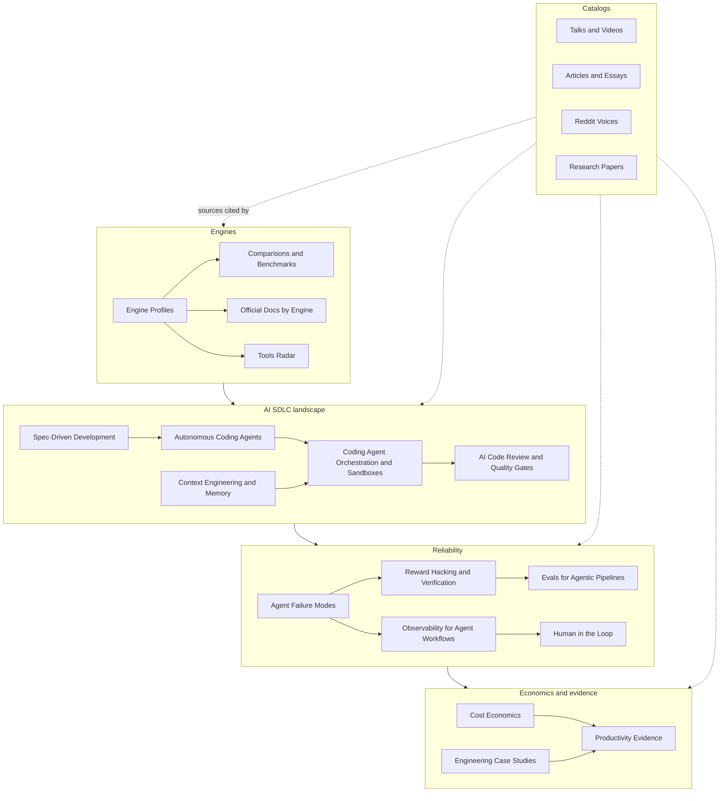

# The library

21 notes on orchestrating a self-driving SDLC with AI agents, as of October 2026: 1,375 fact-checked sources and nearly 600 tools. Back to the [main page](../README.md).

## Map

Engines keep a run alive. The AI SDLC landscape is what runs inside each phase. Reliability is what goes wrong and how you catch it. Economics and evidence is what it costs and what it returns. The catalogs hold the sources behind every note.

## Notes

| Note | What it covers | Size |
|---|---|---|
| [Engine Profiles](engine-profiles.md) | One profile per engine with a Grab, Consider, Watch or Skip verdict for agent pipelines: durability model, determinism rules, limits, human-in-the-loop primitives, versioning, pricing and latest release. | 31 profiles |
| [Comparisons and Benchmarks](comparisons-and-benchmarks.md) | What third parties and vendors say when they compare engines: decision matrices, hard limits, per-step overhead, pricing at scale, and the "just use Postgres" debate. | 34-row source register |
| [Official Docs by Engine](official-docs-by-engine.md) | Official docs, release notes and pricing pages, opening with the one page per engine that matters most. | 190 pages, 24 engines |
| [Tools Radar](tools-radar.md) | Every tool, engine, framework and product found, by category, with maturity, latest release, license or pricing, and a verdict. | 582 entries |
| [Autonomous Coding Agents](autonomous-coding-agents.md) | Unattended coding agents (Claude Code, Codex, Copilot cloud agent, Devin, Cursor, Kiro, Jules and others): orchestration, pricing, independent reliability evidence and benchmark standings. | 12 sections |
| [Coding Agent Orchestration and Sandboxes](coding-agent-orchestration-and-sandboxes.md) | Parallel and multi-agent orchestration and whether parallelism helps; sandbox providers, hourly prices and security incidents. | 29 providers compared |
| [AI Code Review and Quality Gates](ai-code-review-and-quality-gates.md) | The reviewer market and price per review, precision and noise evidence, benchmarks to distrust, mutation testing, CI gates for agent-made changes and a gate stack to copy. | 14 sections |
| [Spec-Driven Development](spec-driven-development.md) | Spec Kit, Kiro, Tessl, BMAD, OpenSpec, Agent OS and plan modes: how they are structured, critiques, the (thin) evidence, and where a spec fits a durable pipeline. | 8 sections |
| [Context Engineering and Memory](context-engineering-and-memory.md) | The practice canon, a numbers sheet, instruction files and their evidence, compaction, harnesses for long-running agents, and per-phase rules for a multi-phase pipeline. | 9 sections |
| [Reward Hacking and Verification](reward-hacking-and-verification.md) | Why agents claim success they did not earn: METR, system cards, benchmark audits, a taxonomy of lies, a verification ladder and a detector for each kind of lie. | 12-row taxonomy |
| [Evals for Agentic Pipelines](evals-for-agentic-pipelines.md) | What to grade, pass@k versus pass^k, evals in CI, a tool catalog and a recipe for evaluating a multi-phase pipeline. | 20 tools |
| [Agent Failure Modes](agent-failure-modes.md) | Failure taxonomies (MAST and newer) with measured frequencies, long-horizon decay, provider incidents, retry and cost failures, and a control list that works on any engine. | 41-row table |
| [Observability for Agent Workflows](observability-for-agent-workflows.md) | Three panes (control flow, LLM trace, claims), OpenTelemetry GenAI status, one trace across orchestrator and model, LLM tracing platforms and cost attribution. | 8 platforms compared |
| [Human in the Loop](human-in-the-loop.md) | Pause primitives per engine and their limits, where autonomy research puts humans, approval-gate and escalation design, and testing a gate in seconds. | 16 primitives |
| [Cost Economics](cost-economics.md) | The October 2026 price sheet, prompt caching, cost per task and per PR, retry and replay cost, budgets and kill switches, orchestrator meters and twelve cost controls. | 11 sections |
| [Productivity Evidence](productivity-evidence.md) | Benchmarks and their caveats, METR's trial and follow-ups, DORA, GitClear, Faros and NBER, sorted into positive, skeptical and mixed, and what you can and cannot claim. | 10 sections |
| [Engineering Case Studies](engineering-case-studies.md) | Companies that built their own agentic SDLC or ran agent-driven migrations (Stripe, Spotify, Ramp, Cursor, Uber, Block, WorkOS, Datadog and more): results, admitted failures and patterns. | 11 detailed cases, 14 smaller |
| [Talks and Videos](talks-and-videos.md) | Conference recordings, videos and podcasts by topic, with a top 10 for a weekend. | 94 entries |
| [Articles and Essays](articles-and-essays.md) | Articles, essays, vendor posts, news and discussion threads by topic, newest first, with a must-read ten. | 513 entries |
| [Research Papers](research-papers.md) | Papers, benchmarks and reports by topic, newest first. Preprints are flagged. | 227 entries |
| [Reddit Voices](reddit-voices.md) | What practitioners on Reddit said about engines, determinism, failures, lying agents and cost, with exact quotes. Field voices, not fact-checked sources. | 61 threads |

## Sources by type

| Type | Count | Where |
|---|---|---|
| Articles and blogs (posts, news, discussion threads) | 513 | [Articles and Essays](articles-and-essays.md) |
| Docs, release notes, pricing pages and specs | 461 | [Official Docs by Engine](official-docs-by-engine.md) lists 190 engine pages; the rest are cited in the topic notes |
| Papers, benchmarks and reports | 227 | [Research Papers](research-papers.md) |
| Talks, videos and podcasts | 94 | [Talks and Videos](talks-and-videos.md) |
| Case studies | 75 | [Engineering Case Studies](engineering-case-studies.md) |
| Repos | 39 | Cited in the notes and listed in [Tools Radar](tools-radar.md) |
| Reddit threads (not fact-checked) | 61 | [Reddit Voices](reddit-voices.md) |
