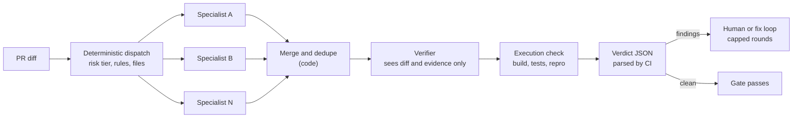

# AI Code Review and Quality Gates

## In one paragraph

> **How to read the numbers**
> "(vendor)" marks a number a vendor produced about its own product. Vendor resolution rates (Bugbot 70-80%, Greptile 66% addressed, Anthropic under 1% incorrect) are self-reported and LLM-judged, so they are not comparable across vendors. Prices are list prices as of October 2026.

## Numbers worth keeping in your head

| Number | What it is | Source |
|---|---|---|
| 56.3% | Share of 31,073 CodeRabbit comments that developers rejected (36.4% accepted, 7.3% discussed), 239 repositories | [Is Agentic Code Review Helpful?](https://arxiv.org/abs/2607.03316) |
| 63% | Most any tool found of the known issues in Martian's benchmark | [Code Review Bench](https://withmartian.com/post/code-review-bench-v0) |
| 82% vs 45% | Greptile on its own 50-bug benchmark vs Augment's re-run of the same repos (as reported by DeepSource) | [Greptile](https://www.greptile.com/benchmarks), [DeepSource](https://deepsource.com/blog/ai-code-review-benchmarks) |
| 0.847 vs 0.066 | F1 on synthetic vs real bug-fix PRs, a 92% drop | [Bigger Isn't Always Better](https://arxiv.org/abs/2606.15689) |
| 71% / 29% | Copilot reviews with actionable feedback vs reviews where "the agent says nothing at all" | [60 million reviews](https://github.blog/ai-and-ml/github-copilot/60-million-copilot-code-reviews-and-counting/) |
| about 10% | Catch-rate gain from cross-family review (experimental, vendor) | [Greptile](https://www.greptile.com/blog/how-to-build-a-code-review-agent) |
| 41 to 8 | Meta catching tests: candidate catches reported vs confirmed true positives | [Catching JiTTests](https://arxiv.org/abs/2601.22832) |
| 19% | Organizations with a gate that blocks every bad release, vs 74% confident their testing catches failures (vendor survey of 700) | [Harness](https://www.harness.io/blog/the-ai-agent-confidence-gap) |
| 1 of 5 vs 5 of 5 | Agent runs that passed the real pipeline without vs with CI status in the loop; all 10 agents said "passed" | [CircleCI](https://loop.circleci.com/we-let-an-ai-agent-say-i-passed-was-it-actually-good) |

## 1. The reviewer market, October 2026

### 1.1 Catalog

| Tool | How it works (as published) | Price | Published numbers (mostly vendor) |
|---|---|---|---|
| [Claude Code Review](https://code.claude.com/docs/en/code-review) (managed) | Parallel bug hunters, a verification step, severity ranking (Important, Nit, Pre-existing); research preview for Team and Enterprise, launched 2026-03-09; never approves. Local `/code-review` and ultrareview exist too, but ultrareview is unavailable on Bedrock, Google Cloud's Agent Platform, Foundry and Zero Data Retention orgs | Token-billed, "generally average $15-25"; monthly org spend caps | Substantive comments on PRs 16% to 54%; 84% of PRs over 1,000 lines get findings (7.5 on average); "less than 1% of findings are marked incorrect"; about 20 minutes per review ([launch post](https://claude.com/resources/articles/code-review)) |
| [Claude Code GitHub Action](https://github.com/anthropics/claude-code-action) and [security review](https://github.com/anthropics/claude-code-security-review) | Open-source actions on your runners; `/security-review` introduced 2025-08-06 with false-positive filtering | MIT; you pay your model provider | Flagged an RCE (DNS rebinding) and an SSRF in internal tools before merge ([announcement](https://claude.com/resources/articles/automate-security-reviews-with-claude-code)) |
| [GitHub Copilot code review](https://docs.github.com/en/copilot/concepts/agents/code-review) | Agentic reviewer on Actions, GA 2026-03-05 ([changelog](https://github.blog/changelog/2026-03-05-copilot-code-review-now-runs-on-an-agentic-architecture)); Lite and Balanced effort; shell tools behind the agent firewall | AI Credits plus Actions minutes on private repos from 2026-06-01 ([billing](https://github.blog/changelog/2026-04-27-github-copilot-code-review-will-start-consuming-github-actions-minutes-on-june-1-2026)); estimate $0.05-$1 Lite, $0.25-$5 Balanced | 60 million reviews, "more than one in five code reviews on GitHub"; approvals in public preview since 2026-09-01 |
| [Cursor Bugbot](https://cursor.com/bugbot) | `.cursor/BUGBOT.md` and learned rules, effort levels, Autofix cloud agents, pre-push `/review`; runs on Cursor's Composer 2.5 ([June update](https://cursor.com/blog/bugbot-updates-june-2026)) | Usage-based since 2026-05-11: "average Bugbot run costs $1.00-$1.50"; was $40 per seat ([change](https://cursor.com/blog/may-2026-bugbot-changes)) | 80% of identified bugs resolved by merge; high effort finds 35% more; over two million PRs a month |
| [Graphite Agent](https://graphite.com/blog/introducing-graphite-agent-and-pricing) (ex-Diamond) | Reviewer plus chat bundled with stacked PRs and a merge queue; agreed in December 2025 to [join Cursor](https://graphite.com/blog/graphite-joins-cursor) | Starter $20, Team $40 per user per month | Martian: highest precision, lowest recall |
| [Greptile](https://www.greptile.com/) | Independent; v5 is a [swarm of hypothesis agents](https://www.greptile.com/blog/greptile-v5); [TREX](https://www.greptile.com/blog/trex) runs code in a sandbox; Model Inversion routes review to the other family | Base, Plus, Apex tiers at 1, 3, 10 credits, extra credits $1; Starter free (50 credits); Pro $30 per seat | v5: median review 5:04 to 2:25, addressed comments 52% to 66%; TREX "catches 20% more bugs" |
| [CodeRabbit](https://www.coderabbit.ai/) | GitHub, GitLab, Azure DevOps, Bitbucket, CLI, IDE; pre-merge checks that "fail until critical issues are resolved" ([post](https://www.coderabbit.ai/blog/build-ai-code-reviewer-cant-maintain-it)) | Essentials $24, Team $48, Advanced $72 per user per month, annual | Over 2 million reviews a week, 17,000+ customers, [$143 million Series C](https://www.coderabbit.ai/blog/introducing-agentic-change-management); [1,049,817 OSS reviews in September 2026](https://www.coderabbit.ai/blog/one-million-open-source-reviews-september-2026) vs 421,336 in April |
| [Qodo 3.0](https://www.qodo.ai/blog/introducing-qodo-3-0/), [PR-Agent](https://github.com/the-pr-agent/pr-agent) | Governance-oriented platform with rule mining; PR-Agent is the open-source original, community-maintained (0.47.0, 2026-10-02) | Not checked | Qodo benchmark F1 60.1% (vendor) |
| [OpenAI Codex review](https://learn.chatgpt.com/docs/third-party/github) | Follows AGENTS.md; `@codex review`; a reviewer trained for the job ([OpenAI](https://alignment.openai.com/scaling-code-verification/)) | Not checked | 52.7% of comments lead to a code change; more than 100k external PRs a day (October 2025) |
| [OpenCodeReview](https://github.com/alibaba/open-code-review) (Alibaba) | Open-source CLI: deterministic dispatch, curated tools, diff-only reflector | Open source (npm 1.12.13, 2026-10-08) | 2.17x SEM-F1 of mainstream coding agents at 5-15x fewer tokens ([paper](https://arxiv.org/abs/2608.09290)) |

Also seen: [Sourcery](https://www.sourcery.ai/) (no momentum signal), [Ellipsis](https://www.ellipsis.dev/) (now a cloud-agents platform), [Macroscope](https://macroscope.com/), [Kodus](https://kodus.io/) (open source, your own model keys), [cubic](https://www.cubic.dev/blog/learnings-from-building-ai-agents) (a 51% false-positive cut in 2025), [Sashiko](https://github.com/sashiko-dev/sashiko) (agentic Linux kernel review) and the [consumer Gemini Code Assist reviewer, shut off on 2026-07-17](https://krm.fyi/blog/gemini-code-assist-deprecation.html).

### 1.2 What one review costs

The price ladder per review run, from the sources above: Copilot Lite $0.05-$1 and Balanced $0.25-$5 (estimates, plus Actions minutes; Balanced is the default since 2026-09-28, [change](https://github.blog/changelog/2026-10-02-copilot-code-review-api-support-and-new-default-effort-level)); Cloudflare's in-house reviewer a $0.98 median (trivial reviews about $0.20, a full seven-agent review $1.68); Bugbot $1.00-$1.50 per average run; a DIY agent reviewer "at least $3-5, up to $10-20 per run", run 2-3 times per PR ([Greptile](https://www.greptile.com/blog/how-to-build-a-code-review-agent)); Claude Code Review $15-25.

### 1.3 Adoption, consolidation and churn

- **Adoption.** Pullflow measured AI agent participation in PR review across 40.3 million PRs at [1.1% in February 2024 and 14.9% in November 2025](https://www.pullflow.com/state-of-ai-code-review-2025). Greptile sees fully agent-authored merged PRs rise from 0.86% to 27.6% (February 2025 to April 2026), with reverts per 1,000 merged PRs of Codex 1.19, Claude 1.80, human 2.72, Devin 3.50 (heuristic, Greptile customers only; [report](https://www.greptile.com/blog/rise-of-the-overnight-agents)). The bottleneck looks like review attention more than raw code quality.
- **Consolidation blurs independence.** Graphite agreed to join Cursor with a plan to [combine its reviewer with Bugbot](https://graphite.com/blog/graphite-joins-cursor), and Cursor [announced in August 2026 that it had been acquired by SpaceX](https://cursor.com/blog/joining-spacex). Pure-play reviewers market independence as separation of duties, which is positioning rather than a measured property.
- **Churn.** Google ended the consumer Gemini Code Assist reviewer after a staged wind-down ([account](https://krm.fyi/blog/gemini-code-assist-deprecation.html)). A reviewer you cannot swap in one line is a dependency risk.

## 2. How the better reviewers are built

Every product that publishes its design converges on the same shape: deterministic structure outside, narrow agents inside, execution for evidence, and a verification stage before the author sees anything.

| Pattern | Who | What they published |
|---|---|---|
| Fixed pipeline with voting | Bugbot v1 (July 2025) | Eight parallel passes with randomized diff order, majority voting, a validator model, dedupe against previous runs ([Building a better Bugbot](https://cursor.com/blog/building-bugbot)) |
| Hill-climbed agentic | Bugbot v11 (January 2026) | 40 major experiments took resolution from 52% to over 70%; "Many changes, surprisingly, regressed our metrics"; the agentic version was too cautious |
| Coordinator plus specialists | Cloudflare | Up to seven specialists, dedupe, severity judge, risk tiers, circuit breakers, failback chains ([Cloudflare](https://blog.cloudflare.com/ai-code-review/)) |
| Ensemble | Copilot (Lite) | Addressed comments +47% high severity, +31% medium, +11% low, cost about 8% lower ([changelog](https://github.blog/changelog/2026-09-11-auto-resolution-and-analysis-updates-in-copilot-code-review)) |
| Execution for evidence | TREX, Copilot shell tools, Autofix | Attach "logs, screenshots, API traces, execution scripts, or a video" so "you or a downstream agent can confirm it instead of taking the result on faith" ([TREX](https://www.greptile.com/blog/trex)) |
| Determinism injected | OpenCodeReview | Rule-guided dispatch, parallel grounded sub-agents, and a reflector that "sees only the diff, not the agent's tool-augmented exploration" |
| Review as trained skill | OpenAI Codex | "Precision is more important for usability than recall"; review as an output monitor inside defense-in-depth |

- **Return a patch, not prose.** Across 54,791 agent review comments, an inline code suggestion was the strongest predictor of resolution ([Go Home Copilot, You're Drunk](https://arxiv.org/abs/2607.21997)).

## 3. Precision, noise and what developers do with comments

### 3.1 Independent field evidence

| Study | Sample | Finding |
|---|---|---|
| [Is Agentic Code Review Helpful?](https://arxiv.org/abs/2607.03316) (2026-07-03) | 31,073 feedback pairs, 10,191 PRs, 239 repos, CodeRabbit | 36.4% accepted, 7.3% discussed, 56.3% rejected (false positives, redundant, out of scope, misaligned); agentic reviews skew functional and were more likely invalid |
| [Go Home Copilot](https://arxiv.org/abs/2607.21997) (2026-07-24) | 54,791 comments from Copilot, Cursor, Codex, Devin, Claude; 342 Python repos | Copilot is 72.9% of resolved comments; unresolved ones are mostly incorrect suggestions or intentional design decisions; long, complex comments are less likely to be acted on |
| [Human-centric to agentic review](https://arxiv.org/abs/2607.13196) (2026-07-14) | 1.02 million PRs, 207 projects | Faster decisions, but "these efficiency gains do not translate into better review quality" |
| [Reviewer habituation](https://arxiv.org/abs/2609.06213) (2026-09-05) | 11,429 reviews, 400 repeat reviewers, 207 days | Approval rate rose from 30.5% to 36.6% (Cohen's d 0.25, a small effect) |

AI review buys speed more clearly than quality, a majority of one popular tool's comments are rejected in the wild, and human reviewers of agent PRs may approve more with exposure. A design that ends in "a human reviews the agent's PR" needs that human designed, not just assumed.

### 3.2 Vendor-reported signal

| Source | Metric | Number |
|---|---|---|
| [Copilot](https://github.blog/ai-and-ml/github-copilot/60-million-copilot-code-reviews-and-counting/) | Actionable reviews; comments | 71%; about 5.1 per review; a stronger reasoning model gave +6% positive feedback for +16% latency, which they accepted |
| [Bugbot](https://cursor.com/blog/bugbot-autofix) | Resolution before merge | 52% to 76%; over 35% of Autofix changes merged |
| [OpenAI Codex](https://alignment.openai.com/scaling-code-verification/) | Comments leading to a code change | 52.7%; on PRs fully generated by Codex cloud, 46% vs 53% on human PRs |
| [Cognition Devin Review](https://cognition.com/blog/multi-agents-working) | Bugs per Devin-written PR | About 2, roughly 58% severe; works best when author and reviewer share no context |
| [CodeRabbit's runs](https://www.coderabbit.ai/blog/opus-5-5-model-review) | Actionable precision | 35.7% to 39.3% (80-pattern OSS set); 29.4% to 66.7% (13-case Signal set) |

Precision against recall is a product position, not a quality level. GitHub stays silent on 29% of reviews, OpenAI trades some recall for signal, Qodo argues recall is the hard capability and precision can be tuned later ([Qodo](https://www.qodo.ai/blog/how-we-built-a-real-world-benchmark-for-ai-code-review/)), and Greptile found GPT 5.5 under OpenAI's `/review` prompt scoped so narrowly that it omitted bugs it had reasoned about. Copilot lets developers tag a resolution as "Addressed", "Won't fix" or "Incorrect" ([changelog](https://github.blog/changelog/2026-08-27-copilot-code-review-resolution-reasons-and-expanded-capabilities)); "Incorrect" is the precision metric to collect on your own panels.

## 4. Benchmarks, and why to distrust them

| Benchmark | Date | Size | Result | Caveat |
|---|---|---|---|---|
| [Greptile](https://www.greptile.com/benchmarks) | July 2025 | 50 bug PRs from five OSS repos (Sentry, Cal.com, Grafana, Keycloak, Discourse), five languages | Greptile 82%, Bugbot 58%, Copilot 54%, CodeRabbit 44%, Graphite 6% | Vendor; false positives did not affect the score. Augment's re-run scored Greptile 45% ([DeepSource](https://deepsource.com/blog/ai-code-review-benchmarks)) |
| [Qodo](https://www.qodo.ai/blog/how-we-built-a-real-world-benchmark-for-ai-code-review/) | 2026-02-04 | 100 PRs, 580 issues injected into merged OSS PRs, LLM judge | Qodo F1 60.1% vs 7 tools | Vendor; injected bugs |
| [Martian](https://withmartian.com/post/code-review-bench-v0) | 2026-02-26 | 200K+ PRs, MIT; offline gold set plus online "which comments get acted on", refreshed monthly | "No tool found more than 63%"; Graphite highest precision, lowest recall | Independent, v0; offline "has significant divergence from what we see in the wild" |
| [CodeRabbit, Opus 5.5](https://www.coderabbit.ai/blog/opus-5-5-model-review) | 2026-09-22 | 80 OSS patterns, 13 hard "Signal" cases | OSS: 51/80 at 38.6% (Standard) vs 50/80 at 35.7% (Max). Signal: 8/13 vs 10/13, tied at 10/13 counting out-of-diff comments | Vendor: "Turning up effort did not consistently produce a better review" |
| [CodeRabbit, Sonnet 5.5](https://www.coderabbit.ai/blog/sonnet-5-5-model-review) | 2026-09-28 | Signal plus 44 OSS PRs (85 issues) | Sonnet 5.5 6/13 vs Opus 5.5 Standard 8/13; 6:33 vs 13:31 per review vs Sonnet 5; about 60% lower Claude model cost per review at list prices | Vendor: "Thirteen cases is a small set, and we say so" |
| [CodeRabbit security](https://www.coderabbit.ai/blog/security-agent-benchmarks) | 2026-10-06 | 100 known vulnerabilities, 94 repos, 11 languages | CodeRabbit 86.7%, Devin 73.3%, Codex 62.0%, Claude Security 40.0% | "Internal comparative development slice"; "A weak model, however, can't be rescued by even the best harness." |
| [ReviewBench](https://github.blog/ai-and-ml/github-copilot/reviewbench-an-open-benchmark-for-ai-code-review/) (GitHub) | 2026-10-05 | 219 PRs from 187 repos, 19 languages; golden set relabeled with 96.6% agreement; rubric and judge published | Offline predicted +227% critical comments, online was +262% | GitHub's product is a participant; free to submit an agent |
| [Bigger Isn't Always Better](https://arxiv.org/abs/2606.15689) | 2026-04-09 | 150 samples (100 synthetic, 50 real) | Haiku 4.5 F1 0.365 vs Sonnet 4.6 0.343 at 3.2x lower cost; F1 0.657 under 10 lines vs 0.043 over 150; near-zero recall on performance bugs | Small, academic |

Also: [AACR-Bench](https://arxiv.org/abs/2601.19494) (200 PRs, 1,505 expert-verified comments), [CRJudgeBench](https://arxiv.org/abs/2609.37216) (1,199 instances; the best repository-grounded judge reached 76.60% accuracy, so plausible wrong comments are hard to spot) and [MCR-Bench](https://arxiv.org/abs/2608.27442) (2,269 multi-round tasks; quality degrades as rounds increase).

**Why scoreboards disagree.** DeepSource lists tiny datasets (under 100 entries "should be treated with skepticism"), synthetic LLM-injected bugs judged by LLMs, unpublished ground truth, and "there's no SWE-bench for code review". Synthetic evaluations also overstate real ability, as 0.847 versus 0.066 shows.

**Cost per verified outcome.** In [Tessl's study](https://tessl.io/blog/cheaper-tokens-bigger-bills-token-price-isnt-agent-cost) (100 runs, ten merged PRs, four models, up to four review-fix rounds) one model "almost three times cheaper per token" was 2.8 times more expensive on the same PR (156 turns against 42). One run per model per subject, so no variance estimate.

**Evaluating your own panel**, combining the better ideas: use real defects from your own history and a held-out set ([Lance Martin](https://claude.dev/blog/automating-eval-design-and-hillclimbing/)); report precision next to recall and collect "Incorrect" tags; use a judge other than the model under test and run the grader twice to see if the verdict flips; beware "leftover state from an earlier trial" that hands the agent the answer; check offline scores against an online signal (ReviewBench and Martian both do); count cost per confirmed finding.

## 5. Cross-family review and independence

[Greptile's Model Inversion study](https://www.greptile.com/blog/model-inversion) (2026-07-21, vendor) built two 500-PR datasets, one Claude Code-authored and one Codex-authored (about 1,500 ground-truth bugs), and ran each vendor's `/review` three times per PR (Claude Opus 4.7 against GPT 5.5), judging recall on high-severity bugs with an LLM judge. Each model found more high-severity bugs in the other's code than its own, and the bug categories a model introduces most often are the ones it tends to miss. The traces differ: Opus built 59.4% of its context in a Scope phase against 6.1% for GPT, while GPT spent 82.5% in Investigate; an average Codex review had about 1 to 2 comments against 7 to 8 for Opus. The rule: "If Claude wrote it, GPT reviews it, and vice versa." Greptile also claims Claude models are twice as likely to introduce n+1 errors and twice as likely to miss them, and about a 10% catch-rate gain from routing to the other family ([post](https://www.greptile.com/blog/how-to-build-a-code-review-agent)).

Caveats: two families, one vendor selling the feature, still marked experimental. Related evidence is consistent but does not test families: Anthropic finds agents "confidently praising the work" and that a standalone skeptical evaluator is "far more tractable" to tune than a self-critical generator ([harness design](https://www.anthropic.com/engineering/harness-design-long-running-apps)); and agents on the same model fail in correlated ways, with 18 of 30 swarm agents choosing the same git branch name ([Anthropic](https://www.anthropic.com/research/multiagent-systems)), so N copies are not N independent attempts.

## 6. Review loops: when more rounds stop helping

- **Run it twice and you get two reviews.** Atomic Object's homegrown reviewer became a blocking gate (a simple regex on must-fix findings, an override label plus justification, an extra human approver). After seven months: "Run it twice on the same PR and you could get two different sets of findings" and "most of our PRs end up having the AI review overridden right now". What helped: feeding prior reviews and replies back in, writing every human-caught miss into the prompt, and a local pre-push review skill. A self-hosted open-weights model "has been a step down so far" ([Atomic Object](https://spin.atomicobject.com/ai-code-review-workflow-7/)). Greptile names the same default DIY failure: new bugs on every run.
- **A measured elbow, from one customer.** [Watson Labs](https://blog.watson-labs.co.uk/6-learnings-from-12000-agentic-code-reviews/) (vendor-adjacent) covers 372 issues over six months through seven review lanes on Claude Opus 4.6 then 5: 65% were mergeable after one round, 94.5% after three, 98.9% by round 4; the chance of passing a given round halves after round 2 and plateaus; 29% never reached a clean pass and shipped with warnings; the naive 3.31-round average becomes 5.99 when warn-shipped issues count, understating cost by 44%. 3.7% of verdicts were lost to agent crashes. After about round 4 the loop oscillates rather than converges.
- **Hand over early.** Stripe's unattended agents run one full CI iteration plus one retry, citing diminishing returns ([Minions, part 2](https://stripe.dev/blog/minions-stripes-one-shot-end-to-end-coding-agents-part-2)). Bugbot dedupes against earlier runs and can review only what is new ([update](https://cursor.com/blog/bugbot-updates-june-2026)); Copilot auto-resolves addressed comments.
- **Satire, labeled.** [CVE-2026-LGTM](https://simonwillison.net/2026/jun/26/incident-report) is a hypothetical report of two competing review agents looping until finance revokes both keys ($41,255 of inference): the cap-and-escalate argument in one joke.

## 7. Reviewer failure modes and attack surface

- **Approvals by an AI.** Copilot can submit approvals that count toward required reviews, scoped by enterprise, organization, repository and file path; off by default, dismissed on new commits "just like a human reviewer's" ([changelog](https://github.blog/changelog/2026-09-01-copilot-code-review-can-now-approve-pull-requests), public preview). Anthropic's managed review "won't approve PRs". If an agent can approve, its blind spots ship; keep approvals off for agent-authored PRs until you have measured precision on your own history.
- **The reviewer is attack surface.** A reviewer that ran a third-party linter on attacker-controlled PR content outside its sandbox allowed code execution; remediated in January 2025 by moving the tool into the sandbox ([Kudelski](https://kudelskisecurity.com/research/how-we-exploited-coderabbit-from-a-simple-pr-to-rce-and-write-access-on-1m-repositories)). Sandbox the review agent like any code touching untrusted input.
- **Size beats model.** F1 falls from 0.657 on diffs under 10 lines to 0.043 over 150 lines; Anthropic reports findings on 84% of PRs over 1,000 lines against 31% under 50 lines ([launch post](https://claude.com/resources/articles/code-review)). Bound the scope of agent changes.
- **A neutral check is not a verdict.** Claude Code's check run never blocks merging; teams that want a gate parse the machine-readable severity JSON in their own CI (the docs show `{"normal": 2, "nit": 1, "pre_existing": 0}`, where `normal` counts Important findings). `jq -e '.normal == 0'` over that payload is the whole gate. It is GitHub-said-success, delivered by design.

## 9. AI test generation, mutation testing and property-based testing

### 9.1 Agent-written tests are runnable but often shallow

- **VibeCheck** (Kiro, Antigravity and Cursor with Claude Sonnet 4.5 on 15 student repos): "Weak assertions and missing edge cases occur more often than blocking failures, showing that runnable tests can still be shallow" ([paper](https://arxiv.org/abs/2609.05978), a workshop at ASE 2026; small sample).
- **The Self-Repair Trap** (ASE 2026): in regression-oracle completion, iterating on execution success pushes oracles toward assertions that are easier to satisfy and weaker at catching faults; a non-iterative, context-grounded method beat repair loops on mutation-based fault detection ([paper](https://arxiv.org/abs/2608.05917)). Scoped to oracle generation, but it is the warning label on "iterate until green".
- **TDD in the agent loop** showed no clearly discernible difference in a small eval (Sonnet 4.6 solutions judged by Opus 4.8), and TDD runs still produced tests that check the implementation's output against itself ([Böckeler](https://martinfowler.com/articles/exploring-gen-ai/tdd-in-the-agent-loop.html)). She also calls a behaviour harness that trusts AI-generated tests "not good enough yet" ([Harness engineering](https://martinfowler.com/articles/harness-engineering.html)).

### 9.2 Mutation testing with LLMs

| Work | What it does | Numbers |
|---|---|---|
| [Meta ACH](https://engineering.fb.com/2025/09/30/security/llms-are-the-key-to-mutation-testing-and-better-compliance/) (2025-09-30) | LLM-made, domain-targeted mutants plus tests that kill them, and an equivalent-mutant detector; trial October to December 2024 for privacy testing across Facebook, Instagram, WhatsApp, Quest, Ray-Ban Meta | Engineers accepted 73% of generated tests, 36% judged privacy relevant; detector precision 0.79 and recall 0.47, rising to 0.95 and 0.96 with simple preprocessing |
| [Catching JiTTests](https://arxiv.org/abs/2601.22832) (2026-01-30) | Per-change tests meant to fail, surfacing regressions before landing | 22,126 tests analyzed; 4x over hardening tests, 20x over coincidentally failing tests; assessors cut review load 70%; 41 candidate catches, 8 confirmed, 4 would have caused serious failures |
| [AdverTest](https://arxiv.org/abs/2602.08146) (2026-02-08) | One agent writes mutants exploiting the suite's blind spots, another writes tests to kill them | +8.56% fault detection over the best LLM methods on Defects4J, +63.30% over EvoSuite |

Copy the pattern (mutants plus assessors), not the tool. [mutmut](https://github.com/boxed/mutmut) (3.8.0, 2026-09-12) and [StrykerJS](https://stryker-mutator.io/) (10.0.0, 2026-08-14) are the cheap way to see whether agent-written tests catch anything. Even at Meta, 8 of 41 candidates were confirmed, so budget an assessor layer.

### 9.3 Property-based testing with agents

- [Agentic Property-Based Testing](https://arxiv.org/abs/2510.09907) (2025-10-10): an agent infers properties, writes Hypothesis tests, reflects on failures and files reports across 100 popular Python packages. 56% of reports were valid, 32% worth reporting; the top 21 by a ranking rubric were 86% valid and 81% reportable; 5 bugs reported, 4 with patches, 3 merged (including NumPy).
- [Kiro](https://kiro.dev/blog/property-based-testing/) turns acceptance criteria into "for any" properties and then Hypothesis tests linked to each requirement. Its docs are frank that PBT "provides evidence of correctness, not a proof" and that "A property that is too weak ... will pass while the real behavior is still wrong"; PBT is optional and IDE-only ([Kiro Correctness](https://kiro.dev/docs/specs/correctness/)).
- [Spec-driven test generation at Google](https://arxiv.org/abs/2608.17177) (2026-08-17): writing semi-formal pre and post-conditions first detected 9.8 points more production bugs (p = 0.0352) and gained 2.5 points of branch coverage; an LLM judge preferred the suites over the baseline in 77.8% of cases and over human-written tests in 56.7%. [Hypothesis](https://hypothesis.readthedocs.io/en/latest/) is 6.169.0 (2026-10-11).

## 10. Quality gates for agent-made changes in CI

Every vendor document repeats one rule in its own words: enforce in the platform, not the prompt. GitHub: ["Approvals are a workflow convenience, not a security control"](https://docs.github.com/en/copilot/concepts/agents/cloud-agent/about-automation-rationale-and-approvals), so "Use repository and agent permissions, not approvals, to control what an automation is allowed to do."

### 10.1 What the platform enforces, and what is eroding

| Control | What it does | Source and date |
|---|---|---|
| Triggers, branch, no raw git | Only write-access users can trigger the Copilot cloud agent; it pushes only to its own `copilot/` branch, "cannot directly run git push", and cannot mark PRs ready, approve or merge | [Risks and mitigations](https://docs.github.com/en/copilot/concepts/security-governance-and-network-settings/risks-and-mitigations) |
| Separation of duties | Workflows wait for "Approve and run workflows"; the requester cannot approve; an app-identity PR needs one more approval | Same page |
| Rulesets and CODEOWNERS | "Subject to rulesets just like human developers"; protect Copilot and MCP config with CODEOWNERS and "Require review from Code Owners"; keep Actions secrets away; prefer ephemeral runners. Sessions cap at 59 minutes, one branch and PR per task | [Guardrails](https://docs.github.com/en/copilot/tutorials/cloud-agent/build-guardrails), [limits](https://docs.github.com/en/copilot/concepts/copilot-surfaces/copilot-on-github) |
| Workflow execution protections | Ruleset allowlists for who (actors, including Copilot and apps) and what (events) can trigger workflows, per file ("restrict deploy.yml to a designated team"), with evaluate mode; GA 2026-09-17; default rule disabling `pull_request_target` in public repos enforced from 2026-11-02 | [Changelog](https://github.blog/changelog/2026-09-17-workflow-execution-protections-in-github-actions-generally-available) |
| Safer checkout | `actions/checkout` v7 refuses fork PR code in `pull_request_target` and `workflow_run` by default; backport enforced 2026-07-20 | [Changelog](https://github.blog/changelog/2026-06-18-safer-pull_request_target-defaults-for-github-actions-checkout) |
| Managed agent permissions | Admins block, gate or allow agent shell commands, file edits and network domains; "can't be weakened by user or workspace settings, auto-approval, or previously saved approvals" (2026-09-09) | [Changelog](https://github.blog/changelog/2026-09-09-enterprise-managed-permissions-for-github-copilot-agent-operations) |
| Security validation for any agent | Third-party agents such as Claude and Codex get CodeQL, advisory-database and secret-scanning checks by default (2026-06-09) | [Changelog](https://github.blog/changelog/2026-06-09-security-validation-for-third-party-coding-agents) |

Smaller guards: Actions caps [reruns at 50](https://github.blog/changelog/2026-04-10-actions-workflows-are-limited-to-50-reruns) "in response to some automations that attempt hundreds of retries"; maintainers can [limit open PRs per non-write user](https://github.blog/changelog/2026-06-17-limit-open-pull-requests-for-users-without-write-access); and since 2026-06-11 PRs from `github-actions[bot]` can [run CI after approval](https://github.blog/changelog/2026-06-11-bot-created-pull-requests-can-run-workflows-if-approved), where before they "could be accidentally merged without having gone through CI".

### 10.2 Agent identity

- **Copilot.** Authored by Copilot with the human as co-author, [signed since 2026-04-03](https://github.blog/changelog/2026-04-03-copilot-cloud-agent-signs-its-commits) (before that, "Require signed commits" blocked the agent entirely), with an `Agent-Logs-Url` trailer to the session log ([2026-03-20](https://github.blog/changelog/2026-03-20-trace-any-copilot-coding-agent-commit-to-its-session-logs)); the enterprise audit log filters `actor:Copilot` over 180 days ([docs](https://docs.github.com/en/copilot/reference/enterprise-administrators/agentic-audit-log-events)).
- **GitLab composite identity.** A token combining a service account and the initiating human, so access is the intersection of both (18.3 behind a flag, default in 18.6, GA 18.8, flag removed 19.3) ([docs](https://docs.gitlab.com/user/duo_agent_platform/composite_identity/)).
- **The risk of acting as you.** Claude Code's PR auto-fix (`/autofix-pr`) posts replies under your GitHub account, labeled as Claude Code, which can fire comment-driven automation such as Atlantis; the docs suggest disabling it where a comment can deploy ([docs](https://code.claude.com/docs/en/claude-code-on-the-web)).
- **Practical rule.** A distinct bot identity per pipeline, a commit trailer with the workflow ID, and "what did our agents do last quarter" as a query.

### 10.3 Auto-fix of CI failures

| Product | How it works | Limits and evidence |
|---|---|---|
| [Codex cookbook](https://developers.openai.com/cookbook/examples/codex/autofix-github-actions), [codex-action](https://learn.chatgpt.com/docs/github-action) | The 2025 recipe is archived: it "exposes an API key to the whole job and combines repository-controlled execution with repository write permissions. Do not copy that credential and permission layout." The replacement separates patch generation from PR publication; `--output-schema` enforces a JSON shape | "Run Codex as the last step in a job"; "Don't rely on read-only alone to protect secrets" |
| [GitLab Duo](https://docs.gitlab.com/user/duo_agent_platform/flows/foundational_flows/) | Foundational flows on runners: "Fix CI/CD Pipeline: Diagnose and repair failed jobs"; GA 2026-01-15 ([announcement](https://about.gitlab.com/blog/gitlab-duo-agent-platform-is-generally-available/)) | Premium and Ultimate; no success rate published |
| [Block](https://engineering.block.xyz/blog/actionable-ci) | Static rules first ("If a failure can be identified with a regex, we do that"), an LLM to explain and group, then a developer-initiated Goose autofix | Eligibility threshold else "we skip autofix entirely"; draft PR; retried to a limit; promoted only if CI passes and the branch is unchanged |
| [Nx Cloud](https://nx.dev/docs/features/ci-features/self-healing-ci) | Auto-applies only when the task matches a glob, the agent is "highly confident" and the fix was "explicitly verified" | `SELF_HEALING.md` holds Confidence Rules and Off-Limits Areas |
| [CircleCI Chunk](https://circleci.com/blog/shipping-trustworthy-code-with-chunk-cli/) | Hooks as a commit gate so lint and tests run in the agent's local loop; harder fixes run in pipelines | Verify before push, so CI is not the agent's debugger |
| [Elastic](https://www.elastic.co/search-labs/blog/ci-pipelines-claude-ai-agent) | Claude Code fixes Renovate PRs that break builds; auto-merge forcibly disabled if AI contributed | First month (45% of about 500 dependencies): "fixed a total of 24 initially broken PRs", est. "20 days of active development work" saved |

**Why CI feedback is the verifier.** CircleCI ran ten controlled runs of the same TDD task: "All 10 passed local tests. Every single agent said 'passed.'" Without CI feedback 1 of 5 passed the real pipeline (an ESLint quote-style mismatch sank the rest); with pipeline status in the loop 5 of 5 passed, the runs hit 12 CI failures and fixed all 12 unaided, and wrote more tests (28-37 against 21-28) ([CircleCI](https://loop.circleci.com/we-let-an-ai-agent-say-i-passed-was-it-actually-good)).

**What CI-hosted agent PRs yield** ([Ten Months with Copilot Coding Agent](https://devblogs.microsoft.com/dotnet/ten-months-with-cca-in-dotnet-runtime/), 2026-03-23): in dotnet/runtime, 878 agent PRs merged at 67.9% against 87.1% for human PRs, with reverts of 0.6% (3 of 535) against 0.8% (33 of 4,251); across seven repos 2,963 PRs merged at 68.6%, rising from 41.7% in month one to about 71%; 65.7% of added lines were tests; humans pushed commits to 52.3% of agent PRs, about 5x the human baseline; nine PRs opened in hours created "5 to 9 hours of review work" and "The bottleneck has moved." Harness's vendor survey of 700 organizations found 58% saw more production incidents per 100 changes since deploying agents, against 25% seeing fewer ([Harness](https://www.harness.io/blog/the-ai-agent-confidence-gap)). Throughput is real, verification cost moved downstream, and the honest metric is dollars per PR that passes CI and human review.

### 10.4 GitHub Agentic Workflows

[GitHub Agentic Workflows](https://github.github.io/gh-aw/) (gh-aw) compiles Markdown workflows, with `gh aw compile`, into standard `.lock.yml` Actions workflows running Copilot, Claude Code, Codex, Gemini CLI or Pi ([repo](https://github.com/github/gh-aw)). [Technical preview 2026-02-13](https://github.blog/changelog/2026-02-13-github-agentic-workflows-are-now-in-technical-preview/), [public preview 2026-06-11](https://github.blog/changelog/2026-06-11-github-agentic-workflows-is-now-in-public-preview); v0.91.8 on 2026-10-11 after five releases in one week ([notes](https://github.github.io/gh-aw/blog/)); MIT; versions 0.83.3 up to 0.85.4 were retired after a security advisory.

- **Safe outputs.** The agent job is read-only in a sandbox and emits structured requests; separate scoped jobs do the writes after a threat-detection job (prompt-injection attempts, secret leaks, malicious changes) runs "after the main job completes but before safe outputs" ([reference](https://github.github.io/gh-aw/reference/safe-outputs/)). Six layers: compile-time validation, sandbox, credential isolation through an API proxy, integrity filtering, threat detection, safe outputs. "Pull requests are never merged automatically, and humans must always review and approve" ([launch essay](https://github.blog/ai-and-ml/automate-repository-tasks-with-github-agentic-workflows/)).
- **Caps and identity.** `max-ai-credits` and `max-turns` stop runaways: by default 1,000 AI Credits per run and 5,000 per day at $0.01 each, so $10 per run and $50 per day. `staged: true` previews outputs. Since 2026-06-11 the built-in `GITHUB_TOKEN` replaces a PAT (`copilot-requests: write`) ([changelog](https://github.blog/changelog/2026-06-11-agentic-workflows-no-longer-need-a-personal-access-token)). Copilot CLI's `--max-ai-credits` is, in GitHub's words, a soft cap because "usage is only known after a response returns" ([changelog](https://github.blog/changelog/2026-07-01-set-ai-credit-session-limits-in-copilot-cli-and-sdk)).
- **Token efficiency.** Moving deterministic data-gathering out of the LLM loop cut Auto-Triage Issues by 62% (109 runs), Security Guard by 43% and Smoke Claude by 59% in Effective Tokens (ET = m x (1.0 x I + 0.1 x C + 4.0 x O), m = 0.25 Haiku, 1.0 Sonnet, 5.0 Opus); a 40-tool GitHub MCP server "can add 10-15 KB of schema per turn"; "The cheapest LLM call is the one you don't make" ([article](https://github.blog/ai-and-ml/github-copilot/improving-token-efficiency-in-github-agentic-workflows/)).

### 10.5 Security failures that found CI agents (conceptual only)

Root causes were configuration: who could trigger the workflow, and what the job could reach. [PromptPwnd](https://www.aikido.dev/blog/promptpwnd-github-actions-ai-agents) (2025-12-04) named the class: untrusted issue or PR text flows into an agent prompt in CI that holds privileged tools and secrets, across Gemini CLI, Claude Code, Codex and GitHub AI Inference; the remedy is restricted toolsets and "Treat AI output as untrusted code". In Clinejection an AI issue-triage workflow open to any user with a broad toolset led, through Actions cache poisoning, to release credentials and a malicious npm release (2026-02-17, about 4,000 downloads before it was pulled; [Adnan Khan](https://adnanthekhan.com/posts/clinejection/), [grith](https://grith.ai/blog/clinejection-when-your-ai-tool-installs-another)). The hackerbot-claw bot probed public repos between 2026-02-21 and 2026-03-02, got code execution in at least 4 of 7 targets, and tried replacing `CLAUDE.md` to steer an AI reviewer, which refused ([StepSecurity](https://www.stepsecurity.io/blog/hackerbot-claw-github-actions-exploitation); [Datadog](https://www.datadoghq.com/blog/engineering/stopping-hackerbot-claw-with-bewaire/) caught it with LLM-based detection). Defaults changed: `claude-code-action` now requires write-access triggers, blocks bots unless listed, restores `.claude/`, `.mcp.json` and `CLAUDE.md` from the base branch on PRs and creates no PRs automatically ([docs](https://github.com/anthropics/claude-code-action)); checkout v7 and execution protections shipped (above).

### 10.6 Progressive delivery as the last net, and the cost of CI

- **LaunchDarkly.** A change shipped behind a flag entered a guarded release that saw errors in "13 of the 243 users exposed" against 0 of 250 control users and rolled back automatically ([incident story](https://launchdarkly.com/blog/our-ai-software-factory-saved-me-from-an-incident/)). Its 66,000-line UI rewrite (two senior engineers, six weeks, a $10K budget) failed as one autonomous plan, grew from 22 phases to 34, cost about $7K and ran behind flags with agentic review; agents came back "proudly saying, 'Great, did it, here you go.'" then admitted "Oh, we missed some" ([factory floor](https://launchdarkly.com/blog/building-a-software-factory-on-our-scariest-code/), [small factory](https://launchdarkly.com/blog/build-a-software-factory-small-enough-to-understand/)). The same event has a LaunchDarkly talk, so this note keeps to the pointer.
- **Cursor Rollouts** writes a pre-merge monitoring plan and compares post-deploy signals to baseline (ping, pause, or a revert PR awaiting approval) ([post](https://cursor.com/blog/rollouts-and-security-reviewer)); the [Argo Rollouts AI plugin](https://github.com/argoproj-labs/rollouts-plugin-metric-ai) hands canary-versus-stable logs to an A2A agent. Keep metrics primary and the model verdict one input. [Harness](https://www.harness.io/blog/harness-acquires-augment-code-cosmos) bought Augment's Cosmos assets on 2026-10-08 as a ticket-to-PR "Software Factory Agent"; too new to judge.

## 12. A gate stack you can copy

Anthropic ranks feedback: rules-based checks best, visual feedback useful, LLM-as-judge "generally not a very robust method" ([Agent SDK guide](https://claude.com/resources/articles/building-agents-with-the-claude-agent-sdk)). Böckeler sorts controls into guides and sensors, each computational (deterministic, milliseconds to seconds) or inferential (LLM-as-judge) ([Harness engineering](https://martinfowler.com/articles/harness-engineering.html)). External validation "converts misinterpretations into crash failures" ([Gopinathan](https://kirancodes.me/posts/log-distributed-llms.html)). Together: deterministic layers first.

| Layer | Gate | Kind | Blocks merge | Evidence |
|---|---|---|---|---|
| 2. Pre-push | Build, typecheck, lint, tests and CI matrix locally; pre-push AI review | Computational | Locally | CircleCI 1 of 5 vs 5 of 5; Chunk, Bugbot `/review` |
| 3. CI required checks | Tests, mutation score on changed lines, CodeQL, advisory and secret scanning | Computational | Yes | Meta ACH and JiTTests; GitHub validation |
| 4. AI panel | Cross-family, risk-tiered, capped rounds, severity JSON parsed by CI; critics may return PASS | Inferential | Only via the parsed verdict | Sections 5 and 6 |
| 5. Platform policy | Rulesets, CODEOWNERS on instruction files and workflows, execution protections, signed distinct agent identity; AI approvals off for agent PRs | Computational | Yes | Sections 10.1 and 10.2 |
| 6. Human at risk tier | Bounded PR size, evidence not narrative, override telemetry | Human | Yes | dotnet/runtime review load; Cloudflare 0.6% overrides |
| 7. Progressive delivery | Flags, guarded rollout, automatic rollback | Computational | After merge | LaunchDarkly 13 of 243 vs 0 of 250 |
| 8. Audit | Trailer with workflow ID, audit-log queries, cost attribution | Observability | No | Copilot `Agent-Logs-Url` |

## 14. Gaps and caveats

- Unverified: whether the planned Graphite plus Bugbot reviewer shipped or the Graphite deal closed; Martian's per-tool numbers and GitHub's ReviewBench leaderboard (only headlines were captured); Sourcery's and Ellipsis's current status.
- No documented incident of an AI reviewer approving a harmful PR was found; CVE-2026-LGTM is satire and Kudelski is about the reviewer as attack surface.
- The "forced tool calls are retired" claims are CodeRabbit's summaries, not checked against Anthropic's docs. Copilot's costs are estimate ranges.
- No success rate is published for Fix with Copilot or GitLab's Fix CI/CD Pipeline. The "4M to 17M agent PRs a month" figures have only secondary sources ([danilchenko.dev](https://www.danilchenko.dev/posts/2026-04-11-github-ai-agents-pull-requests/), Tian Pan).
- Vendor numbers are self-reported; the independent evidence is smaller than the vendor material.

## Unverified leads

- [Sashiko press page](https://github.com/sashiko-dev/sashiko): the repo's PRESS.md quotes Linux kernel maintainers (including a 50% hit-rate remark); only the README was verified, so those quotes are not cited above.
- [Critic](https://www.critic.run/): surfaced on Hacker News on 2026-09-24 ("review code with the agent that wrote it"); the page loads but has no checkable claims.

## Related

- [Spec-Driven Development](spec-driven-development.md)
- [Context Engineering and Memory](context-engineering-and-memory.md)
- [Reward Hacking and Verification](reward-hacking-and-verification.md)
- [Evals for Agentic Pipelines](evals-for-agentic-pipelines.md)
- [Human in the Loop](human-in-the-loop.md)
- [Cost Economics](cost-economics.md)
- [Autonomous Coding Agents](autonomous-coding-agents.md)
- [Research Papers](research-papers.md)
