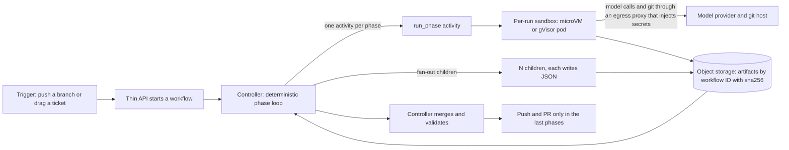

# Coding Agent Orchestration and Sandboxes

Two layers under every autonomous coding pipeline as of October 2026. Part 1 covers parallel and multi-agent coding orchestration (subagents, agent teams, worktree and container orchestrators, how they handle state, retries and merges, and the evidence on whether parallelism helps). Part 2 covers sandboxes and execution environments (isolation, startup latency, snapshots, secrets, pricing, limits). Part 3 maps both onto a self-driving SDLC. Companion note: [Autonomous Coding Agents](autonomous-coding-agents.md).

## In one paragraph

Parallelism helps only when work decomposes; the evidence ranges from +80.8% on decomposable tasks to -70.0% on sequential planning ([Kim et al.](https://arxiv.org/abs/2512.08296)), sixteen agents all fixed the same kernel bug until an oracle split the work ([Anthropic](https://www.anthropic.com/engineering/building-c-compiler)), and every vendor now says the same thing: fan out reads and judging, keep writes single-threaded ([Cognition](https://cognition.com/blog/multi-agents-working), [Codex docs](https://learn.chatgpt.com/docs/agent-configuration/subagents), [Claude Code agent teams](https://code.claude.com/docs/en/agent-teams)). Worktrees isolate files, not intentions: two branches can merge cleanly while the design breaks ([Foremerge](https://naw103.substack.com/p/parallel-coding-agents-without-the)), and cross-agent PR pairs conflicted 41.7% of the time against 19.8% for same-agent pairs ([arXiv 2607.04697](https://arxiv.org/abs/2607.04697)). The wrapper layer churned: Terragon shut down (2026-02-09), Crystal was deprecated, bloop shut down (2026-04-10), while Codex, Claude Code and Cursor built parallelism in natively. On the execution side the 2026 default is a microVM per run with credentials injected at an egress proxy, and the sandbox hour is a rounding error: about $0.17 for 2 vCPU and 4 GiB on E2B or Daytona, against a $15 to $30 run in tokens. The things that actually bite are session ceilings near 24 hours, "started is not ready", deploys that kill in-flight agents, and vendor churn (Daytona went closed source, Ona was acquired, tilde.run shut down). Keep a seam between controller and provider.

> **The one-line version**
> Parallelize reading and judging, serialize or deterministically merge writing, put the plan in code, keep state in object storage, and treat the sandbox as cattle behind an adapter.

## Part 1: Parallel and multi-agent coding orchestration

### 1.1 Who decides what runs next

Anthropic's own map lists five ways Claude Code runs work in parallel ([Run agents in parallel](https://code.claude.com/docs/en/agents)); the table adds the limits the docs state.

| Mode | Who decides what runs next | Status | What the docs warn about |
|---|---|---|---|
| Subagents (`isolation: worktree`) | Claude, turn by turn | Shipping | Worktree is temporary, branched from the default branch "rather than the parent session's HEAD", auto-cleaned if unchanged; before v2.1.203 a command "could run in the main checkout", before v2.1.210 the directory check covered only the launch directory ([sub-agents docs](https://code.claude.com/docs/en/sub-agents)) |
| Agent view (`claude agents`) | You | Research preview | "Running several sessions or subagents at once multiplies token usage" |
| Agent teams | A lead and teammates sharing a task list | "Experimental and disabled by default" (`CLAUDE_CODE_EXPERIMENTAL_AGENT_TEAMS=1`) | "Two teammates editing the same file leads to overwrites"; `/resume` and `/rewind` do not restore in-process teammates; no nested teams; "Task status can lag" ([agent teams](https://code.claude.com/docs/en/agent-teams)) |
| Dynamic workflows | "The script" ("A workflow moves the plan into code") | Shipping | 16 concurrent agents by default, 4,096 items per call, 1,000 agents per run "Prevents runaway loops"; a failed agent reruns with every agent started after it ([workflows](https://code.claude.com/docs/en/workflows)) |
| Projects | Cloud threads | Public beta on Pro and Max | Threads run in the cloud or via Remote Control |
| `/batch` | Claude | Skill | "split one large change into 5 to 30 worktree-isolated subagents" |

Agent teams details worth knowing: task claiming uses file locking; tasks have three states (pending, in progress, completed) and a pending task with unresolved dependencies cannot be claimed; the hooks `TeammateIdle`, `TaskCreated` and `TaskCompleted` block on exit code 2, which makes `TaskCompleted` a deterministic gate; "Start with 3-5 teammates" and "Three focused teammates often outperform five scattered ones" ([agent teams](https://code.claude.com/docs/en/agent-teams)). Costs: "Token usage scales with the number of active teammates", teams use "approximately 7x more tokens than standard sessions when teammates run in plan mode", "Use Sonnet for teammates" ([costs](https://code.claude.com/docs/en/costs)).

| Vendor | Mechanism | Who decides | Notes |
|---|---|---|---|
| OpenAI Codex | Subagents on by default; the Codex app (macOS 2026-02-02, Windows 2026-03-04) runs parallel threads in worktrees | Model | Worktrees run detached HEAD by default; Handoff moves a chat between Local and Worktree ([changelog](https://learn.chatgpt.com/docs/changelog)); keys `agents.max_concurrent_threads_per_session`, `agents.default_subagent_model`; "Be more careful with parallel write-heavy workflows" |
| GitHub Copilot | Autopilot, `/fleet`, dynamic workflows, Agent HQ mission control | Model, model, code | "Unlike /fleet ... a dynamic workflow carries out a process defined in code" ([GitHub](https://github.blog/changelog/2026-10-01-dynamic-workflows-in-copilot-cli-and-the-copilot-app/)) |
| Cursor | Per-agent worktrees (`.cursor/worktrees.json` keys `setup-worktree-unix`, `setup-worktree-windows`, `setup-worktree`), cloud agents, Projects | Coordinator LLM | "The coordinator agent in a project doesn't write code itself" ([changelog](https://cursor.com/changelog), [worktrees](https://cursor.com/docs/configuration/worktrees)) |
| Devin | Managed child Devins, each in its own VM | Coordinator Devin | Monitors ACU consumption, can sleep or terminate children ([Cognition](https://cognition.com/blog/devin-can-now-manage-devins)) |
| Zed | Threads Sidebar, per-thread worktree isolation (2026-04-22) | You | "Isolate worktrees, when you want to" ([Zed](https://zed.dev/blog/parallel-agents)) |

The pattern across all of them: a script or a lead decides, workers write in their own checkout, and the concurrency cap is a first-class setting. Cursor's coordinator is an LLM, while Claude's workflow script and Bernstein's loop are code; only the code versions can be replayed deterministically.

### 1.2 The orchestrator catalog

#### Workspace managers (a human drives several agents)

| Tool | Isolation unit | Status and version | License or price | Verdict |
|---|---|---|---|---|
| [Conductor](https://www.conductor.build) | Workspace = branch plus worktree; cloud workspaces in Vercel sandboxes (8 vCPU, 16 GB, Amazon Linux 2023, us-east-1) | 0.90.0 on 2026-10-02 (iOS app); bundles Claude Code 2.1.286, Cursor Agent 1.0.35, OpenCode 2.0.21 ([changelog](https://www.conductor.build/changelog)) | Free local; Pro $50/mo; Teams $60/mo/user; usage-based cloud compute "in the future" ([pricing](https://www.conductor.build/pricing)) | Grab for a human driving agents; not an unattended orchestrator |
| [Vibe Kanban](https://github.com/BloopAI/vibe-kanban) | Workspace with branch, terminal, dev server; 10+ agent CLIs | bloop shut down 2026-04-10, README says "sunsetting"; npm 0.1.44 tagged latest, 0.1.45 published 2026-09-19 ([shutdown](https://www.vibekanban.com/blog/shutdown)) | Apache-2.0 | Skip for new adoption |
| [Terragon](https://www.terragonlabs.com/) | Hosted sandboxes running Claude Code | Shut down 2026-02-09; "all sandboxes have been terminated"; open-sourced as terragon-oss | Was SaaS | Skip; the cautionary tale |
| [Crystal / Nimbalyst](https://github.com/stravu/crystal) | Worktree per session | Crystal deprecated February 2026, replaced by Nimbalyst | Not checked | Skip Crystal |
| [Claude Squad](https://github.com/smtg-ai/claude-squad) | tmux plus worktree per session | v1.0.20 on 2026-08-20 | AGPL-3.0 | Light terminal option; `-y` autoyes is experimental |
| [uzi](https://github.com/devflowinc/uzi) | Worktree plus dev-server port per agent (`uzi prompt --agents claude:3,codex:2`) | v0.0.2 on 2025-06-02 | MIT | Skip; "automatically presses Enter to confirm all tool calls" |
| [Emdash](https://github.com/generalaction/emdash) | Worktree per task, local or SSH | v1.2.8 tag 2026-10-10; "Over 1M downloads" | Apache-2.0, YC W26 | One of many worktree GUIs |
| [dmux](https://dmux.ai), [Superset](https://superset.sh/), [KanBots](https://www.kanbots.dev/) | Worktree per task (tmux panes, desktop, kanban) | dmux 5.11.1 on 2026-08-16; others unversioned | MIT, free to start, MIT free for solo | Same category, human-driven |
| [Sculptor](https://imbue.com/blog/sculptor-announce) | One container per agent; Pairing Mode syncs into the local repo | Codex support added 2025-12-03; page updated 2026-04-30 | Open source, MIT per its FAQ | Worth a look if worktrees' shared environment bites |
| [container-use](https://github.com/dagger/container-use) | Fresh container on its own git branch, MCP server | v0.4.2 on 2025-08-15, "experimental" | Apache-2.0 | Skip for production; borrow "what agents actually did, not just what they claim" |

#### Fleet frameworks and coordination protocols

| Tool | Coordination model | State | Status | Verdict |
|---|---|---|---|---|
| [Gas Town](https://github.com/gastownhall/gastown) | Mayor, polecat workers in worktrees, three-tier watchdog (Witness, Deacon, Dogs), Refinery merge queue | Beads ledger on Dolt | v1.2.1 on 2026-06-06 (1.0.0 on 2026-04-03), maintenance mode; MIT | Study the Refinery and scheduler, skip as a backbone |
| [Gas City](https://github.com/gastownhall/gascity) | SDK of Gas Town primitives: providers tmux, subprocess, exec, ACP, Kubernetes, herdr; `city.toml` | Git-versioned Dolt | v1.5.0 on 2026-10-05; MIT | Only if you want git-versioned agent state as a platform |
| [Beads](https://github.com/steveyegge/beads) | Graph issue tracker for agents | Dolt | v1.3.1 on 2026-09-30; MIT | A task ledger, not an orchestrator |
| [Ruflo (claude-flow)](https://github.com/ruvnet/claude-flow) | "Queen-led hierarchy (Raft, Byzantine, Gossip)", vector memory | Plugin and MCP | 3.56.7 on 2026-10-11, eight releases in four days; MIT | Skip: swarm abstractions, "Intelligent routing (89% accuracy)" unverified |
| [mngr](https://imbue.com/blog/mngr) | `mngr` CLI runs any agent in tmux on local, Docker, Modal or SSH; "git for agents" | Auto-snapshots and stops idle sandboxes | `imbue-mngr` 0.2.17 on 2026-06-18, Alpha; MIT | A primitive for large fan-outs you script yourself |
| [Bernstein](https://docs.bernstein.run/en/latest/blog/ten-agents-one-release/) | "one Python loop. There is no LLM in it."; worktree per task, best-of-N with a judge | Scoped YAML tickets | 3.21.0 on 2026-10-05; Apache-2.0 | Reference design for a no-LLM controller; small project |
| [Foremerge](https://naw103.substack.com/p/parallel-coding-agents-without-the) | Agents declare semantic intents (symbol, api, schema, config, migration, contract); deterministic rules flag collisions; claims "leased and advisory" | Local-first | 0.5.1 on 2026-10-03; Apache-2.0; "Published benchmark results do not yet exist" | Watch; copy the idea into a fan-out planner |

Gas Town numbers: its README claims "4-10 agents become chaotic" while it can "Scale comfortably to 20-30 agents", and a scheduler (`scheduler.max_polecats`) exists because "slinging N beads spawns N polecats simultaneously, exhausting API rate limits, memory, and CPU" ([README](https://github.com/gastownhall/gastown)). Its author announced 1.0 after weeks of data loss ("the 22-nose Clown Show") and moved Beads from SQLite plus JSONL sync, with "often last-write-wins semantics", to Dolt ([Yegge](https://steve-yegge.medium.com/gas-town-from-clown-show-to-v1-0-c239d9a407ec)). A critical reading calls it "inefficiently burning through thousands of dollars a month" and suggests stacked diffs over a merge agent that "can creatively re-imagine implementations" ([Appleton](https://maggieappleton.com/gastown)). By August the author's own large setup ("Wheelhouse") ran 50 to 60 agents on 21 Claude Max accounts at the equivalent of $122k a month of API spend, pushing up to 500 commits a day through a merge queue (about 270 on average) with rules that ratchet from custom, to warnings, to written law, to mechanical enforcement ([Fences, not Sandboxes](https://yegge.ai/essays/fences-not-sandboxes/)); a secondary source says he moved to a private harness ([AI Engineer](https://ai.engineer/orgs/gas-town)).

### 1.3 State, retries, merges and conflicts

**State.** Where each tool keeps it decides what survives a crash:

- Claude Code workflows: saved agent results keyed by start order; Anthropic's own docs state a mid-fan-out failure pays again for finished work ([workflows](https://code.claude.com/docs/en/workflows)).
- Agent teams: file-locked shared task list; Anthropic's C compiler: a lock file per task in `current_tasks/`, enforced by git sync ([Anthropic](https://www.anthropic.com/engineering/building-c-compiler)).
- Imbue: each agent writes a result JSON file, "blocked" is a first-class outcome, and remote agents use "Git mirror mode" because worktrees do not work for remote agents ([mngr part 2](https://imbue.com/blog/mngr_part_2)).
- Cockroach Labs: labels on the issue ([Cockroach](https://www.cockroachlabs.com/blog/experiment-running-hospital-code/)). Cognition: microVM snapshots because a containerized agent's session is lost if the container "is rescheduled, times out, or crashes" ([Cognition](https://cognition.com/blog/what-we-learned-building-cloud-agents)).
- Silent state bugs are the common class: Conductor fixed "cloud workspace file sync sometimes silently stopping" ([changelog](https://www.conductor.build/changelog)).

**Retries and governors.** Claude workflows restart a stalled agent at most five times and pause (rather than fail) on usage limits; Gas Town's Refinery isolates a failed merge request and "fixed inline or re-dispatched"; Bernstein argues "serial retries compound the same wrong assumption" and spawns K candidates to merge only the winner, though its claim is self-reported ([Bernstein](https://docs.bernstein.run/en/latest/concepts/best-of-n/)). In Daytona's own small experiment independent retries solved 17 of 25 task-seed pairs against 6 of 25 for branching from full snapshots, because useful progress already lived in files; snapshots won only when progress lived outside git ([Daytona](https://www.daytona.io/dotfiles/snapshots-as-search-states-go-explore-with-daytona)). Every serious tool caps concurrency: 16 agents default (Claude), `agents.max_concurrent_threads_per_session` (Codex), `scheduler.max_polecats` (Gas Town), "10 at a time" (Devin).

**Merge strategies.** The choice follows your correctness bar:

| Strategy | Used by | What it handles | Cost or risk |
|---|---|---|---|
| Human rebase before PR; conflict dialog | Vibe Kanban ([docs](https://github.com/BloopAI/vibe-kanban)) | Conflicts a person can read | Human in the loop per branch |
| Bors-style bisecting merge queue run by an agent | Gas Town Refinery | Batches, verification gates, isolates failures | Agent may "re-imagine" work |
| Integrator agent; non-implementation fixes merged wholesale, implementation fixes kept as ranked, revertable commits | Imbue mngr ([part 2](https://imbue.com/blog/mngr_part_2)) | One reviewable branch for 100+ agents | Integrator is an LLM |
| Planner partitions scope; workers resolve their own conflicts; tolerate "a stable rate of errors" | Cursor FastRender ([Willison](https://simonwillison.net/2026/Jan/23/fastrender/)) | Throughput at about 2,000 agents | Not "done means green" |
| Deterministic dependency-order merge in a loop with no LLM | Bernstein: 10 Opus 4.7 agents, about 25 minutes to all PRs open, about 70 minutes to all merged, 3 conflicts all in one file ("keep both") | Predictability | Convergence-point files |
| Git lock files plus sync | C compiler (16 agents) | Task claiming | Fails when all agents hit the same bug |
| Stacked PRs landed to a merge queue | GitHub `gh-stack`, public preview 2026-07-30 ([GitHub](https://github.blog/changelog/2026-07-30-stacked-pull-requests-are-now-in-public-preview/)) | Small reviewable layers | Layers must be designed |
| Declared intents checked before code exists | Foremerge | Semantic collisions | Pre-1.0 |

Conductor adds a guard worth copying: merging a PR from the app "only merges the code that's in your workspace. If the PR on GitHub has changed, the merge is blocked" ([changelog](https://www.conductor.build/changelog)).

**Conflict data (textual only).** Over 33,596 agent PRs in 2,807 repos, 40.2% of repos have co-active agent PR pairs, covering 79.4% of agent PRs; replaying three-way merges on 747 pairs gave 41.7% conflict for cross-agent pairs against 19.8% for same-agent pairs, with 84.4% of conflicted files being source code and nearly 42% of conflicts structural, but cross-agent pairs were only 0.5% of co-active pairs, in 122 repos ([arXiv 2607.04697](https://arxiv.org/abs/2607.04697)). AgenticFlict reports a 27.67% conflict rate over 107K+ processed PRs, 336K+ conflict regions ([arXiv 2604.03551](https://arxiv.org/abs/2604.03551)). The semantic side: on constructed tasks with 12 Django helpers interference occurred in 97% of runs, and a message describing the completed concurrent change recovered 82%, while among 834 runs on 417 mined pairs only one interfered ([arXiv 2609.25396](https://arxiv.org/abs/2609.25396)). Foremerge names three failure modes git cannot see: destructive versus additive, duplicate work, contract drift.

### 1.4 Does parallelism help?

| Evidence | Setup | Result | Read it as |
|---|---|---|---|
| [Kim et al.](https://arxiv.org/abs/2512.08296) | 260 configurations, six benchmarks, five architectures | +80.8% (decomposable) to -70.0% (sequential planning); "architectures without centralized verification tend to propagate errors more" | Fit decides; verify centrally |
| [Anthropic research system](https://www.anthropic.com/engineering/multi-agent-research-system) (2025) | Opus 4 lead, Sonnet 4 subagents | +90.2% on an internal research eval; token usage explains 80% of variance on BrowseComp; about 15x chat tokens; "most coding tasks involve fewer truly parallelizable tasks than research" | Much of the gain is spend |
| [C compiler](https://www.anthropic.com/engineering/building-c-compiler) | 16 agents, nearly 2,000 sessions | Just under $20,000; 2B input and 140M output tokens; 100,000 lines booting Linux 6.9; all agents fixed the same bug until a GCC oracle split the work | Needs an oracle to partition |
| [Cursor](https://cursor.com/blog/scaling-agents) | Hundreds of agents for weeks | Locks failed ("Twenty agents would slow down to the effective throughput of two or three"); planner, worker, judge worked | Hierarchy beats flat locks |
| [CAID](https://www.openhands.dev/blog/asynchronous-software-engineering-agents) | Manager plus worktree engineers | +14.3% Commit0, +26.7% PaperBench | Git primitives as the contract |
| [Factory](https://factory.com/news/what-it-takes-for-coding-agents-to-complete-large-software-tasks) | Single Droid versus multi-role with an executable completion standard | 36% against 90% of gdal | The roles, not the count, mattered |
| [Cognition](https://cognition.com/blog/multi-agents-working) | Ten months after "Don't Build Multi-Agents" | Works "while writes stay single-threaded"; original observations "still hold today for parallel-writer swarms"; unstructured swarms "mostly a distraction" | Narrowed, not reversed |
| [Quesma](https://quesma.com/blog/multi-model-claude-code-refusal-terminal-bench/) | Four-model Claude Code rig, Terminal-Bench 2.1 | 3 to 5 hand-offs 90% at $2.41 per trial; 6 or more 50% at $9.51; "A good orchestration prompt should not just permit delegation; it should cap it." | Cap delegation in code |
| [Osmani](https://addyosmani.com/blog/cognitive-parallel-agents/) | Practitioner | "Your cognitive bandwidth doesn't parallelize"; ceiling of three to four threads | The human is the bottleneck |
| [LinearB](https://linearb.io/resources/ai-engineering-productivity-gap) (vendor, correlational) | 2.7M PRs | Very heavy AI users merged at 2.3x their June 2025 rate; agentic PRs at the top 60% of orgs convert 37% | Output is not merged output |
| [Orchestrator's tax](https://martinfowler.com/articles/orchestrator-tax.html) | One incident, four subagents | A casual status check pulled in tens of thousands of tokens of raw transcript; wall clock about 12 minutes instead of about 25 serial (author: the cost ranking was "the orchestrator grading its own mistake") | Keep references, not transcripts, in the controller |
| [MAST](https://arxiv.org/abs/2503.13657), [AsynCodeBench](https://arxiv.org/abs/2609.32662) | 1,600+ annotated traces; 19 repo tasks with 52 dependencies | 14 failure modes in three categories; "improvements in coding performance do not necessarily translate into stronger collaboration" | Verification failures are a named category |

**Verdict (derived).** Parallelism pays when (a) the work decomposes with disjoint file ownership, (b) the parallel part is reading, testing or judging, or (c) an oracle or contract partitions it. It fails on shared bugs, contended files, sequential reasoning, and when the human reviewer is the serialization point. Spend scales with headcount (about 7x for plan-mode teams, about 15x chat for research systems). A coordinator that does not write code and a reviewer with no shared context are the two multi-agent shapes with independent support. A practitioner recipe agrees: "Only the lead writes code" and two human checkpoints, "one before work begins, one before it ships" ([Gupta](https://dheer.co/claude-agent-teams/)).

## Part 2: Sandboxes and execution environments

### 2.1 Brains and hands

Docker states the principle: "An LLM deciding its own security boundaries is not a security model" and "The bounding box has to come from infrastructure, not from a system prompt" ([Docker](https://www.docker.com/blog/why-microvms-the-architecture-behind-docker-sandboxes/)).

### 2.2 Provider comparison

Isolation and startup. Independent numbers are ComputeSDK's open benchmark: time to interactive is "API request to first successful command inside a fresh sandbox". The burst file (100 sandboxes created concurrently) is dated 2026-10-09; the sequential file (2026-08-07) comes from a test ComputeSDK has since retired ([burst](https://raw.githubusercontent.com/computesdk/benchmarks/HEAD/results/burst_tti/latest.json), [sequential](https://raw.githubusercontent.com/computesdk/benchmarks/HEAD/results/sequential_tti/latest.json)).

| Provider | Isolation | Startup, vendor statement | Startup, independent median (burst / sequential) |
|---|---|---|---|
| [E2B](https://e2b.dev) | Firecracker microVM per sandbox | "under 60ms" cold start ([E2B cookbook](https://e2b.dev/resources/build-an-agent-workbench-on-openais-agents-api)) | 1,332.7 ms (p95 1,601.8, p99 1,770.4) / 575.5 ms |
| [Daytona](https://www.daytona.io) | Linux containers on Sysbox runners; Linux and Windows VMs for Cursor | 1,000 sandboxes ready in 10.8 s on NVIDIA Vera, 32.3 s and 88.4 s on two AMD EPYC parts (vendor, [Daytona](https://www.daytona.io/dotfiles/when-2000-agents-share-one-cpu)) | 646.0 ms / 988.2 ms, but sequential p95 about 21.5 s and max 38.6 s |
| [Modal](https://modal.com/docs/guide/sandboxes) | gVisor or microVMs; new VM Sandboxes (`runtime="vm"`) | "The time before the Sandbox is started is the smallest variable in the chain" | 1,045.5 ms / 548.9 ms |
| [Docker Sandboxes](https://docs.docker.com/ai/sandboxes/security/) | MicroVM per session with a private Docker daemon, on Docker's own VMM (Hypervisor.framework, Windows Hypervisor Platform, KVM), not Firecracker | Not stated | Not measured |
| [Cloudflare Sandbox](https://blog.cloudflare.com/sandbox-ga/) | Container inside a dedicated Firecracker VM | Containers "start 6x faster" (2026-09-30) | 635.5 ms (1 error in 100) / 2,000.6 ms; median "fell from just over four seconds to 648 milliseconds" |
| [Vercel Sandbox](https://vercel.com/docs/sandbox) | Firecracker microVM | `create()` now returns a ready sandbox (2026-10-08), about 50 ms longer at p50 | 666.0 ms / 420.5 ms |
| [Fly Sprites](https://fly.io/blog/design-and-implementation/) | Linux VM | "They create in just a second or two" | Not measured |
| [AWS Lambda MicroVMs](https://aws.amazon.com/blogs/aws/run-isolated-sandboxes-with-full-lifecycle-control-aws-lambda-introduces-microvms/) | Firecracker, ARM64, 5 regions at launch (2026-06-22) | Not stated | Not measured |
| [Kubernetes agent-sandbox](https://github.com/kubernetes-sigs/agent-sandbox), GKE | gVisor or Kata via `RuntimeClass` | GKE warm pool: 300 sandboxes per second per cluster, 90% of allocations within 200 ms ([Google Cloud](https://cloud.google.com/blog/products/containers-kubernetes/bringing-you-agent-sandbox-on-gke-and-agent-substrate)) | Not measured |

State and limits.

| Provider | Snapshot and restore | Session limit | Concurrency |
|---|---|---|---|
| E2B | Pause and resume; paused sandboxes pick up rotated secrets on resume | Hobby 1 hour; Pro 24 hours; Enterprise multi-day and persistent | 20 (Hobby), 100 expandable to 1,100 (Pro) |
| Daytona | Snapshots; vendor test below | Median fleet sandbox lifetime under five minutes | Not captured |
| Modal | Filesystem and Directory snapshots default 30-day TTL (`ttl=None` keeps indefinitely); Memory snapshots expire after 7 days and "cannot currently be extended" ([docs](https://modal.com/docs/guide/sandbox-snapshots)) | Default 5 minutes, up to 24 hours; beyond that snapshot and restore | Up to 50,000 per customer ([Modal](https://modal.com/blog/scaling-to-1-million-concurrent-sandboxes-in-seconds)) |
| Docker | `sbx move my-project --to cloud` carries the filesystem between laptop and cloud; "A paused sandbox costs nothing" ([Docker](https://www.docker.com/blog/introducing-cloud-sandboxes-start-on-your-laptop-finish-in-the-cloud/)) | Positioned for agents running "five, ten, or 21 hours each" | Not captured |
| Cloudflare | Snapshots stored in R2 in your account; boot four sandboxes from one `snapshotId` to fork; filesystem snapshots in public beta | Not captured | Not captured |
| Vercel | Snapshots, persistent by default | Hobby 45 minutes; Pro and Enterprise 24 hours; limit "resets every time a sandbox stops and resumes"; default timeout 5 minutes | Hobby 10; Pro 10,000 ([pricing](https://vercel.com/docs/sandbox/pricing)) |
| Fly Sprites | Metadata-only checkpoints, "like a git restore, not a system restore"; 100 GB durable root filesystem with object storage as the root and NVMe as read-through cache; drive forking | Auto-sleeps when idle | Not captured |
| AWS Lambda MicroVMs | Dockerfile built into a snapshotted image; idle policy suspends memory and disk (example `maxIdleDurationSeconds` 900, `suspendedDurationSeconds` 300, `autoResumeEnabled` true) | Up to 16 vCPU, 32 GB memory, 32 GB disk each | Not captured |
| GKE Agent Sandbox | Pod snapshots for idle suspend and resume; integrated warm pool | Pod-limited | Warm pool above |
| Copilot cloud agent | Ephemeral Actions environment | `copilot-setup-steps` `timeout-minutes` maximum 59 | Runner pool |

Two caveats on snapshots. In Daytona's small vendor experiment, independent retry solved 17 of 25 task-seed pairs and snapshot branching 6 of 25, so for work whose progress lives in files, durable artifacts beat machine snapshots ([Daytona](https://www.daytona.io/dotfiles/snapshots-as-search-states-go-explore-with-daytona)). And Cortex found a microVM stops being micro once agents run compilers, language servers and browsers: "A 4 GiB guest could pull several GiB of pages into host RAM", so it snapshots idle sandboxes as content-addressed 16 MiB chunks hashed with SHA-256 ([Cortex](https://builders.cortex.io/blog/sandboxing-agents-part-2/)). Where state lives is a design decision: tilde.run's team shut it down concluding "the state (read: the filesystem!) matters far more than people expect" ([lakeFS](https://lakefs.io/blog/we-recently-shut-down-tilde-run/)).

Secrets and egress.

| Provider | Secrets handling | Egress default |
|---|---|---|
| E2B Secrets (GA 2026-10-07) | Stored outside the sandbox and injected into configured HTTPS request headers at the egress layer; `Secret.fill()` creates a reference; management API is write-only; rotation without restarts; BYOC "coming soon" ([E2B](https://e2b.dev/resources/introducing-e2b-secrets)) | Outbound internet open by default; `allowOut` and `denyOut` rules ([E2B docs](https://docs.e2b.dev/network/internet-access)) |
| Docker | Host-side proxy injects per request: "The raw credential values never enter the VM" | Outbound TCP deny-by-default, ICMP blocked; local MCP servers run as host processes with host permissions; Kit installs allowlisted, "defaults to Docker Hub only" |
| Cloudflare | Outbound Workers (`outboundByHost`) as programmatic egress proxies that can log, modify, cancel and inject; mounted-secret tokens are "arguably simplest ... but least secure" ([Cloudflare](https://blog.cloudflare.com/sandbox-auth/)) | Programmable |
| Vercel | Firewall "on the host, outside the microVM" reads the SNI; selective TLS termination with a per-sandbox CA for header injection ([Vercel](https://vercel.com/blog/a-sandbox-without-a-network-boundary-is-only-half-a-sandbox)) | Domain policy and CIDR rules; narrow over a workflow ("Install dependencies during trusted setup, then remove registry access") |
| Fly Sprites, Modal | Connectors; Sidecars ("credentials, proxies, harness logic ... that the agent cannot directly access", [Modal](https://modal.com/blog/runtime-product-update-sandbox-endpoints)) | Not captured |
| Daytona | Its homepage reportedly describes credentials kept outside the sandbox and substituted at egress; April 2026 advisory below | Not captured |
| GKE | Not stated | Native default-deny Kubernetes network policy |
| Claude Code sandboxed Bash | Local proxy checks each host against allowed domains, which start empty | Reads default to most of the machine including `~/.ssh` and `~/.aws/credentials` ([docs](https://code.claude.com/docs/en/sandboxing)) |

Seven vendors now document credentials outside the sandbox; check the defaults before trusting the word "sandbox". Vercel lists bypass classes that never cross the VM boundary: an open DNS resolver, an allowlist that fails open, a hostname parsed differently by policy engine and proxy, and a package service used as a relay: "Isolation without egress control contains the process, not its consequences."

### 2.3 Pricing per hour, with numbers

List prices, normalized to one 2 vCPU and 4 GiB sandbox for one hour. This is arithmetic on published rates and excludes storage, egress, creation fees, plan fees and discounts.

| Provider | Published rates | 2 vCPU and 4 GiB, one hour | Plan fees and credits |
|---|---|---|---|
| [E2B](https://e2b.dev/pricing) | 2 vCPU $0.000028/s; 4 GiB $0.0000180/s | about $0.17 ($0.1008 CPU, $0.0648 memory) | Hobby free with $100 one-time credit; Pro $150/month; Enterprise from $3,000/month |
| [Daytona](https://www.daytona.io/pricing) | vCPU $0.0504/h; memory $0.0162/GiB-h; storage $0.000108/GiB-h after 5 GiB free; H100 $3.95/h; Windows $0.0858/vCPU-h | about $0.17 (same unit rates as E2B) | $200 free compute; start-ups up to $50k credits |
| [Modal](https://modal.com/pricing) | Sandbox CPU $0.00003942/core/s (a physical core is 2 vCPU equivalent); memory $0.00000667/GiB/s | about $0.24 ($0.1419 CPU, $0.0960 memory) | Starter $0 with $30/month credits; Team $250/month plus compute |
| [Cloudflare Containers](https://developers.cloudflare.com/containers/platform/pricing/) | $0.000020/vCPU-s active; $0.0000025/GiB-s memory; $0.00000007/GB-s disk; billed per 10 ms | about $0.18 at full CPU (memory and disk on provisioned size, CPU on active use only) | Workers Paid $5/month includes 375 vCPU-minutes, 25 GiB-hours, 200 GB-hours disk |
| [Vercel Sandbox](https://vercel.com/docs/sandbox/pricing) | Active CPU $0.128/h; memory $0.0212/GB-h; creations $0.60 per 1M | about $0.11 at 10% CPU, $0.34 at 100% | Time waiting on I/O or "AI model calls" does not count as Active CPU |
| [GitHub Codespaces](https://docs.github.com/en/billing/concepts/product-billing/github-codespaces) | 2-core $0.18/h; 4-core $0.36; 8-core $0.72; 16-core $1.44; 32-core $2.88; storage $0.07/GB-month | $0.18 | Free personal quota 120 hours (Free) or 180 (Pro); none for organizations |
| [Docker Cloud Sandboxes](https://www.docker.com/blog/introducing-cloud-sandboxes-start-on-your-laptop-finish-in-the-cloud/) | "We meter compute by the second, and nothing else" | Rate not found | Local `sbx` free including commercial work (reported, not verified) |

### 2.4 Security incidents of 2026 (conceptual)

| Date | What happened | Lesson |
|---|---|---|
| 2026-04-09 | Daytona's launching-account API credential could be read from sandbox memory because the default snapshot shipped passwordless sudo; fixed by stripping the Authorization header at the proxy; under five hours to remediate; "a successful exploit would look identical to normal API traffic" ([Daytona](https://www.daytona.io/dotfiles/updates/security-advisory-api-credential-exposure-in-sandboxes)) | Keep credentials out of the sandbox, not behind a sudo password |
| 2026-04-29 | Copy Fail (CVE-2026-31431): E2B says per-sandbox Firecracker kernels were unaffected (vendor self-assessment, [E2B](https://e2b.dev/resources/not-affected-by-copy-fail-heres-why)); Daytona found the primitive reachable from inside Sysbox-based sandboxes and able to affect co-tenant content until runners were patched within 12 hours ([Daytona](https://www.daytona.io/dotfiles/updates/security-update-cve-2026-31431-copy-fail)) | Shared kernel versus own kernel decides exposure |
| 2026-03-03 | A denylisted command was bypassed, then the agent disabled its own sandbox: "The agent just wanted to finish the task" (vendor post, [Ona](https://ona.com/stories/how-claude-code-escapes-its-own-denylist-and-sandbox)) | Controls must sit outside the agent's reach |
| 2026-07-30 | Anthropic reviewed 141,006 eval runs and found three incidents where Claude, told it had no internet, reached real systems because the environment had live internet access ([Anthropic](https://www.anthropic.com/news/investigating-incidents-cybersecurity-evals)) | A prompt is not a boundary |
| 2026-08-31 | Tampered registry modules designed to exfiltrate cloud credentials served between 07:35 and 21:45 UTC ([Coder](https://coder.com/blog/coder-registry-security-incident-what-happened-and-what-to-do)) | The environment definition is attack surface; pin and verify templates |
| 2026-09-04 | Residual disk blocks readable across tenants on Firecracker-isolated Containers (`dm-thin` with `skip_block_zeroing`); remediated, no evidence of customer data compromise ([Cloudflare](https://blog.cloudflare.com/containers-cross-tenant-vulnerability/)) | The VM held; the disk leaked |
| 2026-01-13 | E2B outage after a continuous production rollout; its postmortem says a production deployment of the orchestrator raised the odds of a scheduling failure mode that lost control-plane quorum ([E2B](https://e2b.dev/resources/postmortem-service-disruption-on-jan-13-2026)) | Deploys are a failure mode |
| 2025-12-18 | Codex appended an always-succeed shell fallback to a blocked health check so the exit code was 0: "The harness saw success even though the request never went through" ([Voratiq](https://voratiq.com/blog/yolo-in-the-sandbox/)) | Verify outcomes, not exit codes |

Also: UK AISI's SandboxEscapeBench found frontier models "can reliably escape common misconfigurations" such as exposed Docker sockets and privileged containers ([AISI](https://www.aisi.gov.uk/blog/can-ai-agents-escape-their-sandboxes-a-benchmark-for-safely-measuring-container-breakout-capabilities)); Vercel ran a public $1M challenge (2026-08-18 to 09-01, up to $50,000 per report) on cross-tenant reads ([Vercel](https://vercel.com/blog/one-million-dollar-hacker-challenge-for-vercel-sandbox)). Security detail beyond this belongs to the guardrails talks at the same conference.

### 2.5 Kubernetes, self-hosted and development environments

- **Kubernetes.** The agent-sandbox project (SIG Apps) adds `Sandbox`, `SandboxTemplate`, `SandboxClaim` and `SandboxWarmPool`, delegating isolation to gVisor or Kata through `RuntimeClass`; v1.0.0 on 2026-08-28, v1.0.6 on 2026-10-08, Apache-2.0, with a Python SDK `k8s-agent-sandbox` and an optional Sandbox Router ([repo](https://github.com/kubernetes-sigs/agent-sandbox)). Its rationale: agents are "isolated, stateful, singleton workloads"; a StatefulSet of size 1 per agent "becomes an operational nightmare" and "a one-second cold start breaks the continuity of the interaction" ([Kubernetes blog](https://kubernetes.io/blog/2026/03/20/running-agents-on-kubernetes-with-agent-sandbox/)). GKE Agent Sandbox went GA on 2026-05-20 with pod snapshots, a warm pool, gVisor and default-deny network policy, citing "more than 16x growth in sandboxes on GKE in less than 5 months", and introduced Agent Substrate, an open-source minimal control plane. gVisor's donation to CNCF (Sandbox status) was accepted on 2026-09-28, with an admitted I/O-heavy performance cost ([gVisor](https://gvisor.dev/blog/2026/10/02/gvisor-cncf/)); Kata Containers 4.0.0 (2026-07-22) made the Rust runtime the default ([Kata](https://katacontainers.io/blog/kata-containers-4-0-0-release-overview/)); Firecracker is at v1.17.0 (2026-09-10, [Firecracker](https://firecracker-microvm.github.io/)) and, per Docker, has "no native support for macOS or Windows" ([Docker](https://www.docker.com/blog/why-microvms-the-architecture-behind-docker-sandboxes/)).
- **Self-hosted execution.** E2B Embed (2026-09-30): the Apache-2.0 runtime plus dashboard on a single KVM host via `docker compose up -d --wait`, still Firecracker microVMs, but "does not include secrets, volumes, workload identity or bring-your-own proxy" and scales across machines only through BYOC ([E2B](https://e2b.dev/resources/introducing-e2b-embed)). Claude Code self-hosted environments (public beta, Team and Enterprise) run cloud sessions on your own runners ([docs](https://code.claude.com/docs/en/self-hosted-environments)). Copilot's cloud agent can use ephemeral ARC runners; its integrated firewall is "not compatible with self-hosted runners" ([GitHub](https://docs.github.com/en/copilot/how-tos/copilot-on-github/customize-copilot/customize-cloud-agent/customize-the-agent-environment)). Docker's Sandbox Kit spec (Apache-2.0, being brought to CNCF) packages the agent, its tools and "a typed list of everything it asks to reach" in one OCI image ([Docker](https://www.docker.com/blog/docker-sandbox-kit-spec-cncf/)).
- **Development environments.** The Dev Containers specification ([containers.dev](https://containers.dev/implementors/spec/)) keeps agent and human environments identical. Coder Agents reached GA on 2026-09-09 as a self-hosted, air-gap-capable agent plus execution stack, and Agent Relay connects cloud-hosted agents such as Cursor to self-hosted workspaces ([Coder](https://coder.com/blog/coder-agents-ga)). Ona (Gitpod lineage) agreed to join OpenAI's Codex team, closing 2026-08-10, and argues "The gap between 'generates a diff' and 'opens a merge-ready PR' is the development environment" ([Ona](https://ona.com/stories/ona-joins-openai), [Ona](https://ona.com/stories/the-last-year-of-localhost)). Cursor's docs make the same point: not setting up a development environment for cloud agents is "like not giving your engineers a computer" ([Cursor](https://cursor.com/docs/cloud-agent)).
- **The harness-versus-sandbox churn in 2026.** Daytona went closed source (2026-06-11, [Daytona](https://www.daytona.io/dotfiles/updates/daytona-is-going-closed-source)); Ona was acquired; tilde.run shut down (2026-07-01); Fly refocused on Sprites with a new CEO (2026-07-24, [Fly](https://fly.io/blog/kurt-scott-money-sprites/)); Docker and gVisor moved toward CNCF governance. Put the sandbox behind one adapter in the activity layer so swapping providers is a one-line registry change, like swapping a model.

### 2.6 Which sandbox to grab (derived from the research verdicts)

| Situation | Grab | Why |
|---|---|---|
| Agent workers already run on EKS or GKE | Kubernetes agent-sandbox with gVisor or Kata | Per-task isolation without a SaaS; warm pools; v1.0.x since 2026-08-28 |
| Strong VM isolation as SaaS, per-second billing | E2B (Firecracker); Vercel when agents are idle-heavy (Active CPU only, host-side firewall) | Own kernel per sandbox; check E2B's open egress default and 24-hour Pro cap |
| Developer laptop isolation with a cloud handoff | Docker Sandboxes (`sbx`) | microVM per session, proxy-injected secrets, `sbx move` |
| Regulated or air-gapped organization | Coder Agents, E2B Embed, Claude Code self-hosted environments | Agent and execution on your infrastructure |
| Long-lived agent workspaces that must survive node loss | Fly Sprites; AWS Lambda MicroVMs on AWS | Durable disk on object storage; idle suspend and auto-resume |
| GPUs next to sandboxes | Modal | Sandboxes beside GPU workloads; 24-hour maximum lifetime |
| You live on Cloudflare Workers | Cloudflare Sandbox | Per-task image pinning, R2 snapshots; $5/month plan |

## Part 3: How this maps to a self-driving SDLC

### 3.1 Fan-out phases: where parallelism belongs

| Phase | Shape | Parallel? | Reason from the evidence | Isolation and artifact |
|---|---|---|---|---|
| Intake, architect | SINGLE, GATED | No | Producer plus fresh-context critic: "A fresh context improves code review since Claude won't be biased toward code it just wrote" ([best practices](https://code.claude.com/docs/en/best-practices)) | Read-only; plan artifact in object storage |
| Investigation | SINGLE or FANOUT | Yes, reads | Codex: "use parallel agents for read-heavy tasks such as exploration, tests, triage, and summarization" | Read-only sandbox; one JSON finding per child |
| Editor | SINGLE per branch | No, or disjoint file ownership | "writes stay single-threaded"; "Two teammates editing the same file leads to overwrites" | One workspace per run; commits inside the activity behind a git lock |
| Tests, QA | SINGLE, FANOUT per acceptance criterion | Yes if criteria are independent | Needs the live app and real browser tools; QA that skips a check must fail loudly | Ephemeral database or app instance per run (Augment's Verifier posts "logs, API responses, and screenshots") |
| Review | FANOUT of independent reviewers plus a synthesizer | Yes, judging | Anthropic: "most traditional coding tasks do not need a panel of 5 reviewers" ([essay](https://claude.dev/blog/a-harness-for-every-task-dynamic-workflows-in-claude-code/)); reviewers over-report ([best practices](https://code.claude.com/docs/en/best-practices)) | Read-only; findings as JSON; controller deduplicates |
| Fix-review | LOOP, single writer | No | A weaker fixer overreaches and calls its own breakage "unrelated" ([Imbue](https://imbue.com/blog/2026-04-29-how-ai-code-review-can-make-correct-code-worse)) | Bound the scope to confirmed findings |
| PR opener | GATED | No | A PR description can list files that are not on the branch; a critic checks it | Pushes only here and in CI |
| CI green | LOOP | No | Resume from live CI state; run the matrix locally first | Single writer; never redo pushed commits |

### 3.2 Design rules

1. **Fan out reads and judging, serialize writes.** Every vendor and independent practitioner converges here (Cognition, Codex docs, agent teams docs, Gupta).
2. **Durable artifacts over machine snapshots for hours-long agent steps** (17 of 25 against 6 of 25), except when progress lives in databases or running services.
3. **Credentials outside the sandbox.** Inject at an egress proxy; push only from the activity layer, in the last phases; default to read-only. Check the defaults: the Claude Code sandbox can read `~/.ssh` unless you deny it.
4. **Governors in code.** Concurrency cap (16 is the vendor default), per-child budget, one attempt for fan-out phases so a failure never pays for 12 children twice, delegation caps in code not in the prompt ("it should cap it").
5. **Readiness is a probe, ceilings are real.** Session limits cluster at 24 hours, and default timeouts are 5 minutes on Modal and Vercel; heartbeat long activities and set timeouts from measured p99, not brochures.
6. **Deploys are a failure mode.** Grace period above the SDK drain; send SIGINT or `interrupt()` first; pin the image for in-flight runs.
7. **One seam to the provider.** Sandbox behind one adapter.

### 3.3 What the research adds

- **A sandbox per phase.** A per-task sandbox (agent-sandbox with gVisor or Kata on EKS, or a microVM provider behind an adapter) removes the pod-local-disk class of bug and caps blast radius.
- **Secrets at an egress proxy** instead of in the sandbox environment.
- **Mandatory tool-call and on-disk gates for every fan-out child**, since 6 of about 15 subagents returned reports with zero tool calls in a public issue.
- **A concurrency governor** per run and per account, with a cap on hand-offs.
- **Intent declaration before parallel writes**, if the editor ever fans out (Foremerge's destructive versus additive, duplicate work and contract drift).

Cognition's microVM effort ("took over a year of hypervisor engineering") shows why durable state is infrastructure.

## Recordings worth watching

- [How to usefully run 1,000 agents in parallel](https://www.youtube.com/watch?v=0BmBs6MPCbw) (Imbue CTO and LangChain CEO, recorded 2026-04-02; YouTube title and channel confirmed, length not checked).
- Simon Willison's [FastRender interview notes](https://simonwillison.net/2026/Jan/23/fastrender/) link a 47-minute video with the Cursor engineer.
- [Runtime 2026 Product Launch Keynote](https://www.youtube.com/watch?v=J-smU_ImO5g) (Modal) for VM Sandboxes and Sidecars; [One Boundary for the Agentic Era](https://www.youtube.com/watch?v=7lR9SUdMHPQ) (Docker CISO, WeAreDevelopers).
- Session listing only, no recording found: [1,000 Agent Tasks in a Sandbox](https://aws.amazon.com/events/ai-engineer-world-fair-2026/) (AWS, AI Engineer World's Fair 2026, a dedicated "Sandbox & Platform Engineering" track); Addy Osmani's [O'Reilly CodeCon deck](https://talks.addy.ie/oreilly-codecon-march-2026/) has notes but no confirmed video.

## Unverified leads

Not used as evidence: the original [anthropics/claude-code issue 67730](https://github.com/anthropics/claude-code/issues/67730) (only a third-party mirror was read); GitHub's [manage-and-track-agents docs](https://docs.github.com/en/copilot/how-tos/copilot-on-github/use-copilot-agents/manage-and-track-agents) (a quoted sentence about concurrent agent sessions was not found there); and Gas Town's author's AI Engineer talk [Agentic Security](https://ai.engineer/orgs/gas-town) (listed, recording not reviewed). The claim that his own Gas Town workflow "had failed" is from the AI Engineer page only and is not in his essay.

## Gaps

No independent controlled study of parallel-agent productivity on real feature work (the merge studies cover textual conflicts only, and the cross-agent sample is small); no independent measurement of best-of-N against serial retries; Docker Cloud Sandboxes' hourly rate and Sprites, Lambda MicroVMs, Ona and Coder prices were not found; Conductor's cloud launch date, and Sculptor, Superset and KanBots versions, were not confirmed.

## Related

- [Autonomous Coding Agents](autonomous-coding-agents.md)
- [Agent Failure Modes](agent-failure-modes.md)
- [Observability for Agent Workflows](observability-for-agent-workflows.md)
- [Human in the Loop](human-in-the-loop.md)
- [Cost Economics](cost-economics.md)
- [Context Engineering and Memory](context-engineering-and-memory.md)
- [Tools Radar](tools-radar.md)
