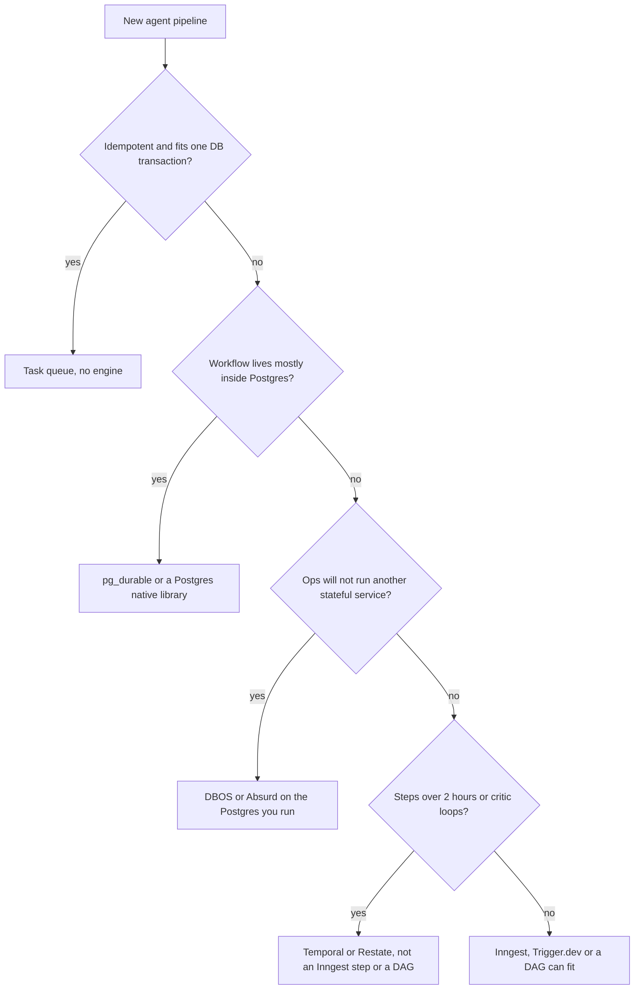

# Comparisons and Benchmarks

## How to read this note

- **Freshness.** Prices come from vendor pricing pages seen in October 2026; versions and dates are in [2.4 Versions and release dates](#24-versions-and-release-dates). Re-read the live page before you decide.
- **Labels.** "(vendor)" means the author sells a compared or adjacent product. "(prototype)" marks a vendor research prototype. "(docs)" marks a documentation-only review. "Estimate" marks arithmetic on a published unit price and an assumed count; the assumptions are stated each time and are not measurements.
- **Missing.** Reddit could not be reached (the search tool rejects it, fetches hit a login wall), so the debate rests on Hacker News threads read in full through the HN Algolia items API. No independent shared-workload benchmark was found; Restate's paid-tier prices, Inngest's overage price and Lambda durable functions pricing are not in the sources reviewed.

## 1. Source register: every comparison source

Grouped by who wrote it. "Verdict" is the source's own conclusion.

### 1.1 Vendor-authored comparisons and benchmarks (vendor)

| Source | Author | Date | Who is compared | Method | Verdict | Bias |
|---|---|---|---|---|---|---|
| [Restate vs Temporal](https://restate.dev/vs/temporal); [Announcing Restate BYOC](https://restate.dev/blog/announcing-restate-byoc); [Replit case study](https://restate.dev/use-cases/replit) | Restate | 2026-06-16 (updated 2026-09-25); 2026-07-07; 2026 | Restate and Temporal | Architecture contrast, cost table at 500 and 5,000 actions per second, a customer migration story | Under 10 ms P99 per durable action; more than 4x to about 10x cheaper on BYOC | Vendor. Prices Temporal at $25 per million and excludes storage |
| [Inngest vs Temporal](https://www.inngest.com/compare-to-temporal) | Inngest | 2026 | Inngest and Temporal | Feature and price contrast | No workers, memoized steps, flow control | Vendor. Its Temporal price claim does not match Temporal's page |
| [Trigger.dev vs Temporal](https://trigger.dev/vs/temporal) | Trigger.dev | 2026-03-03 (modified 2026-10-06) | Trigger.dev and Temporal | Recovery model and billing contrast | Checkpoint/restore: no determinism rules; compute-second billing | Vendor |
| [DBOS vs. Temporal](https://www.dbos.dev/compare/dbos-vs-temporal); [10x Less Code](https://www.dbos.dev/blog/durable-execution-coding-comparison) | DBOS | 2026; 2026-03-10 | DBOS and Temporal | Claims table; one 110-line RAG app made durable both ways | One Postgres write per step; often 2-10x cheaper; 7 changed lines against more than 100 | Vendor. Presents Cassandra as Temporal's required store |
| [DBOS vs. AWS Step Functions Benchmark](https://dbos.dev/blog/dbos-vs-aws-step-functions-benchmark) | DBOS | 2025-01-05 | DBOS Transact, Step Functions Standard and Express | Sequential database-transaction steps on the same RDS database; open-source code | "25x faster in every test" | Vendor benchmark, on DBOS's home workload (interpretation) |
| [Absurd: Comparison](https://earendil-works.github.io/absurd/comparison/) | Earendil Works (Absurd's authors) | 2026-04 | Absurd, PGMQ, Cadence, Temporal, Inngest, DBOS | Opinionated notes from public docs as of April 2026 | Smallest SDK, closest to "just use Postgres" | Vendor in effect. Lines-of-code figures are their claim |
| [Durable Workflow Engines in 2026](https://upstash.com/blog/durable-workflow-engines-compared-every-major-option-in-2026) | Upstash | 2026-07-20 | Upstash Workflow, Temporal, Inngest, Trigger.dev, Step Functions, Cloudflare Workflows | Claims checked against docs in July 2026 | Axes: where steps run, idle cost, limits | Vendor (sells Upstash Workflow) |
| [8 Inngest Alternatives for Durable AI Agents](https://www.zenml.io/blog/inngest-alternatives) | ZenML (Hamza Tahir) | 2026-08-04 | Inngest and eight alternatives | Listicle on run search, isolation, duplicate prevention | Ranks its own Kitaru first | Vendor |
| [Checkpoints Are Not Durable Execution](https://www.diagrid.io/blog/checkpoints-are-not-durable-execution-why-langgraph-crewai-google-adk-and-others-fall-short-for-production-agent-workflows) | Diagrid (Yaron Schneider) | 2026-02-25 | LangGraph, CrewAI, Google ADK against replay-based execution | Walkthrough of each framework's persistence | Checkpoints are save points, not supervision | Vendor (sells Dapr Workflows) |
| [Agent checkpointing is far from production-grade resiliency](https://restate.dev/blog/why-checkpointing-is-not-production-grade-durable-execution) | Giselle van Dongen (Restate) | 2026-06-15 | LangGraph, ADK, Mastra against durable execution | Argument with failure scenarios | "80% of the hard work is still on the plate of the developer" | Vendor |
| [Temporal vs LangGraph (2026)](https://cordum.io/blog/temporal-vs-langgraph) | Cordum | 2026-04-29 | Temporal and LangGraph | Layering argument | Different layers; asking which replaces the other causes incidents | Vendor-adjacent (sells agent governance) |
| [Temporal Cloud pricing vs self-hosted vs a hosted agent loop](https://cadenya.com/other-content/temporal-cloud-vs-self-hosted-cost) | Cadenya | 2026-09-28 | Temporal Cloud, self-hosted Temporal, Cadenya's loop | Prices a sample agent in Actions | About $2 a month for 2,000 runs of a 12-action agent | Vendor (sells a hosted agent loop) |
| [Durable execution without history replay](https://trigora.dev/blog/durable-execution-without-history-replay/) | Trigora | 2026-09-09 | Continuation checkpointing and Temporal replay | Prototype, boundary depth 10 to 1,000 | Recovery 0.6-0.9 ms against 61 ms to 1.7 s | Vendor seeking design partners (prototype); not a production-speedup claim |
| [How to think about durable execution](https://hatchet.run/blog/durable-execution) | Alexander Belanger (Hatchet) | 2025-12-11 | A plain task queue and durable execution | First-principles essay | A queue is enough if the job is idempotent and fits one transaction | Vendor, but argues against over-adopting |
| [SQLite is All You Need](https://obeli.sk/blog/sqlite-is-all-you-need-for-durable-workflows/) | Obelisk | 2026-05-29 | SQLite plus Litestream and Postgres-backed engines | Argument with caveats | One SQLite file per agent or tenant is enough for many workloads | Author of an engine. States that async replication can lose the newest writes |
| [Postgres-backed Durable Workflow Execution](https://www.dbos.dev/blog/postgres-is-all-you-need-for-durable-execution); [Making Postgres Queues Scale](https://www.dbos.dev/blog/making-postgres-queues-scale) | DBOS | 2026-05 (metadata 2026-09-28); 2026-09-28 | External orchestrators and Postgres coordination | Argument; throughput by bottleneck stage | External orchestration is "fundamentally overcomplicated"; over 30K workflows per second | Vendor |
| [Two Roads to Durable Agents](https://ai.engineer/talks/svCnShDvgQg-two-roads-durable-agents-replay-vs-snapshot) | Eric Allam (Trigger.dev) | 2026-05-10 | Replay, journal and snapshot recovery | Conference talk with transcript | Append-only context log plus microVM snapshots | Vendor |
| [Durable execution with Apache Airflow](https://www.astronomer.io/blog/durable-execution-with-apache-airflow/) | Volker Janz, Julian LaNeve (Astronomer) | 2026-09-21 | Where eight systems put the durability boundary | Four-way boundary table | Airflow: explicit task checkpoints; durable execution means at least once | Vendor (sells managed Airflow) |

### 1.2 Independent and documentation-based comparisons

| Source | Author | Date | Who is compared | Method | Verdict | Bias |
|---|---|---|---|---|---|---|
| [2026 Comparative Analysis: Durable Execution Infrastructure for Long-Running AI Agents](https://appliedtechnologyindex.com/research/2026-comparative-analysis-durable-execution-infrastructure-ai-agents/) | Applied Technology Index | 2026-07-25 | Temporal, LangGraph/LangSmith, Azure Durable Task, Step Functions, Cloudflare Workflows | Public documentation as of 2026-07-25 (docs) | "No common agent workload was executed"; durability does not make an action exactly once | Documentation only; no compared product is the author's |
| [Durable Execution: Restate, DBOS, Hatchet and Inngest Compared](https://cloudrps.com/blog/durable-execution-restate-dbos-hatchet-beyond-temporal/) | CloudRPS (author not named) | 2026-09-21 | Restate, DBOS, Hatchet, Inngest, with Temporal as baseline | Practitioner guide ending in a decision matrix | Team shape and workload decide | Not tied to an engine vendor; reports deploying Hatchet twice |
| [Temporal Cloud vs Self-Hosted 2026: True Cost](https://automationatlas.io/guides/temporal-cloud-vs-self-hosted-2026/) | Automation Atlas | 2026-05-06 | Temporal Cloud and self-hosted Temporal | Estimated infrastructure plus labor, two client anecdotes | Cost-competitive at around 30-50M actions a month if you already run Kubernetes and Cassandra | Consultancy. Its Cloud price references do not match Temporal's page |
| [Temporal - Under the Hood](https://backend.how/posts/temporal-under-the-hood/) | backend.how | 2026-04-05 | Temporal on Postgres and Absurd | pg_stat_statements, 500 workflows of 3 activities on one VM | About 145 SQL statements against about 32; about 20x throughput | Independent, hobby-scale; "what you are paying for", not "Temporal is overkill" |
| [The Durable Function Tree - Part 2](https://jack-vanlightly.com/blog/2025/12/4/the-durable-function-tree-part-2) | Jack Vanlightly | 2025-12-04 | Durable function trees and event-driven choreography | Essay | "The honest truth is you don't need durable execution" | Independent |
| [Absurd In Production](https://lucumr.pocoo.org/2026/4/4/absurd-in-production/) | Armin Ronacher | 2026-04-04 | Absurd, with Temporal's SDK size as the foil | Five-month production report | Model held up; Temporal's Python SDK about 170,000 lines against about 1,900 | His company builds Absurd |
| [Kafka is fast -- I'll use Postgres](https://topicpartition.io/blog/postgres-pubsub-queue-benchmarks) | Stanislav Kozlovski | 2025-10-28 | Postgres as pub/sub and queue, against Kafka | Benchmarks on AWS instances | "Just use Postgres until it breaks." | Independent; not a workflow-engine comparison |
| [Keeping a Postgres queue healthy](https://planetscale.com/blog/keeping-a-postgres-queue-healthy) | PlanetScale | 2026-04-10 | Postgres queue tables under churn | MVCC and autovacuum explanation | Tens of thousands of jobs per second when tuned; long transactions hurt | Vendor (hosted Postgres), but a mechanism explanation |
| [Building Durable, Long-Running Autonomous Agents](https://www.aicouncil.com/talks/building-durable-long-running-autonomous-agents) | Parminder Singh (Redscope AI) | 2026-05-12 | Temporal replay and LangGraph checkpoint-and-resume | Conference talk with transcript | Replay is automatic but needs determinism | Independent speaker |
| [Agentic Workloads on Airflow](https://airflow.apache.org/blog/agentic-workloads-airflow-3/) | Vikram Koka (Apache Airflow) | 2026-04-15 | An agent-harness loop and an Airflow DAG | Worked example | DAGs retry per task but are acyclic; a critic cannot loop back | Project blog; admits the limit |
| [pg_durable](https://github.com/microsoft/pg_durable) | Microsoft | 2026-06-05 | Postgres extension against Airflow, Temporal, Step Functions, Argo | README with a "when not to use it" list | Skip it when the workflow spans many heterogeneous systems | Vendor, but the README argues against itself |

### 1.3 Hacker News threads

| Source | Date | Size | Who is compared | Verdict of the thread | Bias |
|---|---|---|---|---|---|
| [Building durable workflows on Postgres (DBOS)](https://news.ycombinator.com/item?id=48313530) | 2026-05-28 | 359 points, 147 comments | Temporal, DBOS, DIY on a database | Split: "poor copy of a workflow engine" against "spend millions on infra" | Mixed; operators and vendor staff |
| [SQLite is all you need for durable workflows](https://news.ycombinator.com/item?id=48326802) | 2026-05-29 | 720 points, 387 comments | Temporal self-hosting, SQLite, Postgres | People re-inventing workflow engines while vibe-coding agents | Mixed; strong determinism complaints |
| [Durable execution without history replay](https://news.ycombinator.com/item?id=49635621) | 2026-09-09 | 41 points, 34 comments | Snapshots and replay | Replay won historically because snapshots were too slow | Includes a Temporal co-founder |
| [Temporal raises $550M at a $12.55B valuation](https://news.ycombinator.com/item?id=49696335) | 2026-09-14 | 84 points, 62 comments | Temporal and Restate, argued by their founders | Disagreement on activity types, durability timing, push against pull, licensing | Founders of both products |
| [Go-Native Durable Execution (DBOS)](https://news.ycombinator.com/item?id=47160065) | 2026-02-26 | 56 points, 19 comments | Restate, Temporal, Hatchet, DBOS | License and per-language feature parity matter | Mixed |

**What the register tells you.** Every vs-Temporal page is written by a product that is not Temporal, and each frames the incumbent by its heaviest topology or its price. The independent items are few and small: the documentation review ran nothing, and backend.how is one VM. Diagrid and Restate compete, yet both say agent-framework checkpointing is a save point rather than supervision, which matches [what Applied Technology Index read in the documentation](https://appliedtechnologyindex.com/research/2026-comparative-analysis-durable-execution-infrastructure-ai-agents/). Vendor-blog dates are unstable: DBOS's "Postgres is all you need" page carries 2026-09-28 in its metadata while its Hacker News thread is from 2026-05-28.

## 2. Decision matrices

A feature checklist is the wrong tool: every engine retries, sleeps and waits. The axes that matter are where your code runs, how recovery works, the durable unit and what you operate. This matrix merges Astronomer's "where does the durability boundary sit" table ([source](https://www.astronomer.io/blog/durable-execution-with-apache-airflow/), vendor) with Upstash's "where does code run" axis ([source](https://upstash.com/blog/durable-workflow-engines-compared-every-major-option-in-2026), vendor). Where a vendor describes a competitor, the cell says so.

### 2.1 The four-axis matrix

| Engine | Where your code runs | Recovery model and durable unit | You operate, and license | Published catch |
|---|---|---|---|---|
| [Temporal](https://temporal.io) | Polling workers. Production server is Frontend, Matching, History and Worker services plus a database ([Restate](https://restate.dev/vs/temporal), vendor framing) | Replay of deterministic workflow code; the unit is the Activity, and [LLM/AI invocations belong in Activities](https://docs.temporal.io/workflow-definition) | Workers, plus server and database if self-hosted, or Cloud. MIT server ([Trigger.dev](https://trigger.dev/vs/temporal), vendor) | History capped at 51,200 events or 50 MB, payload at 2 MB ([limits](https://docs.temporal.io/evaluate/cloud/limits)) |
| [Restate](https://restate.dev) | A single-binary server pushes invocations to handlers in your service ([Restate](https://restate.dev/vs/temporal), vendor) | Journal replay; inline steps such as `ctx.run` [commit one by one](https://news.ycombinator.com/item?id=49696335); Virtual Objects hold keyed state ([Series A](https://restate.dev/blog/announcing-series-a), vendor) | One binary, Restate Cloud, or [BYOC in your VPC](https://restate.dev/blog/announcing-restate-byoc) (vendor). BSL 1.1 ([HN](https://news.ycombinator.com/item?id=47160065)) | "I would not put this on a critical payment path without solid load testing first" ([CloudRPS](https://cloudrps.com/blog/durable-execution-restate-dbos-hatchet-beyond-temporal/)) |
| [Inngest](https://www.inngest.com) | Your existing app over HTTP; Inngest calls you ([Inngest](https://www.inngest.com/compare-to-temporal), vendor) | Memoized steps: the handler is re-entered, completed steps skipped; checkpointing is the TypeScript v4 default ([docs](https://www.inngest.com/docs/durable-execution/durable-workflows)); the unit is `step.run` | Inngest Cloud or the open-source server. SSPL with an Apache 2.0 future-license clause ([Absurd](https://earendil-works.github.io/absurd/comparison/)) | Step capped at 2 hours, 1,000 steps per function ([limits](https://www.inngest.com/docs/durable-execution/limits)); an HTTP-push "latency floor" ([CloudRPS](https://cloudrps.com/blog/durable-execution-restate-dbos-hatchet-beyond-temporal/)) |
| [DBOS Transact](https://www.dbos.dev) | A library in your process, Postgres as system database ([architecture](https://docs.dbos.dev/architecture)) | Checkpoint workflow inputs and step outputs; recovery re-runs the workflow returning checkpointed outputs. One write per step plus two per workflow | The Postgres you already run; Conductor optional. MIT (PyPI metadata; [library is open source](https://www.dbos.dev/dbos-pricing)) | Same two rules as Temporal: deterministic workflow function, idempotent steps ([architecture](https://docs.dbos.dev/architecture)). "Main tradeoff is lower performance" ([HN commenter](https://news.ycombinator.com/item?id=48313530)) |
| [Hatchet](https://hatchet.run) | Workers you run, against an engine and API on Postgres | Durable tasks over an event log, determinism required of the task body ([Hatchet essay](https://hatchet.run/blog/durable-execution), vendor) | The Postgres-backed engine or Hatchet's cloud. MIT ([pricing](https://hatchet.run/pricing)) | Built for DAG-shaped, multi-tenant job queues; durable tasks are a secondary feature (radar verdict) |
| [Trigger.dev](https://trigger.dev) | Managed compute running your TypeScript tasks | Checkpoint and restore of the real process, no determinism rules; Firecracker microVM snapshots in the newer design ([Allam](https://ai.engineer/talks/svCnShDvgQg-two-roads-durable-agents-replay-vs-snapshot), vendor) | Nothing on the managed platform. Apache 2.0 ([Trigger.dev](https://trigger.dev/vs/temporal)) | "Checkpoints grow with process memory"; a failed run retries from the start; TypeScript only |
| [Step Functions](https://aws.amazon.com/step-functions/) | Managed JSON (ASL) state machines orchestrating AWS services | A declared state machine; the unit is the state transition | Nothing. AWS service | 256 KiB payloads, 25,000 history events, 5-minute Express runs ([quotas](https://docs.aws.amazon.com/step-functions/latest/dg/service-quotas.html)) |
| [Lambda durable functions](https://aws.amazon.com/blogs/aws/build-multi-step-applications-and-ai-workflows-with-aws-lambda-durable-functions/) | A regular Lambda handler plus an open-source SDK | Checkpoint and replay from the top, skipping completed operations; waits suspend up to a year without idle compute | Nothing beyond Lambda | "Your code must be deterministic during replay" ([AWS docs](https://docs.aws.amazon.com/lambda/latest/dg/durable-basic-concepts.html)) |
| [Cloudflare Workflows](https://developers.cloudflare.com/workflows/build/rules-of-workflows/), [Vercel Workflows](https://vercel.com/blog/a-new-programming-model-for-durable-execution) | The platform's compute | Memoized steps; Cloudflare's step names act as the cache key; Vercel pegs each run to its starting deployment | Nothing. Platform services | Cloudflare: instances hibernate and lose in-memory state; logic outside steps may be duplicated |
| [LangGraph](https://docs.langchain.com/oss/python/langgraph/overview) | A library in your process; managed via LangSmith Deployment | Checkpoint at super-step boundaries, durability `sync`, `async` or `exit` ([docs](https://docs.langchain.com/oss/python/langgraph/checkpointers)); the unit is the node | A checkpointer database. MIT library | "If your process crashes, no one knows" ([Diagrid](https://www.diagrid.io/blog/checkpoints-are-not-durable-execution-why-langgraph-crewai-google-adk-and-others-fall-short-for-production-agent-workflows), vendor); an interrupt resume [restarts the whole node](https://docs.langchain.com/oss/python/langgraph/interrupts) |
| [Airflow 3.3](https://airflow.apache.org/blog/airflow-3.3.0/) | Scheduler and workers you run | Explicit task checkpoints; 3.3 added a task state store and resumable operators | Scheduler, metadata database, workers. Apache 2.0 | Acyclic: [the critic cannot loop back to the generator](https://airflow.apache.org/blog/agentic-workloads-airflow-3/) |
| [Prefect 3](https://www.prefect.io/) | Server or Prefect Cloud, plus runners | Results addressed by cache key; each task run is a transaction that runs at most once | Server or Cloud. Apache 2.0 OSS | ["Caching requires result persistence, which is off by default"](https://docs.prefect.io/v3/concepts/caching) |
| [Absurd](https://github.com/earendil-works/absurd), [pg_durable](https://github.com/microsoft/pg_durable) | Pull workers on one SQL schema (Absurd); inside Postgres 17 or 18 (pg_durable) | Step checkpoints; [no determinism rule between steps](https://lucumr.pocoo.org/2026/4/4/absurd-in-production/) (Absurd); checkpoint between SQL steps (pg_durable) | Postgres only. Apache 2.0; PostgreSQL License | Absurd: narrow feature set by design. pg_durable: pre-1.0; skip it when the workflow spans many heterogeneous systems |

**Why replay won, from someone who was there.** In the Hacker News thread on Trigora's post, a Temporal co-founder says "the first-ever Durable Execution POC at AWS Simple Workflow used snapshots", that performance was "abysmal", and that the team switched to replay; he expects "a runtime that supports both snapshotting and determinism" ([HN](https://news.ycombinator.com/item?id=49635621)). Trigger.dev's Allam reports the snapshot side: [restores of a few hundred milliseconds](https://ai.engineer/talks/svCnShDvgQg-two-roads-durable-agents-replay-vs-snapshot) (vendor).

**Durable-step semantics are contested.** Restate's founder says [Temporal Local Activity results become durable only when the enclosing Workflow Task completes](https://restate.dev/vs/temporal) while Restate steps commit individually; a Temporal co-founder calls pushing work to handlers questionable ([HN](https://news.ycombinator.com/item?id=49696335)). Temporal's [Local Activity docs](https://docs.temporal.io/local-activity) confirm the first half: a crash before the workflow task completes re-runs it, so it must be idempotent. That is why one regular activity per phase, with a skip-if-artifact-exists check, is the safe shape for an expensive model call.

### 2.2 DAG schedulers and workflow platforms

By 2026 the DAG tools converged on durability inside a step; the real difference is [where the durability boundary sits](https://www.astronomer.io/blog/durable-execution-with-apache-airflow/). [Flyte 2](https://www.union.ai/blog-post/inside-union-the-replay-log-that-makes-flyte-2-durable) (vendor) keeps a replay log of named actions, so with `@flyte.trace` a retry "reads the log instead of asking again". [Kestra 2.0](https://kestra.io/blogs/2026-09-04-kestra-2-0-flows-as-agent-tools) turns any flow into an MCP tool with human-equivalent RBAC and audit. [Windmill](https://www.windmill.dev/blog/launch-week-workflow-as-code) checkpoints and replays workflow-as-code. [Dagster](https://dagster.io/blog/dagster-1-13-octopuss-garden) is assets and lineage, and [Prefect announced buying it on 2026-07-13](https://www.prefect.io/prefect-acquires-dagster) ([not formally closed at first coverage](https://thenewstack.io/prefect-acquires-dagster-orchestrator/)). Argo's memoization is for [pure steps, and workflows "won't enforce this on you"](https://argo-workflows.readthedocs.io/en/latest/memoization/).

### 2.3 Source verdicts by team shape and workload

Each source's own recommendation; rows marked "radar" are the research radar's verdicts on that vendor's page.

| If you are or have | Source's verdict | Source |
|---|---|---|
| A team of five that cannot afford to become Temporal operators | DBOS or Hatchet | [CloudRPS](https://cloudrps.com/blog/durable-execution-restate-dbos-hatchet-beyond-temporal/) |
| DAG-heavy, actor-model, Postgres-first, event-triggered, or large multi-tenant work | Hatchet, Restate, DBOS, Inngest, Temporal respectively; DBOS is strongest when workflows last hours to days | [CloudRPS](https://cloudrps.com/blog/durable-execution-restate-dbos-hatchet-beyond-temporal/) |
| Reasoning plus side effects | LangGraph alone for read-only tasks under about 30 seconds; add Temporal once a workflow makes 3 or more tool calls, pauses for hours, or retries could be harmful | [Cordum](https://cordum.io/blog/temporal-vs-langgraph) (vendor-adjacent) |
| TypeScript agent tasks running hours on managed compute | Trigger.dev; skip it for non-TypeScript workers or a replayable history (radar) | [Trigger.dev](https://trigger.dev/vs/temporal) (vendor) |
| Per-LLM-call durability, serverless hosting, stateful agent sessions | Restate, with BSL terms checked and a load test first (radar) | [Restate](https://restate.dev/vs/temporal) (vendor); [CloudRPS](https://cloudrps.com/blog/durable-execution-restate-dbos-hatchet-beyond-temporal/) |
| A different path every time, about 190 steps and 95 LLM calls per item | Static DAGs were "not dynamic enough" for Dragonfly, which moved to Flyte 2 | [Union.ai](https://www.union.ai/case-study/how-dragonfly-scales-agentic-research-across-250k-products) (vendor) |

### 2.4 Versions and release dates

As of 2026-10-12, from the research radar (the engines are linked in the matrix above).

- **Restate:** Server 1.7.13 (npm 2026-10-01; 1.8.0-rc.2 is a pre-release from 2026-10-08); TypeScript SDK 1.17.3 (2026-10-09); Python 1.0.5 (2026-09-02); Go v1.1.0 (2026-09-22).
- **Inngest:** npm `inngest` 4.23.0 (2026-10-09); Python 0.5.19 (2026-06-23).
- **DBOS:** Python 3.2.0 (2026-09-29); TypeScript 5.2.11 (2026-09-29); Go v1.6.0 (2026-10-07); DBOSify 0.4.0 (2026-06-24).
- **Hatchet:** Python 1.42.1 and TypeScript 1.37.0 (2026-10-09); Go v0.111.0 (2026-10-12). **Trigger.dev:** `@trigger.dev/sdk` 4.7.3 (2026-10-06).
- **LangGraph:** 1.2.14 (2026-10-06); `langgraph-checkpoint-postgres` 3.1.2 (2026-08-07); `@langchain/langgraph` 1.4.21 (2026-10-07).
- **Airflow:** 3.3.2 (2026-09-17); `common-ai` provider 0.10.0 (2026-09-29, 0.x, breaking changes possible). **Prefect:** 3.8.8 (2026-10-06).
- **Others:** Absurd `absurd-sdk` 0.5.0 (2026-08-04); pg_durable 0.2.9 (2026-10-07, pre-1.0); Flyte 2.11.2 (2026-10-09); Kestra v2.0.5 (2026-10-05).

### 2.5 Hard limits that decide before price does

| Engine | Limits |
|---|---|
| Temporal | Event History 51,200 events or 50 MB (warning at 10,240 events or 10 MB); 2 MB per payload; 4 MB per history transaction; non-configurable on Cloud ([limits](https://docs.temporal.io/evaluate/cloud/limits)). External Storage (claim check to S3) is [Public Preview for Python and Go](https://temporal.io/blog/replay-2026-product-announcements) |
| Step Functions | Standard up to 1 year, Express up to 5 minutes; 25,000 history events; 256 KiB per input or output; history kept 90 days after close ([quotas](https://docs.aws.amazon.com/step-functions/latest/dg/service-quotas.html)) |
| Inngest | Step up to 2 hours (or the host's shorter timeout); 1,000 steps per function; 4 MiB step return; 32 MiB run state; run length including sleeps 30 days Free, 90 Pro, 366 Business ([limits](https://www.inngest.com/docs/durable-execution/limits)) |
| Airflow 3.3 state store | 65,535 bytes (`max_value_storage_bytes`), 30 days retention; [worker writes above the cap are logged and stored anyway](https://pydantic.dev/docs/ai/capabilities/durable_execution/airflow/), so a large tool result can land in the metadata database |
| Others | Restate: one durable action per started 64 KiB of data ([pricing](https://restate.dev/pricing)). Bedrock AgentCore harness integration: a documented 15-minute task limit ([docs review](https://appliedtechnologyindex.com/research/2026-comparative-analysis-durable-execution-infrastructure-ai-agents/)). |

## 3. Latency and overhead per step: every published number

Every figure below is a claim, a prototype or a hobby-scale test. The only head-to-head runs are DBOS against Step Functions (vendor) and backend.how's Temporal-on-Postgres against Absurd; nobody has published a run of the same agent workload on two engines.

| What | Number | Source | Setup and caveat |
|---|---|---|---|
| Restate per-action overhead | Under 10 ms P99 per durable action under load | [Restate vs Temporal](https://restate.dev/vs/temporal) (vendor) | Claim on a comparison page; no setup in the extracted text |
| Replit on Restate | "A few milliseconds" per inline step, thousands per agent execution; close to 25,000 durable actions per second per cell in a spike | [Replit case study](https://restate.dev/use-cases/replit) (vendor) | Vendor story quoting the customer |
| DBOS on Temporal | Temporal's async dispatch "adds tens to hundreds of milliseconds per step" | [DBOS vs. Temporal](https://www.dbos.dev/compare/dbos-vs-temporal) (vendor) | Claim about a competitor; no measurement shown |
| DBOS against Step Functions | A 5-step workflow: about 40 ms on DBOS, over a second on Step Functions; "25x faster in every test"; Express "still ~3x slower" | [DBOS benchmark](https://dbos.dev/blog/dbos-vs-aws-step-functions-benchmark) (vendor) | 2025-01-05; sequential database transactions on the same RDS database; code open source |
| Inngest checkpointing | "50% increase in execution speed over 9 workflows"; inter-step latency down to tens of ms; a Shopify order flow from about 18 s to about 5 s | [Inngest](https://www.inngest.com/blog/introducing-checkpointing) (vendor) | 100K-execution sample; the Shopify figure is a customer quote |
| Trigora recovery | 0.6-0.9 ms against Temporal fresh-worker replay of 61 ms rising to 1.7 s as depth grew from 10 to 1,000 | [Trigora](https://trigora.dev/blog/durable-execution-without-history-replay/) (vendor, prototype) | About 4 KB of live state; worker creation excluded; "should not be interpreted as a general production-speedup claim". Its landing page shows a different setup |
| Temporal on Postgres | 37 tables; about 145 SQL statements on 16 tables for a 3-activity workflow ("about 40 + 35 x N" per workflow); Absurd about 32 statements on 3 tables at about 20x the throughput | [backend.how](https://backend.how/posts/temporal-under-the-hood/) | Independent. Postgres 17 and Temporal 1.28.2 in a Podman VM on an M4 Mac mini, 500 workflows; not today's 1.32.x |
| Postgres as a queue | 2,885 msg/s at 17.7 ms p99 on a c7i.xlarge; 20,144 msg/s at 930 ms p99 on a c7i.24xlarge (single-table bottleneck) | [topicpartition](https://topicpartition.io/blog/postgres-pubsub-queue-benchmarks) | Independent; end-to-end latency on AWS instances |

**Five questions for any latency number.** What is measured (round trip, write, commit)? At which percentile and load? When exactly is my step's result committed? Which timeout detects a dead worker, and how long is it? What re-runs after a crash?

## 4. Pricing at scale

### 4.1 Published unit prices, October 2026

| Product | Meter | Published prices |
|---|---|---|
| [Temporal Cloud](https://temporal.io/pricing) | Actions; storage per GB-hour | "Starting at $50 per million actions"; Developer plan $50 at every volume; Business and above $50 for the first 5M, then $45, $40, $35, $30 and $25 in the 100M-200M band ([docs](https://docs.temporal.io/cloud/pricing)); no base fee; $150 free credits for 90 days; storage $0.042 per GB-hour active, $0.00105 retained; Business support from $500 a month (greater of $500 or 10% of usage, 2.5M actions included) |
| What bills on Temporal | [Actions doc](https://docs.temporal.io/evaluate/cloud/actions) | Activity started or retried; a heartbeat only if it reaches the server (default throttle 80% of the heartbeat timeout); replay is free; all Local Activities of one Workflow Task count as one Action |
| [Restate Cloud](https://restate.dev/pricing) | Durable actions | Free 100k actions a month; one action per started 64 KiB of data; beyond that "billed per million, with volume discounts" (paid prices are not in the page). [BYOC](https://restate.dev/blog/announcing-restate-byoc) reserved capacity (vendor): $5k a month license plus $1k-$2k infrastructure at 500 actions/s; $23k license, about $30k all-in at 5,000/s |
| [Inngest](https://www.inngest.com/pricing) | Executions = runs x (steps + 1) | Free 50k executions and 5 concurrent steps; Pro from $99 a month, 1M executions, 100+ concurrent; Business from $499, 10M, 500 concurrent |
| [DBOS](https://www.dbos.dev/dbos-pricing) | Checkpoints, for the optional Conductor (the library is free) | Pro $99, 1M checkpoints a month, extra $50 per million; $499 tier, 10M included, extra $40 per million |
| [Hatchet](https://hatchet.run/pricing) | Task runs and events | 1M runs and 1M events free each month; then $30 per million runs and $5 per million events |
| [Trigger.dev](https://trigger.dev/pricing) | Compute-seconds plus a run fee | Free ($5 credits), Hobby $10, Pro $50 a month; Micro (0.25 vCPU, 0.25 GB) $0.0000169 per second; Large 2x (8 vCPU, 16 GB) $0.00068 per second; $0.000025 per run |
| [Step Functions](https://aws.amazon.com/step-functions/pricing/) | State transitions (Standard); requests plus duration (Express) | $0.000025 per transition in us-east-1, 4,000 free a month, each retry another transition; Express $1.00 per million requests plus duration |
| [Upstash Workflow](https://upstash.com/blog/durable-workflow-engines-compared-every-major-option-in-2026) | Steps (vendor) | $1 per 100K steps |
| [LangSmith Deployment](https://www.langchain.com/pricing) | Seats plus compute | Plus $39 per seat a month; $1.00 per LSU; 0.0675 LSU per vCPU-hour, 0.0090 per GiB-hour, database 0.177 per vCPU-hour |

### 4.2 Three price tags for the same product

Inngest's page says [Temporal Cloud "starts at $100/month"](https://www.inngest.com/compare-to-temporal) (vendor); an April 2026 guide reports a [$200 monthly minimum](https://automationatlas.io/guides/temporal-cloud-pricing-changes-2026/); Temporal's October 2026 page shows [no base fee](https://temporal.io/pricing), and a September 2026 post [says neither floor appears there today](https://cadenya.com/other-content/temporal-cloud-vs-self-hosted-cost) (vendor). Whether the floors were ever published cannot be checked from here. Price it from the live page in the week you decide.

### 4.3 Worked examples (estimates)

| Example | Assumptions | Arithmetic | Result |
|---|---|---|---|
| A. One SDLC run on Temporal Cloud | Developer plan at $50 per million; 1,000 runs a month; 12, 100 or 1,000 actions per run. 12 is [Cadenya's refund agent](https://cadenya.com/other-content/temporal-cloud-vs-self-hosted-cost) (1 start, 9 activities, 1 signal, 1 timer). 100 is about 11 activity starts, a start, a few retries and 75 heartbeats (a 1-hour run, an assumed 60-second heartbeat timeout, so the 80% throttle sends one every 48 s) | 12 x $50/M = $0.0006; 100 = $0.005; 1,000 = $0.05 | $0.60, $5 or $50 per 1,000 runs against $15,000-$25,000 of model spend: at most about 0.3% |
| C. Restate's scale math, checked | 500 and 5,000 actions per second, 30 days | 500/s = 1.296B a month: $32,400 at $25/M, $64,800 at $50/M. 5,000/s = 12.96B: $324,000 at $25/M, $648,000 at $50/M | Matches Restate's "more than $32k" and "about $300k" (vendor); BYOC at $6-7k and about $30k is roughly 5x and 10x cheaper. The Business-tier price above 200M actions is not in the sources reviewed. At 100 actions per run, 500/s is 5 runs a second, 432,000 runs a day |
| D. Daylight-style schedules | One schedule every 10 s, 4 actions per run (start plus three activities) | 8,640 starts a day = 259,200 a month = 1.04M actions x $50/M | About $52 a month per schedule ($8.64 at one a minute); 100 tenants is about $5,184. Daylight published no figures, only that [costs "grew with every new tenant"](https://daylight.ai/blog/how-we-migrated-off-temporal-cloud-without-downtime) |
| E. Per-call durability | 2,000 durable steps per agent session at one action each; 10,000 sessions a day. Replit reports [thousands of inline steps per execution](https://restate.dev/use-cases/replit) | 2,000 x $50/M = $0.10 a session; 20M a day = 600M a month | $30,000 a month at $50/M, $15,000 at $25/M: the argument for cheap durable actions |
| F. Trigger.dev compute | 1 hour on Micro, 1 hour on Large 2x, a 4-hour CI-fix round on Large 2x, billed for the whole wall clock | 3,600 x $0.0000169; 3,600 x $0.00068; 14,400 x $0.00068 | $0.06, $2.45 and $9.79 per round, the same order as a $15-25 run. The sources reviewed do not say whether time spent waiting on an LLM response is billed |

**What each meter punishes.** Per action punishes chatty step design; per execution punishes steps; per compute-second punishes long waits; per transition punishes retries; per checkpoint punishes both steps and workflows. Inngest's Pro tier covers about 83,000 runs a month at 12 executions a run (11 phase-level steps) but only about 3,300 at 301 (300 per-call steps), before overage (price not captured). Restate's own line is that managed durable execution is ["priced second only to inference"](https://restate.dev/blog/announcing-restate-byoc) while [databases and queues cost about $1 per million writes](https://restate.dev/blog/announcing-series-a) (vendor argument).

### 4.4 Hidden lines and cost comparables

- **Retries multiply.** Pydantic AI's Prefect docs say to turn provider-client retries off because ["the layers multiply"](https://pydantic.dev/docs/ai/capabilities/durable_execution/prefect/); Airflow's model-based retry policies make a classification call on every failure that [is not subject to the operator's usage limits](https://airflow.apache.org/docs/apache-airflow-providers-common-ai/stable/retry_policies.html); per-run cost limits only arrived in [common.ai 0.10.0 (2026-09-29)](https://airflow.apache.org/docs/apache-airflow-providers-common-ai/stable/changelog.html).
- **A duplicate costs what the call costs.** Prefect (vendor) puts a roughly 1,000-token call at [about $0.006, so ten calls failing at the end waste about $0.06](https://www.prefect.io/blog/prefect-pydantic-integration). Inngest's rerun-from-step example, [on placeholder pricing](https://www.inngest.com/blog/dont-pay-for-the-same-step-twice) (vendor), shows $15.00 against $6.00 for ten iterations of three $0.50 calls.

| Bounded agentic workflow | Reported cost | Scope | Source |
|---|---|---|---|
| Plugin SDLC (plan, implement, review, QA, PR) | About $2.70 an issue unoptimized, about $1.65 optimized; about 4 hours manual against about 30 minutes | Over 100 issues; vendor-reported | [Kestra](https://kestra.io/blogs/context-engineering-plugins-squad) |
| Security questionnaires | Under $1 per assessment | Narrow, repeatable; vendor-reported | [Prefect](https://www.prefect.io/blog/running-agentic-security-questionnaires-with-prefect-cloud) |
| Product research agents | $2-3 per research run, 250K products | About 95 LLM calls each; vendor case study | [Union.ai](https://www.union.ai/case-study/how-dragonfly-scales-agentic-research-across-250k-products) |

## 5. Self-hosted versus cloud operations

The evidence runs in both directions, and the drivers are step frequency, data residency and on-call capacity, not ideology.

| Source | Setup | What they report |
|---|---|---|
| [Daylight](https://daylight.ai/blog/how-we-migrated-off-temporal-cloud-without-downtime) | Temporal Cloud to self-hosted on Kubernetes (official Helm chart), Aurora PostgreSQL and OpenSearch | Peak about 500 workflow starts a second, schedules every 10 s to 1 minute, Cloud costs that "grew with every new tenant", data kept in the VPC. 2,048 history shards, "effectively immutable after cluster creation"; production load exhausted the database connection pool |
| [HN: an on-prem operator](https://news.ycombinator.com/item?id=48313530) | Self-hosted Temporal | "A couple hundred being started, concurrently, every second", about 200 events each, on "a 12 node cassandra cluster ... with 64cpu nodes"; "you're going to spend millions on infra" |
| [HN: SQLite thread](https://news.ycombinator.com/item?id=48326802) | Self-hosted Temporal | "Self-hosting is very easy in my experience... They have a helm chart which just works"; another relays that you are "either paying more money than you expected" for Cloud "or taking on substantial ops burden" |
| [HN: Temporal raises](https://news.ycombinator.com/item?id=49696335) | In-house and Inngest | Running it yourself means "funding a minimum of 2-3 engineers to handle on-call"; one team chose Inngest "over temporal because it was so much simpler operationally" |
| [Automation Atlas](https://automationatlas.io/guides/temporal-cloud-vs-self-hosted-2026/) | Consultancy estimate | Small production self-host $2,500-$4,500 a month plus 0.25-1.0 FTE; a fintech at $3,200 a month and 0.4 FTE against an estimated $1,400 on Cloud; a second client moved from self-host to Cloud because on-call was too heavy |

**A check on the crossover heuristic.** Automation Atlas puts self-hosting at "cost-competitive" from around 30-50M actions a month for teams that already run Kubernetes and Cassandra. The arithmetic: that volume is $1,500-$2,500 a month at $50 per million, or $750-$1,250 at $25, which is below the guide's own $2,500-$4,500 infrastructure range before any labor. The heuristic only holds when marginal infrastructure is small, which is what the guide says; do not read it as a general crossover.

## 6. The "just use Postgres, a queue, or no orchestrator" debate

Three different questions hide inside the slogan. **No orchestrator**: a queue plus idempotent jobs. **A Postgres-native library**: DBOS, Absurd, pg_durable, DBOSify. **A dedicated engine**: Temporal, Restate and the rest. The threads below are Hacker News (Reddit could not be reached); quotes are short and dated.

### 6.1 The strongest "you don't need it" arguments

- **Hatchet's founder (vendor, 2025-12-11):** "if your task is easily idempotent, and can update application state via a single database transaction, then this is likely all you need" ([Hatchet](https://hatchet.run/blog/durable-execution)).
- **Jack Vanlightly (2025-12-04):** "The honest truth is you don't need durable execution"; the real value is "treating a workflow as a single governable entity", and "large function trees are an anti-pattern" ([Part 2](https://jack-vanlightly.com/blog/2025/12/4/the-durable-function-tree-part-2)).
- **DBOS (vendor, 2026-05):** external orchestration is "fundamentally overcomplicated"; "a single Postgres server can vertically scale to handle tens of thousands of workflows per second" ([DBOS](https://www.dbos.dev/blog/postgres-is-all-you-need-for-durable-execution)). An HN commenter in the 2026-05-28 thread: "DBOS is much less complexity compared to Temporal... Main tradeoff is lower performance" ([HN](https://news.ycombinator.com/item?id=48313530)).
- **Kozlovski (2025-10-28):** "Just use Postgres until it breaks." ([topicpartition](https://topicpartition.io/blog/postgres-pubsub-queue-benchmarks))
- **Kestra (vendor, 2026-06-30), on when to adopt any orchestrator:** "If your agent only ever runs when you run it, and a failure just means you rerun it, probably not yet." ([Kestra](https://kestra.io/blogs/orchestrate-ai-agents-kestra))

### 6.2 The strongest "you will rebuild one" arguments

- **HN, 2026-05-28:** once you need "retries, backoff, timeouts, cancellation, versioning, visibility" you "build a poor copy of a workflow engine" (the full comment lists 17 items) ([HN](https://news.ycombinator.com/item?id=48313530)).
- **Hatchet's founder:** "while durable execution helps you recover program state, it doesn't help you if your application state is buggy"; persisting state costs developer experience and "$$$" ([Hatchet](https://hatchet.run/blog/durable-execution)).
- **Obelisk, the SQLite champion (vendor, 2026-05-29):** async replication means "a restore can miss the newest local writes", and Postgres is the right choice for higher availability ([Obelisk](https://obeli.sk/blog/sqlite-is-all-you-need-for-durable-workflows/)).
- **Microsoft's pg_durable README:** do not use it when "the workflow mostly lives outside Postgres and spans many heterogeneous systems" ([README](https://github.com/microsoft/pg_durable)).

### 6.3 What the numbers say

A Postgres queue clears agent-pipeline throughput by orders of magnitude ([20,144 msg/s on a c7i.24xlarge](https://topicpartition.io/blog/postgres-pubsub-queue-benchmarks); [tens of thousands of jobs a second](https://planetscale.com/blog/keeping-a-postgres-queue-healthy) when tuned). The failure modes are operational: without locking clauses contention [stalls near 100 workflows a second](https://www.dbos.dev/blog/making-postgres-queues-scale) (vendor), and PlanetScale's examples "assume sub-millisecond worker operations", because a long transaction holds back autovacuum. A worker that keeps a transaction open across an LLM call is therefore the quiet way a Postgres queue rots (an inference, not a measurement).

### 6.4 Tests to run before adopting an engine

## 7. Where the comparisons contradict each other or the primary docs

| Claim | Who | What the other source says | Lesson |
|---|---|---|---|
| Temporal Cloud has a $100 or $200 monthly floor | [Inngest](https://www.inngest.com/compare-to-temporal) (vendor); an April 2026 guide | [Temporal's October 2026 page](https://temporal.io/pricing): no base fee, $50 per million | Price from the live page |
| Temporal requires a Cassandra cluster | [DBOS](https://www.dbos.dev/compare/dbos-vs-temporal) (vendor) | [Temporal's docs](https://docs.temporal.io/temporal-service/persistence) list Cassandra, PostgreSQL and MySQL | Read the primary doc |
| 2 to 10 FTEs to operate Temporal | DBOS (vendor), "source: Temporal", no link | Automation Atlas estimates 0.25-1.0 FTE; an HN commenter says 2-3 engineers on call | Three numbers, three incentives |
| Worker Versioning "eliminates the need for patching" | The [Replay 2026 post](https://temporal.io/blog/replay-2026-product-announcements) (vendor) | [The docs](https://docs.temporal.io/production-deployment/worker-deployments/worker-versioning): Auto-Upgrade workflows still need patching | Pinning versions code; it does not fix a shutdown grace-period mismatch |
| "Open source" | Landing pages | Flyte 2's backend is "coming soon" per its repo README ([Flyte](https://flyte.org/)); Agor is [BSL 1.1](https://github.com/preset-io/agor); Kestra's Copilot is [Enterprise and Cloud only](https://kestra.io/blogs/release-2-0) | Open on a landing page is not "I can run all of it" |
| 500 actions per second costs more than $32k a month on Temporal | [Restate](https://restate.dev/vs/temporal) (vendor) | Assumes $25 per million (the lowest tier, not the Developer plan's $50) and excludes storage | Vendor math, in both directions |

## Unverified leads and gaps

- Reddit could not be reached, so no Reddit thread is cited. All Hacker News facts rest on the HN Algolia items API (item pages return 419 to the fetch tool) and were not re-checked by a second pass.
- A Hacker News post dated 2026-10-02, "Migrating 300 namespaces from self-hosted Temporal to Temporal Cloud" (Coinbase), is reported as the counterpart to Daylight's move. It could not be opened, so it is a lead to check, not evidence.
- No independent shared-workload benchmark was found in the sources reviewed; Hatchet's lack of a vs-Temporal page was not re-checked.
- Whether Temporal's page ever showed a $100 or $200 floor cannot be checked from here (no archive access).
- Restate's paid-tier prices and Inngest's overage price are not in the sources reviewed, so example C stops at the published tiers and the Inngest overage in 4.3 is left open.

## Related

- [Engine Profiles](engine-profiles.md)
- [Cost Economics](cost-economics.md)
- [Official Docs by Engine](official-docs-by-engine.md)
- [Tools Radar](tools-radar.md)
- [Articles and Essays](articles-and-essays.md)
- [Talks and Videos](talks-and-videos.md)
