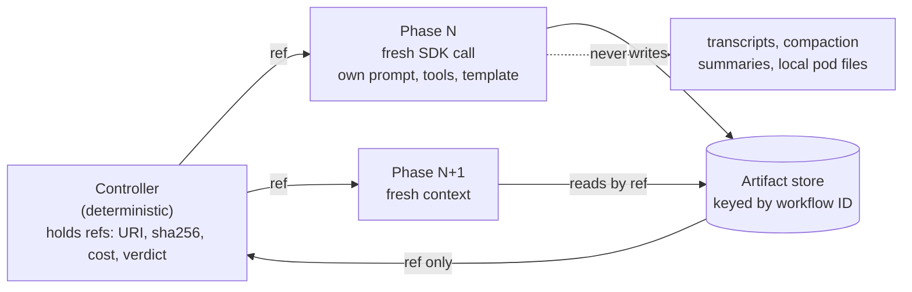

# Context Engineering and Memory

Reference note on context engineering for coding agents and long-running pipelines as of October 2026: the practice canon (Anthropic, Manus, LangChain, Chroma), repository instruction files and their governance, Agent Skills and plugins, codebase indexing, compaction and memory, harnesses for long-running agents, and what it all means per phase of a multi-phase pipeline.

## In one paragraph

Context engineering is curating the whole set of tokens an agent sees on every turn (system prompt, tools, MCP definitions, data, history), with the goal of finding ["the smallest possible set of high-signal tokens"](https://www.anthropic.com/engineering/effective-context-engineering-for-ai-agents). Five lessons from 2025-2026 hold up. First, a bigger window is not a fix: [Chroma's 18-model study](https://research.trychroma.com/context-rot) found focused prompts of about 300 tokens beat full prompts of about 113k on the same questions, and [a 10,664-trajectory study](https://arxiv.org/abs/2609.01660) found decay tracks step count more than context length. Second, instruction files are not a reliable quality lever on their own ([no general gain and over 20% higher inference cost in one rigorous study](https://arxiv.org/abs/2602.11988)), and optional context often never loads ([a skill went uninvoked in 56% of Vercel's eval cases](https://vercel.com/blog/agents-md-outperforms-skills-in-our-agent-evals)). Third, compaction is lossy and can corrupt the agent's sense of progress ([Claude Code 2.1.293 fixed the agent treating pre-compaction actions as done](https://code.claude.com/docs/en/changelog)), so the ledger of what is done belongs in deterministic code. Fourth, context is the bill: [Manus reports a 100:1 input-to-output ratio and a 10x price gap between cached and uncached input](https://manus.im/blog/Context-Engineering-for-AI-Agents-Lessons-from-Building-Manus). Fifth, scaffolding goes stale: [Anthropic removed over 80% of Claude Code's system prompt for its Claude 5-generation models with no measurable eval loss](https://claude.com/blog/the-new-rules-of-context-engineering-for-claude-5-generation-models). For a multi-phase pipeline this resolves into three rules: fresh context per phase, artifacts as memory, and small references across the boundary.

## 1. The practice canon

| Source | Date | Core claim | Number to remember |
|---|---|---|---|
| [Anthropic, Effective context engineering](https://www.anthropic.com/engineering/effective-context-engineering-for-ai-agents) | 2025-09-29 | Curate the whole token set; keep tools minimal; retrieve just in time through lightweight identifiers; for long horizons use compaction, structured note-taking and sub-agents | Sub-agents return "a condensed, distilled summary of its work (often 1,000-2,000 tokens)"; compaction keeps the summary "plus the five most recently accessed files" |
| [Manus, Lessons from building Manus](https://manus.im/blog/Context-Engineering-for-AI-Agents-Lessons-from-Building-Manus) | 2025-07-18 | "KV-cache hit rate is the single most important metric for a production-stage AI agent"; mask tool logits instead of removing tools; use the file system as unlimited, restorable context; recite goals by rewriting `todo.md`; keep errors in context | About 100:1 input to output; cached Claude Sonnet input $0.30 vs $3 per million tokens; about 50 tool calls per task; framework rebuilt four times; a timestamp at the start of the system prompt "kills your cache hit rate" |
| [LangChain, Context engineering](https://www.langchain.com/blog/context-engineering-for-agents) | 2025-07-02 | Four buckets: write, select, compress, isolate; the context window as RAM | No number; a compact taxonomy |
| [Chroma, Context Rot](https://research.trychroma.com/context-rot) | 2025-07 | Holding difficulty constant and varying only input length, performance drops non-uniformly | 18 LLMs; LongMemEval full input about 113k tokens vs focused about 300; even one distractor hurts; shuffled haystacks beat logically structured ones |
| [Cognition, Don't Build Multi-Agents](https://cognition.ai/blog/dont-build-multi-agents) | 2025-06-12 | "Share context, and share full agent traces, not just individual messages"; "Actions carry implicit decisions, and conflicting decisions carry bad results" | Parallel subagents in the Flappy Bird example built a mismatched background and bird |
| [Anthropic, Writing tools for agents](https://www.anthropic.com/engineering/writing-tools-for-agents) | 2025-09-11 | Tool design is context engineering: concise responses, pagination, actionable errors | Claude Code caps tool responses at 25,000 tokens by default; a detailed response of 206 tokens vs 72 concise |
| [Anthropic, Code execution with MCP](https://www.anthropic.com/engineering/code-execution-with-mcp) | 2025-11-04 | Present MCP tools as code on a filesystem; load definitions on demand; filter data in code before it reaches the model | Tool-definition tokens "from 150,000 tokens to 2,000 tokens - a time and cost saving of 98.7%" |
| [Anthropic, New rules for Claude 5 models](https://claude.com/blog/the-new-rules-of-context-engineering-for-claude-5-generation-models) | 2026-07-24 | Judgment over rules, interface design over examples, progressive disclosure over front-loading, auto-memory over hand-edited CLAUDE.md | "Removed over 80% of Claude Code's system prompt ... with no measurable loss"; some tools now load deferred through ToolSearch |
| [Debois, Context Is the New Code](https://ai.engineer/talks/bSG9wUYaHWU-context-is-new-code) | 2026-04 | A DevOps-style Context Development Lifecycle: Generate, Evaluate, Distribute, Observe | "We're in the cowboy coding era of context" |
| [ACE, Agentic Context Engineering](https://arxiv.org/abs/2510.04618) | 2025-10-06 | Treat context as an evolving playbook updated by small deltas; names two failure modes of repeated rewriting | "Brevity bias" and "context collapse, where iterative rewriting erodes details over time"; +10.6% on agents; ICLR 2026 |

## 2. The numbers sheet

### 2.1 Window sizes, thresholds and limits

| Item | Value | Source |
|---|---|---|
| Claude Code default context vs Codex default | 1M vs 400k tokens; 1 GPT token is about 1.7 Claude tokens | [Boolean](https://www.boolean.ai/blog/context-rot-quantified) (2026-09-15) |
| Anthropic's multi-agent research lead | Saves its plan to memory because context beyond 200,000 tokens is truncated | [Research system](https://www.anthropic.com/engineering/multi-agent-research-system) (2025-06-13) |
| OpenAI server-side compaction example | `compact_threshold: 200000` | [OpenAI guide](https://developers.openai.com/api/docs/guides/compaction) |
| LangChain Deep Agents | Tool results over 20,000 tokens offloaded to the filesystem with a file path and a 10-line preview; old write and edit arguments truncated past 85% of the window; summarization forced at 10-20% (or 25%) of the window in evals | [Deep Agents](https://www.langchain.com/blog/context-management-for-deepagents) (2026-01-28) |
| Pi coding agent | Retains a 20 thousand token budget of recent messages, "roughly 5 to 20 turns" | [Pi compaction](https://earendil.com/posts/compaction-in-pi/) (2026-08-13) |
| HumanLayer | Keep context utilization "in the 40-60% range" through frequent intentional compaction | [ACE-FCA](https://github.com/humanlayer/advanced-context-engineering-for-coding-agents/blob/main/ace-fca.md) (2025-09) |
| Claude Code auto memory and CLAUDE.md | Auto memory loads "first 200 lines or 25KB"; target under 200 lines per CLAUDE.md; `@path` imports recurse to four hops and "don't reduce its context cost" | [Memory docs](https://code.claude.com/docs/en/memory) (2026-10-08) |
| Codex project instructions | `project_doc_max_bytes` 32 KiB by default; files concatenated root-down | [Codex AGENTS.md](https://developers.openai.com/codex/guides/agents-md) |
| Bugbot rules | Each rule truncated at 30,000 characters, combined cap 100,000 | [Bugbot docs](https://cursor.com/docs/bugbot) |
| Agent Skills budget | Metadata about 100 tokens at startup; instructions under 5000 tokens recommended; keep `SKILL.md` under 500 lines; `name` max 64 chars, `description` max 1024 | [Specification](https://agentskills.io/specification) |
| MCP schema weight | A 40-tool GitHub MCP server "can add 10-15 KB of schema per turn" | [gh-aw token efficiency](https://github.blog/ai-and-ml/github-copilot/improving-token-efficiency-in-github-agentic-workflows/) |
| Vercel docs index | Compressed from about 40KB to 8KB while keeping a 100% pass rate | [Vercel](https://vercel.com/blog/agents-md-outperforms-skills-in-our-agent-evals) |
| Token multipliers | Agents about 4x the tokens of chat, multi-agent about 15x; token usage "explains 80% of the variance" on BrowseComp | [Research system](https://www.anthropic.com/engineering/multi-agent-research-system) |

### 2.2 Measured degradation

| Study | Setup | Result |
|---|---|---|
| [Chroma](https://research.trychroma.com/context-rot) | 18 LLMs, input length varied alone | Focused about 300-token prompts beat about 113k-token prompts on LongMemEval for all models |
| [Boolean](https://www.boolean.ai/blog/context-rot-quantified) (small sample) | 20 terminal-bench v4 tasks, prefill 0k, 250k, 500k tokens | GPT-5.6 Sol 31% to 24% at 250k unrelated context; Claude Opus 5 flat on unrelated context but 50% to 40% with related context |
| [How Fast Do Agents Rot?](https://arxiv.org/abs/2609.01660) | 10,664 trajectories, nine models, five horizons, three context regimes | On the agentic task every model fell "from near-perfect success to near zero within sixteen steps"; bounding the context window made decay steeper (logit slope -0.69 vs -0.44); projected reliability 0.42 at GAIA-length horizons vs 0.24 at hundred-step production horizons |
| [Manus Wide Research](https://manus.im/blog/manus-wide-research-solve-context-problem) | Sequential multi-item research | Items 1-5 genuine, 6-8 subtly degrade, 9 and later "fabrication mode"; the fix is parallel sub-agents each with a fresh, empty context window that never talk to each other |
| [MCR-Bench](https://arxiv.org/abs/2608.27442) | 2,269 multi-round review tasks | Review quality degrades as rounds increase |
| [Anthropic compaction docs](https://platform.claude.com/docs/en/build-with-claude/compaction) | Vendor statement | "Response quality degrades as a conversation grows" |

Two readings. The dangerous context is the related, plausible kind (earlier phase artifacts, similar files), not noise. And step count matters more than window size: the argument for a deterministic controller that keeps every agent call short-horizon (one phase per SDK call) instead of one long autonomous loop. Capping context made decay worse in that study, so shortening the horizon is not the same as shrinking the window.

## 3. Repository instruction files

### 3.1 How each tool loads them

| Tool | Behavior |
|---|---|
| Claude Code, CLAUDE.md | Scoped files, path-scoped `.claude/rules`, imports, auto memory; memory is "context, not enforced configuration" and a `PreToolUse` hook is the way to block an action ([docs](https://code.claude.com/docs/en/memory)) |
| Claude Code, AGENTS.md | Added in 2.1.277 (2026-09-18) for projects with no CLAUDE.md; widened on 2026-09-23 in 2.1.281 to Bedrock, Vertex AI, Foundry, LLM gateways and telemetry-off sessions; direct reading needs v2.1.277 or later ([changelog](https://code.claude.com/docs/en/changelog)) |
| Claude Agent SDK | "When you omit `settingSources`, `query()` reads the same filesystem settings as the Claude Code CLI"; pass `settingSources: []` for programmatic configuration only; managed policy and global `~/.claude.json` are read regardless ([docs](https://code.claude.com/docs/en/agent-sdk/claude-code-features)) |
| OpenAI Codex | Global `~/.codex/AGENTS.md`, project files concatenated from the root down so closer files override, an override file, 32 KiB cap ([docs](https://developers.openai.com/codex/guides/agents-md)) |
| Cursor Bugbot | Rules merged in order: Team Rules, `.cursor/BUGBOT.md` (nested too), learned rules, manual rules; learned rules come from team activity and `@cursor remember [fact]` ([docs](https://cursor.com/docs/bugbot)) |
| GitHub Copilot cloud agent | Instruction and MCP configuration files are privileged; GitHub tells enterprises to protect them with CODEOWNERS ([guardrails](https://docs.github.com/en/copilot/tutorials/cloud-agent/build-guardrails)) |

Loading rules are tool-specific, so do not assume portability. The AGENTS.md open format is "plain Markdown", with no required fields, nested files allowed and "the closest AGENTS.md to the edited file wins; explicit user chat prompts override everything", with 60k+ examples on GitHub ([agents.md](https://agents.md)).

### 3.2 Governance

The Linux Foundation formed the Agentic AI Foundation (AAIF) on 2025-12-09 with three founding projects, Anthropic's MCP, Block's goose and OpenAI's AGENTS.md; platinum members include AWS, Anthropic, Block, Bloomberg, Cloudflare, Google, Microsoft and OpenAI, and the release cites more than 10,000 published MCP servers ([press release](https://www.linuxfoundation.org/press/linux-foundation-announces-the-formation-of-the-agentic-ai-foundation)). Agent Skills is an open standard "originally developed by Anthropic" and published 2025-12-18; no evidence was found that it moved under AAIF, so treat it as not moved ([spec](https://agentskills.io/specification)).

### 3.3 Do instruction files help? The evidence

| Study | Result |
|---|---|
| [Evaluating AGENTS.md](https://arxiv.org/abs/2602.11988) (2026-02-12) | On SWE-bench tasks and on new issues from repos with developer-committed files, context files do not generally improve success and raise inference cost by over 20% on average; "repository overviews, although popular and recommended by model providers, are not helpful"; they help for "specifying non-standard coding practices" |
| [Two-agent ablation](https://arxiv.org/abs/2607.27250) (2026-07-28) | Claude Code and Codex on 17 tasks from 3 repositories, 288 runs: context strategy did not measurably change correctness (effect bounded to 10-15 points); failures came from "feature design, pattern selection, exact wiring" |
| [Augment](https://www.augmentcode.com/blog/how-to-write-good-agents-dot-md-files) (2026-04-22, vendor) | Best 100-150 line files plus a few reference docs gave a 10-15% improvement; a six-step workflow cut PRs missing wiring files from 40% to 10% (correctness +25%); 30+ "don't" rules on a simple CRUD task made it twice as long and 20% less complete. Discovery: AGENTS.md 100%, referenced files over 90%, directory README 80%+, nested READMEs about 40%, orphan docs under 10% |
| [Vercel](https://vercel.com/blog/agents-md-outperforms-skills-in-our-agent-evals) (2026-01-27, vendor) | On Next.js 16 APIs absent from training data: baseline 53%, skill by default 53% (never invoked in 56% of cases), skill with explicit instructions 79%, an 8KB docs index in AGENTS.md 100% |
| [Tessl](https://tessl.io/blog/your-agentsmd-file-isnt-the-problem-your-lack-of-evals-is/) (2026-02-24, vendor) | Summarizes the ETH study as developer-written files +4% and LLM-generated files -3%, both costing over 20% more; argues "unvalidated context is useless, and often harmful" and files need evals like code needs tests |

The variance is in the content, not the file: a good file is a model-upgrade-sized gain, a bad one is worse than none, and a file is a contract that needs an eval ("every prompt is a contract, so test it"). Augment's advice for phase prompts: numbered workflows, decision tables, short real examples, and each "don't" paired with a "do". Context files do not fix wiring mistakes; those need gates.

### 3.4 Context can fail to load, silently

Claude Code 2.1.277's AGENTS.md loader was a built-in plugin behind a remote flag with a fallback of false, so sessions with telemetry or nonessential traffic disabled, and on Bedrock, Vertex and gateways, never read the file, with no warning, until 2.1.281 ([independent investigation](https://blog.szypowi.cz/p/claude-code-reads-agents.md-only-when-telemetry-is-on/), 2026-09-23). The author proved it with a canary word in the file; the workaround was a one-line `CLAUDE.md` containing `@AGENTS.md`. Anthropic's own April postmortem found a context-management optimization that cleared prior thinking on every turn and "made it past multiple human and automated code reviews, as well as unit tests, end-to-end tests, automated verification, and dogfooding" ([postmortem](https://www.anthropic.com/engineering/april-23-postmortem)). The cheap test: put a canary word in the instruction file and ask for it. Before you blame the model, prove the context reached it.

### 3.6 Instruction files are an attack surface

Instructions that steer the agent are privileged configuration. An October 2026 preprint shows prompts injected into community-shared rule files can steer coding agents to swap legitimate dependencies for attacker-controlled packages, with high transfer across models ([paper](https://arxiv.org/abs/2610.09264)); a bot tried to hijack an AI reviewer by replacing `CLAUDE.md` ([StepSecurity](https://www.stepsecurity.io/blog/hackerbot-claw-github-actions-exploitation)); `claude-code-action` now restores `CLAUDE.md`, `.claude/` and `.mcp.json` from the base branch on PRs ([docs](https://github.com/anthropics/claude-code-action)); and Anthropic's skills guidance warns about untrusted skills. Review context files like code, pin skill sources ([Anthropic's advice](https://www.anthropic.com/engineering/equipping-agents-for-the-real-world-with-agent-skills): install skills only from trusted sources), and defer detail to the neighbouring talk on guardrails ([AI Code Review and Quality Gates](ai-code-review-and-quality-gates.md) covers the CI side). Keep CLAUDE.md concise in CI too: it is read on every run ([GitHub Actions docs](https://code.claude.com/docs/en/github-actions)).

## 4. Agent Skills and plugins

- **Format.** A skill is a folder with a `SKILL.md` (YAML frontmatter plus Markdown) and optional `scripts/`, `references/` and `assets/`; only each skill's name and description enter the system prompt at startup, the body loads when relevant and bundled files load on demand, so bundled context is "effectively unbounded" ([Anthropic](https://www.anthropic.com/engineering/equipping-agents-for-the-real-world-with-agent-skills), 2025-10-16; [spec](https://agentskills.io/specification) with a `skills-ref` validator, 2026-08-04). Bundled scripts let deterministic code do what tokens do badly. Anthropic published it as an open standard on 2025-12-18.
- **Curated, focused skills help.** SkillsBench paired 87 tasks in 8 domains with deterministic verifiers across 18 model-harness configurations: curated skills lifted the average pass rate from 33.9% to 50.5% (+16.6 points), configuration-level gains ran from +4.1 to +25.7 points, "focused skills with at most three modules outperform larger or exhaustive bundles", and small models with skills can match larger ones without ([SkillsBench](https://arxiv.org/abs/2602.12670), 2026-02-13).
- **But optional means maybe.** Vercel's skill was never invoked in 56% of eval cases and added nothing by default, while an always-loaded 8KB index reached 100% ([Vercel](https://vercel.com/blog/agents-md-outperforms-skills-in-our-agent-evals)). "The skill existed, the agent could use it, and the agent chose not to." If a phase always needs an instruction, load it as the phase prompt, not as an optional skill.
- **Progressive disclosure now covers tools.** LangChain's Deep Agents bind tools to skills (`metadata.include_tools`), pin skills at runtime and reload them mid-thread; a tool called before its skill is read "fails as an unknown tool"; their GTM agent has more than 50 skills and "enterprise skill registries grow to thousands" ([Revamping Skills](https://www.langchain.com/blog/revamping-skills-in-deep-agents), 2026-10-07). Newer Anthropic and OpenAI models accept tools mid-conversation without breaking the cached prefix.
- **Plugins and registries.** In Claude Code, plugins sit alongside CLAUDE.md, auto memory, `.claude/rules`, skills and auto-compaction ([changelog](https://code.claude.com/docs/en/changelog)); [Statewright](https://github.com/statewright/statewright) is a plugin for Claude Code, Codex, Cursor, opencode and Pi that enforces per-phase tool allowlists. Tessl markets a skills registry, and Debois's lifecycle (Generate, Evaluate, Distribute, Observe) treats rules, skills and memory like code with a release process ([talk](https://ai.engineer/talks/bSG9wUYaHWU-context-is-new-code)). Skills are also a supply-chain surface (section 3.6).

## 5. Codebase indexing, search and knowledge graphs

| Approach | Evidence | Numbers |
|---|---|---|
| Embedding index alongside grep | Cursor trained an embedding model on agent traces and keeps the index in sync ([post](https://cursor.com/blog/semsearch), 2025-11-06, vendor) | 12.5% higher question-answering accuracy on average (6.5%-23.5% by model); code retention +0.3%, +2.6% on repos with 1,000+ files; 2.2% more dissatisfied follow-ups without it |
| Vector index vs deep agentic search | A planner delegating grep exploration to an isolated sub-agent ([study](https://arxiv.org/abs/2608.01507), 2026-08-02) | Semantic search 65.2% correct vs 46.2% on SWE-QA, at under half the cost; 41.8% of the agentic failures happened at the planner-to-sub-agent hand-off, mostly fluent wrong answers |
| Tree-sitter knowledge graph over MCP | Codebase-Memory, 66 languages, 31 repositories ([paper](https://arxiv.org/abs/2603.27277), 2026-03) | 83% answer quality vs 92% for a file-exploring agent, with "ten times fewer tokens and 2.1 times fewer tool calls"; matches or beats the explorer on 19 of 31 languages for graph-native queries |
| Just-in-time grep and glob | Anthropic describes Claude Code as loading CLAUDE.md up front and using glob and grep just in time, avoiding stale indexes ([Anthropic](https://www.anthropic.com/engineering/effective-context-engineering-for-ai-agents)) | A design stance, not a measurement |
| Memory with hybrid retrieval | Elastic's agent memory layer ([post](https://www.elastic.co/search-labs/blog/agent-memory-elasticsearch), 2026-06-16) | R@10 averages 0.89 over 168 questions with zero cross-tenant leaks; contradicted facts superseded, not deleted |

## 6. Long-running memory and compaction

### 6.1 Mechanisms and what they expose

| Mechanism | What it does | Details |
|---|---|---|
| [Context editing](https://platform.claude.com/docs/en/build-with-claude/context-editing) (Claude API) | Rule-based server-side clearing of old tool results or thinking blocks | Beta header `context-management-2025-06-27`; strategies `clear_tool_uses_20250919` and `clear_thinking_20251015`; parameters `trigger`, `keep`, `clear_at_least`, `exclude_tools`, `clear_tool_inputs`; cleared results become placeholder text. [Launch](https://www.anthropic.com/news/context-management) numbers: memory tool plus editing +39% on agentic search, editing alone +29%, tokens down 84% in a 100-turn eval |
| [Compaction](https://platform.claude.com/docs/en/build-with-claude/compaction) (Claude API) | A summary Claude writes replaces older turns: on demand, at a token threshold, or with your own summarizer | Beta header `compact-2026-09-04` with a top-level `compaction` parameter; "Use on-demand compaction wherever it is available"; on Claude Fable 5.1, Opus 5.5, Sonnet 5.5 and Haiku 5.5, threshold compaction requires removing thinking from re-inserted turns |
| [Memory tool](https://platform.claude.com/docs/en/agents-and-tools/tool-use/memory-tool) | Client-side: Claude asks for file operations under `/memories` and your application performs them | Tool type `memory_20250818`; `view`, `str_replace`; handlers "must reject paths outside /memories"; the application owns the side effect |
| [OpenAI compaction](https://developers.openai.com/api/docs/guides/compaction) | At `compact_threshold` the server emits an encrypted compaction item and prunes context | The item "is opaque and not intended to be human-interpretable"; works with `store=false`; with `previous_response_id` chaining "do not manually prune" |
| [Pi](https://earendil.com/posts/compaction-in-pi/) | A separate summarization request with its own prompt and a structured template (goal, progress, key decisions); can use a different model | Stored as plain text in the session, readable and portable across models |
| [Deep Agents](https://www.langchain.com/blog/context-management-for-deepagents) | Offload large tool results, truncate old edits, then summarize and write the original messages to the filesystem | Tested with forced-summarization evals |
| [Kiro Crew 0.7.0](https://kiro.dev/changelog/crew/0-7/) (2026-09-24) | Optional append-only session ledger that survives compaction (`KIROCREW_CREW_LOG=1`) | Durable queue so a Gateway restart restores queued work |
| Claude Code subagents | `autoCompactWindow` in subagent frontmatter (2.1.296, 2026-10-09) | Per-subagent windows |

For an observability-first pipeline, readable compaction (or your own phase-boundary artifacts) is the auditable choice: with an opaque compaction item you cannot see what the agent forgot.

### 6.2 Compaction is lossy, and sometimes wrong about progress

- Claude Code 2.1.293 (2026-10-07) fixed "Claude sometimes treating its own last actions before a context compaction as done after it, and retracting or redoing finished work"; 2.1.47 (2026-02-18) fixed a plan "lost after context compaction, causing the model to switch from planning to implementation mode" ([changelog](https://code.claude.com/docs/en/changelog), [Claude Code changelog on GitHub](https://github.com/anthropics/claude-code/blob/main/CHANGELOG.md)).
- Anthropic's Managed Agents post treats compaction as an irreversible choice about what to keep. Its AI Engineer Europe workshop abstract says "context compaction doesn't cure coherence drift but structured handoffs do" ([workshop](https://ai.engineer/europe/2026/llms-full.txt), 2026-04-08).
- Rewriting context wholesale erodes it: ACE names brevity bias and context collapse and updates in small deltas instead.
- Test it. LangChain forces summarization mid-task and checks that the objective survives and a planted fact can be recovered ([Deep Agents](https://www.langchain.com/blog/context-management-for-deepagents)).

### 6.3 The harness can hurt you

Anthropic's April 2026 postmortem traced reported Claude Code degradation to three harness-side changes that each reached a different traffic slice, so together they looked like random degradation: a default effort change from high to medium on March 4 (reverted April 7); an idle-session optimization on March 26 that used `clear_thinking_20251015` with `keep:1` and so cleared thinking every turn (fixed April 10 in v2.1.101); and a system prompt line capping text between tool calls at 25 words, added April 16, which cost 3% on evals for Opus 4.6 and 4.7 and was reverted April 20 in v2.1.116 ([postmortem](https://www.anthropic.com/engineering/april-23-postmortem)). The cache misses showed up as drained usage limits, so a context bug became a cost bug. Anthropic added guidance to its own CLAUDE.md so model-specific changes are gated to the targeted model.

### 6.4 Memory for unattended agents

- **Two stores, two owners, fail closed.** Anthropic's reference for scheduled agents keeps preferences in a read-only store and state (bookmarks, ledger, notes, run records) in a read-write store under `/mnt/memory/`, starts every run in a fresh sandbox, and warns "If it can't read the file, it should stop and say so instead of running on defaults." The stale-memory failure ("reports an item as still waiting after it was resolved") costs trust: "One stale still waiting on you costs more trust than ten missing items" ([Building effective agent automations](https://claude.dev/blog/building-effective-agent-automations/), 2026-10-08).
- **Plain files beat pipelines.** "Memory should be a data format, not a multi-stage pipeline": Markdown pages with optional YAML frontmatter and an optional SQLite vector index ([Paterson](https://calpaterson.com/memoryfields.html), 2026-08-31).
- **Skip heavy memory layers for an artifact pipeline.** [Letta](https://github.com/letta-ai/letta), [Mem0](https://github.com/mem0ai/mem0) and [Graphiti](https://github.com/getzep/graphiti) fit personalization and time-aware entity memory, not a pipeline that already has durable state and phase artifacts.

## 7. Harnesses for long-running agents

| Harness | What it is | Memory mechanism and numbers |
|---|---|---|
| [Initializer plus coding agent](https://www.anthropic.com/engineering/effective-harnesses-for-long-running-agents) (Anthropic, 2025-11-26) | An initializer writes `init.sh`, a progress file and an initial git commit; coding sessions each do one feature and leave a clean state | A JSON feature list of "over 200 features", all initially failing, because "the model is less likely to inappropriately change or overwrite JSON files compared to Markdown files"; compaction "isn't sufficient"; failure mode: "a later agent instance would look around, see that progress had been made, and declare the job done" |
| [Planner, generator, evaluator](https://www.anthropic.com/engineering/harness-design-long-running-apps) (Anthropic, 2026-03-24) | GAN-style harness with "sprint contracts" and an evaluator driving the running app through Playwright MCP | Solo 20 min and $9 vs full harness 6 hr and $200; a later DAW build 3 hr 50 min and $124.70 (planner 4.7 min, $0.46); "Out of the box, Claude is a poor QA agent" and the evaluator would "talk itself into deciding they weren't a big deal"; "every component in a harness encodes an assumption about what the model can't do on its own" |
| [Managed Agents](https://www.anthropic.com/engineering/managed-agents) (Anthropic, 2026-04-08, beta) | Session (append-only event log), harness (stateless loop), sandbox (`execute(name, input) -> string`); `wake(sessionId)` rebuilds a crashed harness from the log | "The session is not Claude's context window"; time-to-first-token p50 down about 60% and p95 over 90% after decoupling; credentials never enter the sandbox; the team had "adopted a pet" before |
| [Long-horizon Codex run](https://developers.openai.com/blog/run-long-horizon-tasks-with-codex) (OpenAI) | A design tool built from a blank repo | About 25 hours, 13 million tokens, 30 thousand lines; "The most important technique was durable project memory", a `Plans.md` with milestones, acceptance criteria and validation commands, verified at every milestone |
| [Parallel Claudes building a C compiler](https://www.anthropic.com/engineering/building-c-compiler) (Anthropic, 2026-02-05) | 16 agents in a bash loop coordinating through git and lock files, no orchestrator agent | Nearly 2,000 sessions, just under $20,000, 2 billion input and 140 million output tokens; "the task verifier is nearly perfect, otherwise Claude will solve the wrong problem" |
| [Multi-agent research system](https://www.anthropic.com/engineering/multi-agent-research-system) (Anthropic, 2025-06-13) | Orchestrator-worker; subagents with separate windows compress findings | Opus 4 lead with Sonnet 4 subagents beat single-agent Opus 4 by 90.2% on an internal eval at about 15x chat tokens; rainbow deployments because "agents might be anywhere in their process"; subagent output to a filesystem "to minimize the game of telephone" |
| [The Orchestrator's Tax](https://martinfowler.com/articles/orchestrator-tax.html) (Thoughtworks, 2026-07-16) | Incident analysis of a Claude Code session with four subagents | A "check on the agents" prompt pulled "tens of thousands of tokens of JSONL" into the main thread; "Tokens are spent once. Context shapes every decision that follows." One subagent ran `git stash` while siblings were writing in the same tree |

Common lessons: the durable record lives outside the model's window (session log, progress file plus git, plans file); state the agent must not corrupt is typed JSON; every long run needs a separate skeptical evaluator or an executable verifier; subagents exist to protect the orchestrator's working memory; and harness parts encode assumptions that go stale. Lilian Weng's survey adds a rule: "The evaluator and permission control should likely sit outside the loop that evolves harness" ([Harness Engineering for Self-Improvement](https://lilianweng.github.io/posts/2026-07-04-harness/)).

## 8. What this means per phase in a multi-phase pipeline

### 8.1 Two rules

1. **Artifacts as memory.** Phase artifacts live in shared durable storage keyed by workflow ID, so they survive pod death and every replica sees the same state. The same idea appears as Managed Agents' session log, Codex's `Plans.md` and Anthropic's progress file. Unlike an opaque compaction item, an artifact can be read, diffed and replayed, and it is where a durable workflow's replay sees the same input.
2. **Small references across the boundary.** Only an artifact URI, a sha256, cost and a verdict cross the controller boundary. Anthropic's sub-agents return 1,000-2,000 tokens, the Orchestrator's Tax is what happens when transcripts flow into the orchestrator instead, and MCP's 2026-07-28 guidance for cross-call state is to "mint an explicit handle from a tool and have the model pass it back as an argument" ([MCP blog](https://blog.modelcontextprotocol.io/posts/2026-07-28/)).

### 8.2 Phase by phase

| Phase | Context it should get | Artifact it leaves | Context risk to guard |
|---|---|---|---|
| Intake | PRD and design bundle, by reference | Intake artifact | Long design input; a conflict punted as an "open question" instead of decided |
| Investigation | Intake artifact and the repository | Investigation artifact | Repo exploration floods the window: return a condensed result (Anthropic's 1,000-2,000 token norm), not the transcript |
| Plan | Intake and investigation artifacts | Plan | The plan is the highest-leverage context for every later phase; a fresh-context critic checks it |
| Edit | The plan | Code on a branch | Tool-result bloat and missing tools |
| Tests, QA, Review, Fix-review | The plan and the diff, not the editor's narrative | Test, QA and review artifacts | Same-family blind spots; QA that silently lacks its Playwright tools; a fix-review that says "nothing to fix" |
| Fan-out work | A shared contract and source inputs | One artifact per child | Fan-out children guessing different schemas; solved by a shared contract and a deterministic merge |
| PR opener | Verified facts | PR text | Narrative drift: a PR description listing files that are not on the branch |
| CI green | Live CI state, never memory | Verdict | The loop counter and "what is done" must come from durable state and the live system |

### 8.3 Context failures, and the research behind each

| Context lesson | Research |
|---|---|
| Context and inputs must live on shared durable storage, never local pod disk | The SDK reads whatever CLAUDE.md, skills and settings are on the pod unless `settingSources` is pinned ([docs](https://code.claude.com/docs/en/agent-sdk/claude-code-features)); Mendral keeps memories and skills in Postgres behind a virtualized read/write tool, last-writer-wins per key ([post](https://mendral.com/blog/agent-harness-belongs-outside-sandbox)) |
| The SDK injects its whole context into every call; small calls are not small | Manus: input dominates cost at about 100:1 and caching is a 10x lever; Claude Code's Actions docs note Claude reads CLAUDE.md on every run |
| An allowlist is context; preflight that required tools exist | Vercel's skill never invoked in 56% of cases; GitHub's tool-instruction regression |
| The rule pile accrues cost and goes stale | Anthropic's 80% prompt cut; `/doctor`; ACE's context collapse |
| Parallel agents make conflicting implicit decisions without a shared contract | Cognition's Flappy Bird example |
| A fallback that launders prose into state poisons every downstream phase | Anthropic's rule: if memory cannot be read, "stop and say so instead of running on defaults" |
| Model memory must not own "what's done" | Claude Code 2.1.293 compaction fix |

### 8.4 What the research says to try next

1. **Run the canary test** in each phase's context (a nonsense word in the prompt files and the artifact templates) as a deploy check; on Bedrock, Vertex AI and gateways, Claude Code's AGENTS.md loading silently failed until 2.1.281.
2. **Log what each phase actually received**: token counts by section (system, tools, instructions, artifacts, history) per call, in the traces. Anthropic suggests tracking tool-call counts, token consumption and tool errors as eval metrics ([Writing tools for agents](https://www.anthropic.com/engineering/writing-tools-for-agents)).
3. **Eval the prompts and instruction files**, not only the code: Tessl's "evals like code gets tests", Augment's measured 25% gain versus 30% loss from the same kind of file.
4. **Keep prompts cache-friendly**: stable prefixes, no timestamps at the head, append-only context (Manus), and shape tool output before it reaches the model (CI logs capped like Claude Code's 25,000 token tool limit).
5. **Prefer forced loading to optional skills** for phase-critical instructions; use skills for rarely needed know-how.
6. **Re-audit the rule pile on every model upgrade**.
7. **If compaction is ever used inside a long phase**, persist the summary as an artifact and prefer on-demand compaction at phase boundaries over opaque threshold compaction.

## 9. Gaps and caveats

- Whether Agent Skills governance moved to the Agentic AI Foundation could not be confirmed; agentskills.io says only "originally developed by Anthropic, released as an open standard".
- OpenAI's "Harness engineering" post returned 403; only a related talk was confirmed by title. The Anthropic workshop recording on agents that run for hours was not verified (schedule abstract only).
- No launch date or independent evaluation was found for Claude Code auto memory; only the current docs and the July 2026 post. The publication date of OpenAI's long-horizon Codex post is not shown (it is after December 2025).
- Codebase knowledge-graph evidence is mostly preprints and vendor claims; a "62% fewer tokens" figure for one tool appeared only in an unverifiable secondary write-up and is excluded.
- Several vendor numbers here are self-reported (Manus Cascade: "In one tested configuration, Cascade used 23.2% fewer tokens, finished tasks in 28.2% less time, and cost 32% less", [Manus 2.0](https://manus.im/blog/introducing-manus-2-0), 2026-09-28; Augment; Vercel; Cursor). The Boolean context-rot study is small (20 tasks).

## Related

- [Spec-Driven Development](spec-driven-development.md)
- [AI Code Review and Quality Gates](ai-code-review-and-quality-gates.md)
- [Agent Failure Modes](agent-failure-modes.md)
- [Observability for Agent Workflows](observability-for-agent-workflows.md)
- [Cost Economics](cost-economics.md)
- [Evals for Agentic Pipelines](evals-for-agentic-pipelines.md)
- [Human in the Loop](human-in-the-loop.md)
- [Autonomous Coding Agents](autonomous-coding-agents.md)
- [Coding Agent Orchestration and Sandboxes](coding-agent-orchestration-and-sandboxes.md)
