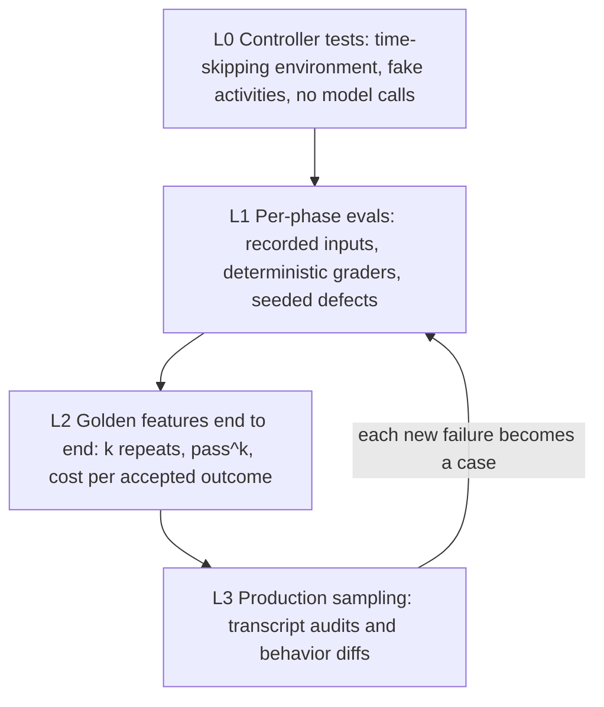

# Evals for Agentic Pipelines

## In one paragraph

> **How to read this note**
> "(vendor)" marks a number a vendor produced about its own product. Hosted price lists were not collected, so prices are quoted only where a source gives them and are otherwise marked "not captured". Several 2026 items are single-author preprints or practitioner blogs; they are flagged. Freshness: as of 2026-10-12.

## Numbers worth keeping in your head

| Number | What it is | Source |
|---|---|---|
| 20-50 tasks | "A great start" for an agent eval when drawn from real failures | [Anthropic](https://www.anthropic.com/engineering/demystifying-evals-for-ai-agents) |
| 75% per trial, 42% over 3 | pass^k arithmetic: 0.75 to the third power is about 42% | [Anthropic](https://www.anthropic.com/engineering/demystifying-evals-for-ai-agents) |
| pass^8 under 25% | gpt-4o in the retail domain of tau-bench, where pass^k was introduced | [tau-bench](https://arxiv.org/abs/2406.12045) |
| 6 pp and up to 6% | Terminal-Bench 2.0 score swing from container resource enforcement alone, and tasks failing from pod errors | [Anthropic](https://www.anthropic.com/engineering/infrastructure-noise) |
| 42% to 95% | Opus 4.5 on CORE-Bench before and after grading bugs were fixed | [Anthropic](https://www.anthropic.com/engineering/demystifying-evals-for-ai-agents) |
| 3% | Drop that a broad eval ablation found for a one-line Claude Code system-prompt change that had passed weeks of internal evals | [Anthropic postmortem](https://www.anthropic.com/engineering/april-23-postmortem) |
| 87.2% recall | Best automated error-analysis system on 100 labeled traces (Braintrust Loop); all systems missed context failures | [Parlance Labs](https://parlance-labs.com/blog/posts/auto-evals/index.html) |
| 56% | Eval cases in which an available docs skill was never invoked (vendor) | [Vercel](https://vercel.com/blog/agents-md-outperforms-skills-in-our-agent-evals) |
| 60-80% | Share of development time Hamel Husain and Shreya Shankar report spending on error analysis and evaluation | [Evals FAQ](https://hamel.dev/blog/posts/evals-faq/) |
| 100+ | Labeled examples an LLM-as-judge evaluator needs, plus weekly maintenance | [Evals FAQ](https://hamel.dev/blog/posts/evals-faq/) |
| $1.05 to $18.34 | Cost per task across coding-agent harnesses on the same tasks, for pass rates of 60-67% | [FrontierHarness](https://frontierharness.org/) |
| 2026-10-31 and 2026-11-30 | OpenAI's hosted Evals become read-only, then shut down | [OpenAI deprecations](https://developers.openai.com/api/docs/deprecations) |

## 1. What to grade

**Outcome vs path.** The sources disagree in a useful way:

- Anthropic: "it's often better to grade what the agent produced, not the path it took", and exact tool-call sequences are brittle.
- Google's [ADK evaluation](https://adk.dev/evaluate/) defaults the other way: `tool_trajectory_avg_score` is an exact match of the tool-call trajectory with a default of 1.0, `response_match_score` is ROUGE-1 with a default of 0.8, and further criteria cover rubric-based tool use, multi-turn trajectories, hallucinations and multi-turn task success.
- Braintrust and Basis argue long-horizon agents need process supervision, with [behavior specs](https://www.braintrust.dev/blog/behavior-specs) (2026-07-29, open standard at agentbehavior.dev) that describe expected behavior per situation as Intent, Evidence, Decision, Execution and Recovery. Their line: "It is not a prompt and it is never shown to the agent." They argue outcome evals on hours-long runs are expensive and do not locate the bad decision.
- Langfuse's [deployment-gate case study](https://langfuse.com/blog/2026-07-15-llm-certification-financial-services) (2026-07-15) shows the middle: a 150-item FinanceBench run scored 81.3% against an 85% numerical-accuracy gate and failed, and "An agent that guesses the right ratio without computing it gets the answer marked correct and the trajectory marked wrong, and the trajectory fails it."

Working rule: grade the outcome by default; check the trajectory only for the few places where the path is the requirement (a required tool was called, a forbidden action did not happen, a step or cost budget held). The Vercel result below is the best reason: if an agent can skip a tool and still produce a plausible answer, only a path assertion sees it.

**Three scopes, one table.** DeepEval's [agent guide](https://deepeval.com/guides/guides-ai-agent-evaluation) names the scopes; OpenAI's [trace grading](https://developers.openai.com/api/docs/guides/trace-grading) page recommends starting with trace grading (structured scores or labels on an end-to-end trace of model calls, tool calls, guardrails and handoffs) while debugging, then moving to datasets and eval runs for repeatability.

| Scope | What you check | Example checks | Tools |
|---|---|---|---|
| End-to-end (black box) | Final state or output | Reservation row exists; PR is mergeable; CI is green | Code graders in any framework; [Inspect](https://inspect.aisi.org.uk/), [Harbor](https://www.harborframework.com/) verifiers |
| Trajectory | Tools, order, step count | A `pytest*` command ran at least once; the browser tool was used; no more than N commits | [promptfoo](https://www.promptfoo.dev/docs/guides/evaluate-coding-agents/), [agentevals](https://docs.langchain.com/langsmith/trajectory-evals), DeepEval `ToolCorrectnessMetric`, `StepEfficiencyMetric` |
| Component (step-wise) | One phase or one decision | Tool choice, argument extraction, plan adherence | DeepEval `PlanQualityMetric`, `PlanAdherenceMetric`, `ArgumentCorrectnessMetric`, `TaskCompletionMetric` |

## 3. Metrics: pass@k, pass^k, noise and what evals cost

**Judged evals need a noise floor.** [digline](https://digline.dev/blog/my-llm-eval-cried-wolf/) (2026-09-09) had a 21-case LLM-judged suite flag a regression that vanished on rerun: one case went 5/5 to 2/5 and back to 5/5 fifteen minutes later with identical prompt and config. The fix: sample each case K=5 times at approval and store a per-check min and max, so only drops outside the band count; "A flip through the threshold is never within noise" and "A gate that cries wolf gets muted." Anthropic's hillclimb similarly checks that eval noise is smaller than the smallest improvement you would act on.

**Graders and datasets have bugs and versions.** Opus 4.5 scored 42% on CORE-Bench until grading bugs were fixed, then 95%, and Anthropic says a 0% pass@100 usually means a broken task ([guide](https://www.anthropic.com/engineering/demystifying-evals-for-ai-agents)). Pin dataset and grader versions in regression gates: Langfuse's action takes a `dataset_version`.

**What evals cost.**

- *Per task, by harness.* [FrontierHarness](https://frontierharness.org/) (v1.0, 2026-09) ran the same terminal tasks from a golden checkpoint: Codex 66.7% pass at $3.47 per task, Claude Code 63.3% at $18.34, Pi 60.0% at $2.43, with Exo Harness the lowest listed at $1.0452. It warns "Cache hit rate is not cost. A cached 300-turn failure can still burn more than a short cache miss." The page text did not name the single model used across harnesses, so treat the comparison as indicative.
- *At the extreme.* Anthropic's compiler build used [16 agents, nearly 2,000 sessions and $20,000](https://www.anthropic.com/engineering/building-c-compiler) with most effort in the verifier.
- *Spend dashboards.* Braintrust's [coding agent insights](https://www.braintrust.dev/blog/coding-agent-insights) (public preview, 2026-10-07; self-hosted from dataplane 2.13) trace Claude Code, Codex, OpenCode and others to find cost drivers and recurring corrections. Its own caveats: costs come from traced model calls and may differ from your provider's bill, and "A lower weekly total could mean your team did less work." Measure cost per completed task, not weekly spend.
- *Replays are cheaper than reruns.* Harbor's `backfill_job` syncs a finished job "without paying for the agent and verifier a second time" ([Braintrust on Harbor](https://www.braintrust.dev/blog/harbor-agent-evals)).

## 4. Evals in CI, regression suites and the platform risk

**CI is not production monitoring.** The [Evals FAQ](https://hamel.dev/blog/posts/evals-faq/): keep CI sets small and curated (regressions for past bugs, known edge cases) with deterministic assertions; run reference-free LLM judges on sampled production traffic; feed new production failures back into the CI set. Airbnb's [layered approach](https://airbnb.tech/ai-ml/eval-driven-development-lessons-from-evaluating-genai-at-scale/) (undated page; Airbnb Engineering) is programmatic checks first, calibrated LLM judges second and human review for ground truth, golden sets of 50-100 examples including bad ones, judge agreement "in the high 80s-90s" (a worked example went from 78% to 88% after rubric fixes) and a daily sample of "5% of live de-identified traffic".

**PR gates that exist today.**

- **Langfuse.** [`langfuse/experiment-action@v1.0.0`](https://langfuse.com/changelog/2026-05-25-experiment-ci-cd-gates) (2026-05-25) runs a Langfuse experiment against a pinned `dataset_name` and `dataset_version` on each PR, comments the result (passed, regressed or failed to run) and can fail the job below a threshold.
- **Braintrust.** A [GitHub Action](https://github.com/braintrustdata/eval-action) runs a dataset on each PR and fails on regression, and a [Temporal plugin](https://www.braintrust.dev/blog/temporal-braintrust-integration) turns every Workflow and Activity into a span.
- **promptfoo.** Evaluations are "defined in a config file and run with the CLI or in CI", per OpenAI's [migration cookbook](https://developers.openai.com/cookbook/examples/evaluation/moving-from-openai-evals-to-promptfoo); `--repeat 3` measures variance and `--no-cache` avoids stale results during development.
- **LangSmith** has pytest and Vitest integrations; **DeepEval** is pytest-style.

**Platform risk is real.** The 2026 consolidation, in dates:

| Date | Event | Source |
|---|---|---|
| 2026-01 | ClickHouse acquired Langfuse; stays open source and self-hostable (the exact date was taken from HN threads, 2026-01-16/17, not the post) | [Langfuse](https://langfuse.com/blog/joining-clickhouse) |
| 2026-02-17 | Braintrust raised $80M, Series B led by ICONIQ; traces are "often hundreds of megabytes per interaction" | [Braintrust](https://www.braintrust.dev/blog/announcing-series-b) |
| 2026-03-09 | Promptfoo agreed to be acquired by OpenAI; the CLI "will remain open source"; "More than 350k developers have used it, 130k are active each month"; closing was "subject to customary closing conditions" (closing status not confirmed) | [Promptfoo](https://www.promptfoo.dev/blog/promptfoo-joining-openai/) |
| 2026-06-03 | OpenAI announced deprecation of its hosted Evals platform (graders included) and Agent Builder; existing evals read-only 2026-10-31, dashboard and API shut down 2026-11-30; no reason stated; migration to Promptfoo recommended | [OpenAI](https://developers.openai.com/api/docs/deprecations) |
| 2026-09-25 | LangSmith Engine v2 (red teaming, issue detection, automated fix validation); "more than 60M traces" analyzed since May; Trajectories launched 2026-09-24 | [LangChain](https://www.langchain.com/blog/langsmith-engine-agents-fine-tuning-trajectories) |

## 5. Trajectory evals and transcript review

- **agentevals** (LangChain, open source) matches a trajectory to a reference in four modes: strict, unordered, subset ("no extras") and superset ("Verifying minimum required actions are taken"), via `create_trajectory_match_evaluator` (Python) or `createTrajectoryMatchEvaluator` (TypeScript); the match "is deterministic, fast, and cost-effective since it doesn't require additional LLM calls" ([docs](https://docs.langchain.com/langsmith/trajectory-evals)). Superset mode is the natural "at least these tools ran" gate.
- **promptfoo's coding-agent guide** ([updated 2026-10-12](https://www.promptfoo.dev/docs/guides/evaluate-coding-agents/)) covers the Codex SDK, Codex app-server, Claude Agent SDK, OpenCode and Open Interpreter, with capability tiers, read-only defaults, cost and latency thresholds, repeats and OTLP trace assertions: "When you need to verify behavior rather than the agent's self-report, tracing is the better fit." Assertion types include `trajectory:step-count` (for example pattern `pytest*` with a minimum of 1), `trajectory:tool-used` and `trajectory:tool-sequence`. The Claude Agent SDK provider has no tools by default; write tools need `append_allowed_tools` and `permission_mode`.
- **Inspect Scout** scanners run over Inspect logs to flag reward hacking, eval awareness and environment misconfiguration, and `sandbox_agent_bridge()` runs CLI agents such as Claude Code and Codex CLI in a sandbox ([docs](https://inspect.aisi.org.uk/agent-bridge.html)): the "read the transcripts" step, partly automated.
- **Stateful agents.** Braintrust's [stateful agent evals](https://www.braintrust.dev/blog/stateful-agent-evals) (2026-06-26) names four failure modes (wrong but consistent narrative, mid-context amnesia, stale assumptions, state corruption), says "Make state explicit" and "Make the environment resettable", and aims to catch "an agent arrives at the right answer through the wrong path". "Wrong but consistent narrative" is the editor that wrote reports about code that did not exist.
- **Diagnosing failures is hard.** On TRAIL (148 annotated traces, 1,987 OpenTelemetry spans) the best model in 2025 [scored 11%](https://arxiv.org/abs/2505.08638) at joint accuracy; AgentRx localizes the critical failure step by synthesizing constraints and checking them step by step, [improving step localization by 75% on average](https://arxiv.org/abs/2602.02475). That structured per-phase artifacts beat a giant trace for a judge is this note's inference, not a finding of either paper.
- **Verifiers outside the agent.** [Harbor](https://www.braintrust.dev/blog/harbor-agent-evals) (from the terminal-bench team) holds each task as an environment definition, an instruction and a verifier, runs it in a clean Docker container and records trajectories in ATIF format; the verifier inspects the container after the agent stops.

## 6. Tool catalog (October 2026)

Licenses and versions are as recorded in October 2026; "not captured" means no value was found. Verdicts are working verdicts.

| Tool | What it is | License, price, version | Pick it when | Source |
|---|---|---|---|---|
| Inspect AI | UK AISI framework: tasks, solvers, scorers, sandboxes, agent bridge, epochs and reducers, checkpointing | Open source (MIT per repo); price n/a | Rigorous, reproducible agent evals in sandboxes; heavier than a simple PR gate | [Inspect](https://inspect.aisi.org.uk/) |
| Inspect Scout, inspect-swe, inspect-evals | Transcript scanners; CLI agents packaged for Inspect; benchmark collection (inspect-evals 0.24.0, 2026-10-08) | Open source | Scout if you already use Inspect; skip inspect-evals unless you need public benchmarks | [Scout](https://inspect.aisi.org.uk/scanners.html), [inspect-swe](https://pypi.org/project/inspect-swe/), [inspect-evals](https://pypi.org/project/inspect-evals/) |
| promptfoo | Config-file and CLI eval and red-team tool with coding-agent providers and trajectory assertions | Open source; being acquired by OpenAI (announced 2026-03-09) | Evals as code in CI, OpenAI's recommended path off its deprecated Evals | [promptfoo](https://www.promptfoo.dev/) |
| Braintrust | Eval and observability platform: experiments, autoevals scorers, Loop analysis agent, Temporal and Harbor plugins, GitHub Action | Commercial SaaS, BYOC and self-hosted; autoevals open source; hosted price list not captured | A hosted eval plus trace platform; the Temporal plugin fits a Temporal pipeline | [Braintrust](https://www.braintrust.dev/) |
| LangSmith | Tracing, offline and online evals, pytest and Vitest integration, Engine agent, Trajectories | Commercial SaaS with a free tier; price list not captured | You are on LangGraph or LangChain; validate Engine's findings | [LangSmith](https://docs.langchain.com/langsmith/evaluation-concepts) |
| agentevals, openevals | Trajectory evaluators (strict, unordered, subset, superset) and starter LLM-judge evaluators | Open source | agentevals for cheap "required tools were called" checks; write product-specific evaluators instead of using openevals as-is | [agentevals](https://github.com/langchain-ai/agentevals), [openevals](https://pypi.org/project/openevals/) |
| Arize Phoenix, phoenix-evals, AX Alyx | Open-source tracing and evals (code and LLM-judge, tool-calling agent templates); AX is the SaaS with the Alyx analysis agent | Phoenix open source; AX commercial | An OTel-native open-source alternative; Alyx had the highest precision (91.0%) in the Parlance test | [Phoenix](https://arize.com/docs/phoenix/evaluation/llm-evals) |
| DeepEval | Pytest-style agent metrics with `@observe` tracing | Open source; Confident AI platform commercial | Python teams that want metrics in pytest; validate LLM-judged metrics against labels | [DeepEval](https://deepeval.com/) |
| Harbor | Sandboxed tasks (environment, instruction, verifier) in clean containers, ATIF trajectories | Open source | Coding-agent evals that must check the outcome on disk in a clean container per trial | [Harbor](https://www.harborframework.com/) |
| Google ADK evaluation | Tool-trajectory match, ROUGE response match, rubric judges | Open source (ADK) | You build on ADK; relax the default 100% trajectory match for open-ended agents | [ADK](https://adk.dev/evaluate/) |
| claude-api skill: build-eval, hillclimb | Claude Code commands that interview you, build an eval, validate the grader and hill-climb with a held-out split (2026-09-28) | Part of Claude Code's claude-api skill; model usage billed | Bootstrapping, but do error analysis on your own data first (Hamel) | [post](https://claude.dev/blog/automating-eval-design-and-hillclimbing/) |
| evals-skills | Agent skills for eval audits, error discovery, judge prompts, evaluator validation (README updated 2026-08-31) | Open source | A cheap way to audit an existing pipeline's evals with Claude Code | [repo](https://github.com/ai-evals-course/evals-skills) |
| Behavior specs | Open standard for expected agent behaviors judged over trajectories (2026-07-29) | Open source | Long-horizon agents where outcome-only evals are too slow or vague | [agentbehavior.dev](https://www.agentbehavior.dev/) |
| tau2-bench, tau3-bench | Tool-agent-user simulation with pass^k | Open source | Reference for pass^k methodology; not a direct fit for SDLC pipelines | [repo](https://github.com/sierra-research/tau2-bench) |
| OpenAI Evals platform and graders | Hosted evals, datasets, trace grading, graders | Part of the OpenAI Platform; shutting down 2026-11-30 | Skip for new work; migrate to an evals-as-code tool | [deprecations](https://developers.openai.com/api/docs/deprecations) |
| Jev (TypeSafe) | Specialized decision model for typed classification and eval verdicts, plugs in as a judge | Commercial API; TypeSafeAI 1.1 shown on the site | Cheap high-volume judges, validated against human labels (a Red Hat benchmark article that reportedly disputes its edge over LLM judges could not be opened) | [TypeSafe](https://typesafe.ai/) |
| FrontierHarness | Harness comparison by pass rate, cost and latency from golden checkpoints (v1.0, 2026-09) | Public results; runs on Runta | A reference for harness cost variance, not a product eval | [site](https://frontierharness.org/) |
| ImpossibleBench, MALT, MAST | Impossible-task cheating eval; labeled hacking transcripts; multi-agent failure taxonomy with 1,642 traces | Open source or public datasets | Calibrating monitors and canaries; see [Reward Hacking and Verification](reward-hacking-and-verification.md) and [Agent Failure Modes](agent-failure-modes.md) | [ImpossibleBench](https://github.com/safety-research/impossiblebench), [MALT](https://huggingface.co/datasets/metr-evals/malt-transcripts-public), [MAST](https://github.com/multi-agent-systems-failure-taxonomy/MAST) |
| ragas | RAG and LLM-application evaluation | Open source | Skip for SDLC agents; relevant for retrieval-heavy agents | [docs](https://docs.ragas.io) |

## 7. How teams measure task success: public evidence

- **Evals plus durable execution as a confidence signal (vendor survey).** In Inngest's [survey of 130 engineers](https://www.inngest.com/blog/ai-in-production-report-2026) (2026-05-05), "The combination of using a durable execution solution as well as structured evals is the most actionable three-factor predictor (p=0.011), with 49% of confident teams having all three versus 13% of unconfident teams"; only 19% of AI teams were very confident they could handle 2-3x scale. A durable-execution vendor's audience, so treat it as directional.
- **Mergeability as the bar.** METR's [maintainer review](https://metr.org/notes/2026-03-10-many-swe-bench-passing-prs-would-not-be-merged-into-main/) found a 24.2 pp gap between the grader and maintainers; Cognition's [FrontierCode](https://cognition.com/blog/frontier-code) (2026-06-08, vendor) built tasks and blocker criteria with 20+ maintainers (over 40 hours per task), claims an "81% lower false positive rate compared to SWE-Bench Pro", and scores the hardest 50 tasks at 13.4% for Claude Opus 4.8, 6.3% for GPT-5.5 and 4.7% for Gemini 3.1 Pro; TestJack found [34.4% of passing trials violate requirements](https://arxiv.org/abs/2610.10619). Correct is table stakes, mergeable is the bar.
- **Eval design talks from the field.** The AI Engineer World's Fair 2026 had an [Evals track](https://ai.engineer/worldsfair/2026/sessions.json) (Track 5, June 29 to July 2): "Your Agent Evolved. Your Evals Didn't." (Ameya Bhatawdekar; "A prompt-quality rubric won't catch a bad tool call"), "Building Closed-Loop Evals for a Multimodal Agent at Uber Scale" (reward hacking, where "the agent figured out how to game the eval loop"), "Don't Ship Skills Without Evals" (Philipp Schmid) and "Everything Is a Rollout" (Alex Shaw, Ryan Marten). Only the schedule was opened; recordings were not verified.
- **Own the metric you ship on.** Anthropic frames an agent eval as harness plus model together, so track the pipeline's score per pipeline version (a recommendation, not a finding).

## 8. A recipe for evaluating a multi-phase SDLC pipeline

### 8.1 Principles

1. **Evaluate the artifact, not the narration.** Every grader reads a file, a git state, a CI result or a harness-recorded tool call, never the agent's closing message.
2. **Start from failures, not metrics.** The seed suite is the bug list (8.4); add a case for each new production failure.
3. **Deterministic first, judge last.** Add a calibrated binary judge only where no script can decide (8.3).
4. **Repeat.** Run LLM-bound cases at least three times, report pass^k, and store a noise band for judged checks.
5. **Separate infra from agent.** A SIGTERM during a deploy is not a prompt regression.
6. **Keep graders out of the agent's reach** and keep judge-only behavior specs out of its prompt.
7. **Version everything:** dataset, grader, prompt, model ID, allowed-tools list and registry.

### 8.2 Four layers

| Layer | Tests | Runs | Cost | A failure means |
|---|---|---|---|---|
| L1 | One phase against recorded inputs, graded by scripts, with planted defects | PRs that touch the registry, a prompt, an allowed-tools list, a model ID or the SDK version; nightly | A few dollars for expensive phases | A prompt contract broke |
| L2 | A handful of real features end to end | Weekly and before any model or SDK upgrade | The cost of a full run, times k | A pipeline regression or a drifting model |
| L3 | Sampled real runs: rubric audits and behavior diffs | Continuous | Low | A new failure mode: write the L1 case |

### 8.3 Per-phase evals

The outcome column runs on the phase's artifact; the path column asserts on the harness-recorded tool-call log (promptfoo trajectory assertions, agentevals superset mode, or a plain query over Langfuse spans); a judge appears only where no script can decide.

| Phase | Outcome grader | Path assertion | Judge only if needed |
|---|---|---|---|
| Intake | Verdict schema valid; a fixture with a planted design conflict ends escalated, never an "open question" (the idea behind [SpecGuard](https://arxiv.org/abs/2610.09159)) | None | Requirement-coverage rubric, binary |
| Investigation | Cited files exist at the cited paths; referenced symbols resolve | At least one read-tool call | No |
| Architect | Plan has the required sections (file list, test list); the critic rejects a plan seeded with a missing section | None | Critic's catch rate on seeded-bad plans is itself a metric |
| Editor | Typecheck and build pass; diff touches only planned files | Tool-call count above zero and write tools used | No |
| Tests | Tests ran with a count above zero; they fail when run against a deliberately broken editor output | Test runner invoked | No |
| QA | Every acceptance criterion has a result; every visual criterion has a screenshot artifact | The browser tools were used ([`trajectory:tool-used`](https://www.promptfoo.dev/docs/guides/evaluate-coding-agents/) or superset mode) | Visual judgment only where no deterministic check exists |
| Review | Recall on a PR with a planted critical defect; no false alarm on a clean PR | None | Calibrated binary judge for finding quality |
| Fix-review | The planted defect is fixed or escalated; "nothing to fix" is a failure while it remains | Write tools used | No |
| PR opener | Files named in the PR body equal files on the branch (set equality via git) | The `gh` tool was called | No |
| CI green | The verdict equals the real CI state; commit count under a cap | Step count of push-and-poll cycles ([DeepEval `StepEfficiencyMetric`](https://deepeval.com/guides/guides-ai-agent-evaluation) as a model) | No |

### 8.4 Known failure classes as the seed regression suite

| Failure | Eval type | Check |
|---|---|---|
| Intake punts a design conflict as an "open question" | L1 fixture | Planted conflict must end escalated |
| File-name contract mismatch between prompt and worker | Contract test | The file name the prompt demands equals what the worker reads |
| Each fan-out child guesses a different JSON root path | Schema validation | Every child output validates against one schema before merge |
| A race runs the diff before the branch switch | L0 controller test | Event order: branch switched, then diff (a `tool-sequence`-style assertion) |
| A CI phase burns commits and money by push-and-poll | Path assertion | Local CI ran before the first push; commits at or below a cap |
| Pod SIGTERM mid-deploy produces a heartbeat timeout | Infra test, not an agent eval | Drain time exceeds the grace period; failure tagged infra, unscored |
| QA silently skips visual criteria because browser tools are missing | Preflight plus canary | A QA phase without browser tools must escalate; a PASS pages a human |

### 8.5 End-to-end golden features

- **Metrics.** pass^k of runs that end with a CI-green PASS; **false-PASS rate**, the share of PASS runs where a human reviewer finds a requirement violation, sampled by hand (external reference: TestJack found [34.4% of passing trials violate requirements](https://arxiv.org/abs/2610.10619)); **cost per accepted outcome**, not per run (FrontierHarness: "A cached 300-turn failure can still burn more than a short cache miss"); **human commits to merge** (compare METR's [26 to 42 minutes of fix-up](https://metr.org/blog/2025-08-12-research-update-towards-reconciling-slowdown-with-time-horizons/) per agent PR); time to green; and the escalation rate, where an honest stall is a good outcome on canaries.
- **Canaries.** Keep a few cases the pipeline cannot legitimately finish (a missing tool, a contradictory spec, a failing upstream test) and page on any PASS, following [CapCode](https://arxiv.org/abs/2606.07379) and [ImpossibleBench](https://arxiv.org/abs/2510.20270). Details in [Reward Hacking and Verification](reward-hacking-and-verification.md).
- **Headroom.** If every golden feature sits at pass^3 of 100%, add harder ones; Anthropic's hillclimb warns when a baseline is "about 95% or higher".
- **Upgrade gate.** Run L2 before changing the model, the Claude Code or Agent SDK version (claude-agent-sdk 0.2.165 was released 2026-10-08, and its PyPI status is Alpha) or a system prompt. The April 2026 postmortem is the argument for pinning versions and soaking changes.

### 8.6 Replaying recorded inputs

- **What to record per phase.** Input artifact URIs and hashes (already crossing the controller boundary), prompt template version, model ID, allowed-tools list, phase kind, attempt, pod and cost.
- **How to replay.** When one activity (`run_phase`) is the only place the model is called, a replay is one call to it with a recorded input and a new prompt or model in a scratch workspace, then the same graders as L1. Braintrust's plugin makes the same point at the engine level (replay cached results, retry only the failed step), and Harbor's `backfill_job` avoids paying for a finished run twice.
- **Mind the idempotency trap.** If a phase skips the model call when its artifact already exists, a replay must bypass that skip or namespace the artifact; otherwise a re-run can find the previous run's plan file (containing error text), skip the call and produce an empty PR. Add a validity check on any reused artifact.
- **Replay real failures.** Dead and escalated runs are the best fixtures; salvage them into the golden set rather than regenerating.

### 8.7 CI wiring and budgets

- Trigger L1 for affected phases on any PR touching the registry, a prompt, an allowed-tools list, a model ID or the SDK version; pin the dataset version; hard-fail deterministic checks; for judged checks sample K=5 and fail only outside the stored band.
- Tag infra failures (pod, attempt, SIGTERM) as unscored.
- Cap spend per eval run: `max_turns` and `max_budget_usd` default to `None` in the Claude Agent SDK, and the budget is a client-side estimate that can be passed, so leave headroom ([SDK reference](https://code.claude.com/docs/en/agent-sdk/python)).
- Use the tool you already run: the Langfuse experiment action if traces live in Langfuse, promptfoo for path assertions, Braintrust's Temporal plugin if you want hosted experiments on a Temporal pipeline. Keep the dataset and graders in the repo whichever you pick.

### 8.8 What not to build first

- LLM-judge scorecards before error analysis: in the Parlance test even the best system missed context failures, and Hamel's review of a generated evaluator found four failures bundled into one check.
- Exact trajectory equality as the default; Anthropic calls it brittle and ADK's 100% default needs relaxing for open-ended agents.
- A dataset that lives only in a vendor dashboard.

## 10. Gaps and caveats

- No recordings were verified for the AI Engineer World's Fair 2026 Evals-track talks; only the schedule JSON was opened.
- The Red Hat article benchmarking Jev against LLM judges (403) and the Wix post on 250 agent evals (429) could not be opened; claims from their HN titles are not used.
- The Airbnb page shows no publication date. FrontierHarness did not name the single model used across harnesses.
- No public source found on evaluating durable-execution SDLC pipelines end to end beyond Braintrust's Temporal plugin, no case study of per-phase regression suites for multi-agent coding pipelines, and no rigorous study of the return on agent eval suites.
- OpenAI gave no reason for deprecating its Evals platform, and the Promptfoo acquisition's closing status was not confirmed.
- Hosted price lists for Braintrust, LangSmith, Langfuse Cloud, Arize AX and Confident AI were not captured; check vendor pages before budgeting.

## Unverified leads

- [tau-bench site and tau2-bench README](https://taubench.com/): the page loads but its title does not match the expected one, so claims about a tau3-bench release and a July 2026 grading update (which would make earlier results non-comparable) are not used here. If used at all, say "reportedly" and re-check.

## Related

- [Reward Hacking and Verification](reward-hacking-and-verification.md)
- [Agent Failure Modes](agent-failure-modes.md)
- [Observability for Agent Workflows](observability-for-agent-workflows.md)
- [AI Code Review and Quality Gates](ai-code-review-and-quality-gates.md)
- [Cost Economics](cost-economics.md)
- [Research Papers](research-papers.md)
- [Comparisons and Benchmarks](comparisons-and-benchmarks.md)
