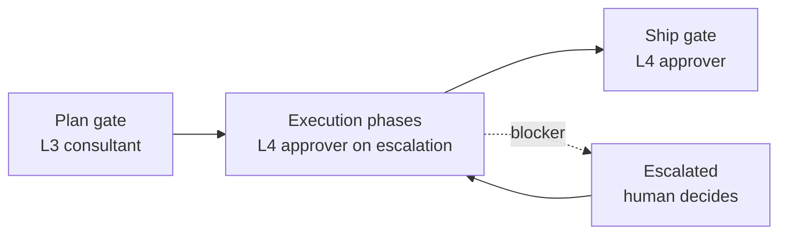
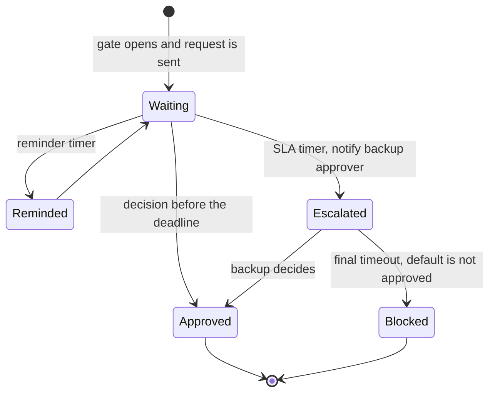

# Human in the Loop

## In one paragraph

Every durable engine now ships a first-class "pause for a human" primitive, so the question is no longer whether you can wait but what happens around the wait. Four things differ. How long you may wait: Inngest counts `waitForEvent` against a plan limit of 30, 90 or 366 days, Step Functions and Lambda durable functions cap at one year, while Temporal documents history limits rather than a wait cap and the Restate pages read state none. Whether an answer that arrives before the wait is registered is kept: Restate and Temporal keep it, Inngest's `waitForEvent` does not. What resumes after a deploy: the code that resumes may not be the code that suspended. And who notices when nobody answers. Waiting is close to free in compute everywhere; the human's time is the real cost. The evidence on where to put humans is consistent: users approve 93 to 97% of Claude Code permission prompts but reject 39% of plans, reviewers agree on what is risky only moderately (Fleiss' kappa 0.52), and more escalation can reduce safety through fatigue. So put few gates at the plan and at the ship step, bind every approval to the exact artifact hash, give every gate a timer and a visible escalation path, and make the default terminal state escalated, never "approved by timeout".

## 1. Four gates

**Four gates** (names are working labels):

| Gate | Opens when | Blocks | Carries | If nobody answers |
|---|---|---|---|---|
| 1. Plan | The architect's plan passes its critic, before any code | The whole run | Plan artifact (URI, sha256), critic objections, estimated cost | Keeps waiting, reminds, escalates to a backup; never auto-approved |
| 2. Escalation | A gated phase used up its revisions, or a loop hit its iteration cap | That phase | The question, options, artifacts, trace link | The run stays escalated and pages; no silent state |
| 3. Budget | A run reaches its cost cap | Further spend | Spend per phase, projected remaining cost | Aborts (a budget gate aborts, it does not auto-raise) |
| 4. Ship | CI is green and the verdict is PASS | The merge of the draft PR | PR, diff sha, verdicts, cost | The PR stays a draft |

The timeout column follows the gate-type rules in the aiwg ruleset: an approval gate "Blocks until a human approves", a review gate "auto-proceeds on timeout", a budget gate aborts, and a conditional mode without stated `auto_approve_conditions` is forbidden ([aiwg hitl-gates](https://cdn.jsdelivr.net/npm/aiwg@2026.7.12/agentic/code/frameworks/sdlc-complete/rules/hitl-gates.md)). LangChain's taxonomy for background agents fits too: notify, question and review ([Introducing ambient agents](https://www.langchain.com/blog/introducing-ambient-agents), 2025-01-14). Gates 1 and 4 are reviews, gate 2 is a question, and "the PR is green" is a notify.

## 2. Primitives per engine

Every row is a way to park a run until a person answers. "Max wait" is how long the platform lets you stay parked; where the pages read give no cap, the cell says so.

| Engine | Primitive | Max wait | How to time out and escalate | Docs |
|---|---|---|---|---|
| Temporal | Signal (async write), Update (sync, tracked, validated), Query (read); `workflow.wait_condition` | No wait cap documented: "works identically whether the wait is five seconds or five months". Per-execution limits: 10,000 Signals, 10 in-flight and 2,000 total Updates, history 51,200 events or 50 MB (Continue-As-New) | `wait_condition` with a timeout plus durable timers; SLA timer then a backup approver; decision values APPROVED, REJECTED, ESCALATED; the cookbook sample times out after 5 minutes | [Message passing](https://docs.temporal.io/encyclopedia/workflow-message-passing), [Approval guide](https://docs.temporal.io/guides/reliable-document-approvals.md) |
| Restate | Awakeable (one-shot, ID-addressed, "similar to a task token"), Signal (resolvable many times), workflow promise | No cap stated in the pages read; the talk demo suspends for a month | A durable timer raced against the promise: "Restate persists both the timer and the approval promise", so a restart keeps the remaining time; an awakeable is "resolved or rejected once" | [External events](https://docs.restate.dev/develop/ts/external-events.md), [Approvals](https://docs.restate.dev/ai/patterns/human-in-the-loop.md) |
| Inngest | `step.waitForEvent` (match or CEL `if`), `step.waitForSignal` (experimental, transactional) | Counts toward max run length: Free 30 days, Pro 90, Business 366 | `timeout` argument; returns null on timeout; "Always handle the timeout, for example by recording an expired request or sending a reminder" | [waitForEvent](https://www.inngest.com/docs/durable-execution/primitives/step-waitforevent), [Limits](https://www.inngest.com/docs/durable-execution/limits) |
| LangGraph | `interrupt()` and `Command(resume=...)` with a checkpointer and `thread_id`; `HumanInTheLoopMiddleware` | No limit in the library (state sits in the checkpointer). Agent Server: `BG_JOB_TIMEOUT_SECS` defaults to 86400, Cloud has a 1-hour limit on API requests | No timeout argument in the docs read; resume from an external timer with a default decision (inference) | [Interrupts](https://docs.langchain.com/oss/python/langgraph/interrupts), [Middleware](https://docs.langchain.com/oss/python/langchain/human-in-the-loop), [Env vars](https://docs.langchain.com/langsmith/env-var-self-hosted) |
| Trigger.dev | Waitpoint token: `wait.createToken({ timeout: "10m" })`, `wait.forToken` | Set per token; platform maximum not read | `timeout`, TTL and idempotency key at creation; complete via SDK or an HTTP POST to the token URL | [Wait for token](https://trigger.dev/docs/wait-for-token) |
| Step Functions | `.waitForTaskToken` callback; `SendTaskSuccess`, `SendTaskFailure` | Until the one-year execution quota (Standard only; Express has no callbacks) | `HeartbeatSeconds` (docs example 600) "to avoid stuck executions" | [Service integration patterns](https://docs.aws.amazon.com/step-functions/latest/dg/connect-to-resource.html) |
| Lambda durable functions | Checkpointed waits and callbacks | Up to one year; waits incur no compute charges | Timeout detail not in the pages read | [Durable functions](https://docs.aws.amazon.com/lambda/latest/dg/durable-functions.html) |
| Airflow 3.1+ | `HITLOperator`, `ApprovalOperator`, `HITLBranchOperator`, `HITLEntryOperator` (deferred state, UI forms, REST API) | No cap stated; `response_timeout` and timeout defaults are enforced by the scheduler | `response_timeout`, `assigned_users`, notifiers; under `airflow dags test` a parked task waits indefinitely | [3.1.0 release](https://airflow.apache.org/blog/airflow-3.1.0/), [HITL tutorial](https://airflow.apache.org/docs/apache-airflow/stable/tutorial/hitl.html) |
| DBOS | `DBOS.send` and `DBOS.recv` (topic-queued, in Postgres), events | `recv` takes `timeout_seconds`, default 60 | Pass a longer timeout; "if send completes successfully, the destination workflow is guaranteed to be able to recv it" | [Workflow communication](https://docs.dbos.dev/python/tutorials/workflow-communication) |
| Hatchet | Durable event waits | Not stated | Event key must match; a requeued task still reads the event from the durable log | [Durable event waits](https://docs.hatchet.run/v1/durable-event-waits) |
| Vercel Workflow SDK | Hook: a token resumes a suspended workflow | Not stated | `hook.getConflict()` reports a claimed token; check the caller before `resumeHook()` | [Hooks](https://workflow-sdk.dev/docs/foundations/hooks) |
| Cloudflare Agents | `waitForApproval()` on Cloudflare Workflows | "months or longer" | Docs example: timeout "7 days", reminder after 4 hours, log "Approval timeout - escalating to manager" | [HITL patterns](https://developers.cloudflare.com/agents/concepts/agentic-patterns/human-in-the-loop/) |
| OpenAI Agents SDK | `needs_approval` (bool or async predicate), `RunState`, `state.approve(...)` | No wait of its own: serialize `RunState` and resume later | None built in; bring a timer | [Human in the loop](https://openai.github.io/openai-agents-python/human_in_the_loop/) |
| Prefect | `pause_flow_run` (keeps infrastructure), `suspend_flow_run` (tears it down) | Not stated | Typed input via UI or API; resume semantics of suspend not confirmed | [Interactive workflows](https://docs.prefect.io/v3/advanced/interactive) |
| GitHub environments | Required reviewers (up to six, one must approve), prevent self-review, wait timer | Wait timer 1 to 43,200 minutes (30 days) | Up to six protection rules; on Free, Pro and Team plans required reviewers apply to public repositories only | [Deployments and environments](https://docs.github.com/en/actions/reference/workflows-and-actions/deployments-and-environments) |
| MCP elicitation | Form mode and URL mode; accept, decline, cancel | Session-bound, no durable wait | Clients "provide clear decline and cancel options"; forms must not request credentials | [Elicitation spec 2025-11-25](https://modelcontextprotocol.io/specification/2025-11-25/client/elicitation) |

**Which to grab** (verdicts from the research, as of October 2026):
- **Multi-day gates with an audit trail:** Temporal Updates with validators, so the approver UI gets a confirmation and a stale sha is rejected; plan Continue-As-New.
- **Cheap one-shot callbacks, especially on serverless:** Restate awakeables, which have the strongest buffered-signal semantics.
- **Event-shaped approvals inside a plan limit:** Inngest `waitForEvent`; register the wait before the human can answer and keep the total wait inside your plan's run-length limit.
- **HTTP-callable approvals in TypeScript:** Trigger.dev waitpoint tokens, mindful of concurrency slots.
- **Already on AWS:** Step Functions or Lambda durable functions; always set `HeartbeatSeconds` or a timeout.
- **Data pipelines:** Airflow 3.1 HITL operators are a good approval gate there, still a poor fit for hours-long LLM steps; DBOS if ops will not run another stateful service (override the 60-second `recv` default).
- **Final ship gate:** GitHub environments are the cheapest option if you already run on Actions.
- **Skip for production gates for now:** Google ADK confirmation until its experimental status lifts; HumanLayer's original SDK.

Also in the field: Google ADK tool confirmation (`require_confirmation`, experimental, introduced in Python v1.14.0) ([ADK](https://adk.dev/tools-custom/confirmation/)), Microsoft Agent Framework `request_info` and `RequestInfoEvent` ([docs](https://learn.microsoft.com/en-us/agent-framework/workflows/human-in-the-loop)), and Temporal's experimental Agent Harness with `ToolApprovalPolicy.allow_inherently_safe()` (0.6.0, 2026-10-03, "APIs will change") ([Temporal Agent Harness](https://temporal.io/blog/temporal-agent-harness-durable-agent-infrastructure)).

## 3. Per-engine notes: config names and limits

**Temporal.** A wait is cheap: during `wait_condition()` "the Worker returns the current task to the Temporal Server and becomes idle" ([approval guide](https://docs.temporal.io/guides/reliable-document-approvals.md)), and the AI cookbook sample says the agent "consumes no compute resources" while waiting ([HITL cookbook](https://docs.temporal.io/ai/cookbook/human-in-the-loop-python.md)). Each wait costs history: a Timer is about 4 events and a received Signal about 4, so a months-long approval loop should watch `workflow.info().is_continue_as_new_suggested()`. Updates are deduplicated server-side by Update ID, but after Continue-As-New "implement the deduplication in your Workflow code, since Update ID deduplication by the server is per Workflow run"; validators "are not allowed to block" and reject by throwing ([Handling messages](https://docs.temporal.io/handling-messages.md)). A Signal and a timer cannot truly race: a Signal arriving after the timer fired finds the wait already returned with a timeout ([Approval Pattern](https://docs.temporal.io/design-patterns/approval.md)). Limits above come from [Temporal Cloud limits](https://docs.temporal.io/cloud/limits.md) and [Workflow Execution limits](https://docs.temporal.io/workflow-execution/limits). Replit's Temporal case study describes using Workflow Updates for human-in-the-loop ([case study](https://temporal.io/resources/case-studies/replit-uses-temporal-to-power-replit-agent-reliably-at-scale), vendor).

**Restate.** Awakeables and signals both let the invocation suspend. "A signal can arrive before or after the invocation starts waiting for it. Restate stores each resolution durably." Resolve over HTTP at `/restate/awakeables/{id}/resolve`. Caution: waiting on an awakeable inside an exclusive Virtual Object handler queues every other call to that object. The Python SDK reached 1.0 on 2026-06-23 with `ctx.signal("approved")` and `ctx.resolve_signal(target_invocation_id, ...)` ([Python SDK changelog](https://docs.restate.dev/changelog/python-sdk)). On request/response targets such as Lambda, suspension is "an artificial error thrown by the SDK" and old versions "scale to zero when idle", whereas on Kubernetes you would keep old versions running until all requests complete ([AI agents should be serverless and durable](https://restate.dev/blog/resilient-serverless-agents)). The OpenAI Agents integration takes human approval from `restate_context().awakeable()` ([announcement](https://restate.dev/blog/durable-orchestration-for-ai-agents-with-restate-and-openai-sdk)).

**Inngest.** "The wait only sees events sent after it starts listening", so register the wait first or re-read external state before waiting. "Inside a group.parallel() race, a losing step.waitForEvent() is not cancelled" and keeps the run Running until its timeout, and `if` expressions do not support the CEL `in` operator ([step.waitForEvent reference](https://www.inngest.com/docs/reference/typescript/v4/functions/step-wait-for-event)). A wait "does not keep a worker running" ([durable workflows](https://www.inngest.com/docs/durable-execution/durable-workflows)) and waiting steps do not hold a concurrency slot ([concurrency](https://www.inngest.com/docs/durable-execution/flow-control/concurrency)). Limits: step timeout up to 2 hours, `step.sleep` up to a year within the plan's maximum run length ([limits](https://www.inngest.com/docs/durable-execution/limits)). An Inngest essay says a Free-plan sleep is 7 days while the limits page says 30 ([essay](https://www.inngest.com/blog/all-your-workflows-are-about-to-be-long-running)); trust the limits page.

**LangGraph.** `interrupt()` pauses, the checkpointer saves state under a `thread_id`, and `Command(resume=...)` continues, but "the runtime restarts the entire node from the beginning". Resume values match "strictly index-based", so order matters; "Side effects called before interrupt must be idempotent"; do not wrap `interrupt()` in a bare try/except; avoid `while True` plus `interrupt()` loops, because each resume replays every earlier iteration ([Interrupts](https://docs.langchain.com/oss/python/langgraph/interrupts), 2026-10-09). `response_schema` validates resume values. In Agent Server, a worker holds a lease, the queue allows at most one run per thread, and human-in-the-loop releases the worker ([Agent Server](https://docs.langchain.com/langsmith/agent-server), [runtime behind deep agents](https://www.langchain.com/blog/runtime-behind-production-deep-agents)); `BG_JOB_SHUTDOWN_GRACE_PERIOD_SECS` defaults to 180 ([env vars](https://docs.langchain.com/langsmith/env-var-self-hosted)). Resume bugs are still being fixed: the October 2026 Agent Server changelog fixes "pending interrupts being erased when a run ends without a state snapshot, which made later answers fail with no_such_interrupt" ([changelog](https://docs.langchain.com/langsmith/agent-server-changelog)), and LangGraph 1.1.0 (2026-03-10) stopped replays from reusing stale RESUME values ([LangChain changelog](https://docs.langchain.com/oss/python/releases/changelog)). Temporal's LangGraph plugin (Public Preview, 2026-07-16) turns interrupts into durable waits ([Temporal](https://temporal.io/blog/temporal-langgraph-plugin-durable-execution)). In the open-source library nothing restarts a stranded run: "It is not failed. It is stranded" is a competitor's description of a pod recycled mid-run ([Diagrid](https://www.diagrid.io/learn/integrating-diagrid-catalyst-langgraph), vendor).

**Trigger.dev, Step Functions, Airflow, DBOS.** Trigger.dev waits longer than 5 seconds do not count toward compute, but "Free compute isn't the same as freed concurrency" ([Wait overview](https://trigger.dev/docs/wait)); waitpoints launched 2025-08-18 ([changelog](https://trigger.dev/changelog/waitpoints)). Step Functions: "To avoid stuck executions you can configure a heartbeat timeout". Airflow's REST API lists pending requests (`GET /api/v2/dags/~/dagRuns/~/hitlDetails?response_received=false`) and answers them with a PATCH carrying `{"chosen_options": ["Approve"]}`; HITL arrived with 3.1.0 on 2025-09-25 ([blog](https://airflow.apache.org/blog/airflow-3.1.0/)). DBOS's 60-second `recv` default is the opposite trap from a year-long wait: a human answer will usually miss it unless you raise it.

## 4. Semantics that bite

| Gotcha | Where | What happens | Fix |
|---|---|---|---|
| Early answer lost | Inngest `waitForEvent` | "A matching event sent earlier will not resume this wait" ([Inngest](https://www.inngest.com/docs/durable-execution/primitives/step-waitforevent)) | Register the wait first, re-read state, or use `waitForSignal` |
| Early answer kept | Restate, Temporal | Restate stores each resolution durably whether it arrives before or after the wait ([docs](https://docs.restate.dev/develop/ts/external-events.md)); a Temporal Signal updates workflow state at any time ([pattern](https://docs.temporal.io/design-patterns/approval.md)) | Still dedupe |
| Node re-runs on resume | LangGraph | An Opus call before `interrupt()` in the same node is paid again | Model call in its own node or activity; gate in the controller |
| Duplicate approval | Temporal, chat buttons | Update dedupe is per run; a Slack hook "runs in an at-least-once worker" ([Temporal](https://docs.temporal.io/handling-messages.md), [GitLab](https://gitlab.com/gitlab-org/gitlab/-/work_items/628438)) | Request ID, guard on persisted state |
| Late approval | Temporal | A Signal after the timer finds the wait already timed out | Treat as ignored; tell the approver |
| Stale approval | Any | An approval for plan A is used for plan B | Bind to a hash; Update validator rejects a mismatched sha |
| Approval under old policy | Restate, Temporal | After a redeploy "a human approval granted under one policy gets treated as an approval under a different one" ([Restate](https://restate.dev/blog/dealing-with-versioning-in-long-running-agents)) | Pin runs to their version: Temporal Worker Versioning (GA 2026-03-30, `PINNED` or `AUTO_UPGRADE`, [announcement](https://temporal.io/blog/ga-worker-versioning-public-preview-upgrade-on-continue-as-new)), Restate immutable deployments |
| Token is not auth | Vercel hooks, any token-resume design | "knowing the token does not authorize the caller" ([Hooks](https://workflow-sdk.dev/docs/foundations/hooks)) | Check who is calling; refuse unless the owner matches |
| Refusal read as success | LangChain middleware | `respond` is "treated as a successful tool result" ([docs](https://docs.langchain.com/oss/python/langchain/human-in-the-loop)) | Use `reject` to deny; keep decisions in request order |
| Wait that never ends | Step Functions, Temporal without a timeout, Airflow without a scheduler | Parked until a quota or forever | Always set a timeout, and run the component that enforces it |
| Dead session | Any chat approval | Button clicked after the run is gone | Reply with an explanation and a link ([GitLab](https://gitlab.com/gitlab-org/gitlab/-/work_items/628438)) |

## 5. What waiting costs

| Engine | Compute while waiting | Other meters and limits |
|---|---|---|
| Temporal | Worker idle, nothing held | History events per wait (Timer about 4, Signal about 4); Continue-As-New for long loops |
| Restate | Invocation suspends; serverless scales to zero | An awakeable is one billable action ($25 per million on Starter and Business, [pricing](https://restate.dev/pricing)); a month-long approval "shouldn't be consuming resources" ([checkpointing post](https://restate.dev/blog/why-checkpointing-is-not-production-grade-durable-execution)) |
| Inngest | "your compute will entirely pause during the wait" ([docs](https://www.inngest.com/docs/durable-execution/durable-workflows)) | The wait consumes run-length budget: 30, 90 or 366 days by plan |
| Trigger.dev | Waits over 5 seconds not billed | Concurrency slot held |
| Lambda durable, Step Functions | No compute charge while waiting on Lambda durable functions ([docs](https://docs.aws.amazon.com/lambda/latest/dg/durable-functions.html)); Step Functions Standard bills per state transition | One-year ceiling |
| LangGraph | None if the process exits | Checkpoint storage (5.3 GB for a 200-turn coding agent under full snapshots, 129 MB with DeltaChannel, [Delta Channels](https://www.langchain.com/blog/delta-channels-evolving-agent-runtime)); Agent Server bills database uptime ([pricing](https://www.langchain.com/pricing)) |

## 6. Autonomy ladders and the research behind them

**Levels.** Feng, McDonald and Zhang treat autonomy as a deliberate design decision separate from capability and define five levels by the user's role: operator, collaborator, consultant, approver, observer, with "autonomy certificates" issued by a third party ([Levels of Autonomy for AI Agents](https://arxiv.org/abs/2506.12469)).

| Level | Role | Field evidence | Proposed placement in a phased pipeline |
|---|---|---|---|
| L1, L2 | Operator, collaborator | A person steers each step | Not used |
| L3 | Consultant | On complex tasks Claude asks for clarification more often than humans interrupt ([Anthropic](https://www.anthropic.com/research/measuring-agent-autonomy)) | Plan review: the human shapes the plan |
| L4 | Approver | Auto mode escalates after 3 consecutive or 20 total denials ([Anthropic](https://www.anthropic.com/engineering/claude-code-auto-mode)) | Execution phases: human only on an escalation; the ship gate |
| L5 | Observer | Full auto-approve rose from about 20% of sessions for new users to over 40% by 750 sessions ([Anthropic](https://www.anthropic.com/research/measuring-agent-autonomy)) | A read-only agent with no write tool |



**What the field measured.**
- **Claude Code.** Users approve 93% of permission prompts ([auto mode engineering post](https://www.anthropic.com/engineering/claude-code-auto-mode), 2026-03-25) and 97% by August; they reject 39% of plans presented for approval versus 3% of permission requests. A controlled study of 1,053 paid testers had auto-mode users shipping about 25% more PRs, and auto mode became the default on August 14 for Pro, Max and Team ([auto mode default](https://claude.com/resources/articles/auto-mode-default-in-claude-code)). The classifier runs on Sonnet 4.6 with stage-1 false-positive rate 8.5% falling to 0.4% after stage 2 and a 17% false-negative rate on real overeager actions; after 3 consecutive or 20 total denials the model stops and escalates, and in headless mode "we instead terminate the process". That is the default-ESCALATED rule from another vendor.
- **Autonomy in practice.** The 99.9th percentile turn duration rose from under 25 minutes to over 45 (Oct 2025 to Jan 2026); experienced users auto-approve more (over 40% of sessions) but interrupt more (about 9% of turns versus 5%); human interventions per session fell from 5.4 to 3.3 in internal usage, and human involvement was 87% of tool calls on minimal-complexity tasks versus 67% on high-complexity ones ([Measuring AI agent autonomy](https://www.anthropic.com/research/measuring-agent-autonomy)).
- **Cursor** Auto-review blocks about 4% of reviewed actions on a 6,122-row labeled set, about 7% of chats lead to at least one interruption, and some enterprise customers previously saw about 40% of actions blocked; Auto-review is now the default for new users ([Governing agent autonomy](https://cursor.com/blog/agent-autonomy-auto-review)).
- **GitHub.** The Copilot cloud agent opens draft PRs it cannot approve or merge, workflows do not run until a user with write access clicks "Approve and run workflows", and agent-authored PRs need an extra approval ([risks and mitigations](https://docs.github.com/en/copilot/concepts/security-governance-and-network-settings/risks-and-mitigations)). Agentic Workflows run read-only and write only through declared "safe outputs" ([about](https://docs.github.com/en/copilot/concepts/agents/about-github-agentic-workflows)).
- **Survey of practice.** Across 59 papers, 21 production agent systems and 26 security plugins (as of April 2026), runtime approval is adopted by 15 of 21 production systems, scope configuration by 16 and policy specification by 14, while intent anchoring and trust labeling have zero production deployment ([Reframing LLM Agent Security](https://arxiv.org/abs/2605.24309)).

## 7. Approval gate design

**What a request carries.**
1. The exact artifact or action, by hash. A plan is `plan.md` plus sha256, not "the plan".
2. The question and the options: approve, edit, reject, respond (LangChain's decision vocabulary), and what each option does.
3. Rationale and blast radius, built from the pending action, not from model text.
4. An owner (Airflow `assigned_users`; GitLab refuses unless `workflow.user == current_user`).
5. A deadline and its timeout action.
6. A request ID, for idempotency.
7. Links to the artifacts and the trace (see [Observability for Agent Workflows](observability-for-agent-workflows.md)).
8. An audit record: Temporal's approval guide retries its audit activity 10 times (2 s initial, 2x backoff, 5 minutes max).

**Bind the approval to what executes.** "Loopjacking" is a human approving operation A while the implementation uses that decision for operation B, either by misrepresentation at approval time or by post-approval state substitution. The paper reproduced substitution in seven Agno AgentOS releases (ending at 3.0.9) and in 12 versions of a conditional in-memory LangGraph Agent Server composition (ending at 0.14.0), found a representation mismatch in OpenClaw 2026.2.23 (rejected in 2026.2.24), and used OpenAI Agents SDK 0.22.0 and 0.22.2 as a negative control with exact per-call binding ([Loopjacking](https://arxiv.org/abs/2609.21081)). The Verifiable Action Card builds approval text from the ground-truth pending action, renders it out of band and re-verifies the exact action at dispatch: attack success fell from 68 to 100% without it to 0% with it, with 78% legitimate-task completion and a 0% false-block rate on a 24-scenario benchmark ([VAC](https://arxiv.org/abs/2609.18411)). For a pipeline: approve a hash, ship that hash, re-check it at the last push, and never let a salvage path skip the gate. Temporal's own security post says it plainly: "If an agent can bypass an approval or replay a rejected action after a retry, the controls are broken" ([Oso joins Temporal](https://temporal.io/blog/oso-security-joins-temporal-accelerate-ai-agent-security), 2026-10-06; nothing in the product changed that day).

**Tier by risk, not by habit.** AWS's baseline: read-only proceeds autonomously, low-risk writes get a single reviewer, higher risk gets stricter review; risk classification "can't rely on an LLM exposed to the same untrusted content"; routing everything creates "reviewer fatigue and rubber-stamp approvals" ([AGENTSEC04-BP02](https://docs.aws.amazon.com/wellarchitected/latest/agentic-ai-lens/agentsec04-bp02.html)).

**More gates can mean less safety.** On 125 hand-labeled, adversarially weighted agent actions reviewers agreed with Fleiss' kappa 0.52, and with fatigue modeled "safety is an inverted-U in the escalation rate", including a flooding attack that slips a malicious action past a tired reviewer ([Oversight Has a Capacity](https://arxiv.org/abs/2606.08919)). That argues for a few gates, not forty.

## 8. Escalation design

An escalation is a workflow state with a timer and a consumer, not a status column.



| Step | Illustrative timing | What happens | Source |
|---|---|---|---|
| Notify | At gate open | Typed request to the chat or ticket tool with Approve and Deny, visible to the requester only; owner check; idempotent | [GitLab](https://gitlab.com/gitlab-org/gitlab/-/work_items/628438) |
| Remind | After 4 hours | Scheduled reminder | [Cloudflare example](https://developers.cloudflare.com/agents/concepts/agentic-patterns/human-in-the-loop/) |
| Escalate | At the SLA | Backup approver or manager; the Temporal guide models SLA timers and "automatic escalation to a backup approver" | [Temporal guide](https://docs.temporal.io/guides/reliable-document-approvals.md) |
| Final | After the last timer | Approval gates block, review gates proceed, budget gates abort; the run ends escalated and pages someone | [aiwg](https://cdn.jsdelivr.net/npm/aiwg@2026.7.12/agentic/code/frameworks/sdlc-complete/rules/hitl-gates.md) |

Rules that make it hold:
- **No answer is not approval.** "Headless" has no human, so stop: Claude Code's classifier terminates the process.
- **Build for months only when you must.** Use Continue-As-New when `is_continue_as_new_suggested()` flips, and pin versions (see the table in section 4).

## 9. The operator in the loop

Humans do not only approve; they also pause, restart and repair. Engine-level controls are the safe alternative to hand-salvaging stranded work, because the gates still run.
- **Restate 1.6** (2026-02-11) added manual pause and resume and restart from a specific journal entry or on a different deployment: the vendor's example keeps three human approvals and re-runs only the buggy reimbursement step. Batch operations pause, resume, cancel or purge hundreds of invocations ([1.6](https://restate.dev/blog/announcing-restate-1-6), [remote control](https://restate.dev/blog/a-remote-control-for-your-agents)). Restate 1.7 lets an error request "pause" or "fail" to avoid "burning retry budget on a doomed invocation" (protocol v7, opt-in, one-way) ([release notes](https://github.com/restatedev/restate/blob/main/release-notes/v1.7.0.md)).
- **Temporal** Workflow Pause is pre-release (invite-only on Cloud; self-hosted needs Server v1.30.0+ with `frontend.WorkflowPauseEnabled`, CLI v1.6.0+, UI v2.47.2+) ([Workflow Pause](https://docs.temporal.io/encyclopedia/workflow/workflow-pause.md)); Activity Pause and Reset exist ([Activity pause](https://docs.temporal.io/activity-operations/pause.md)).
- **Inngest** rerun-from-step (August 2026) rebuilds earlier steps from memoized output and re-executes the chosen step and everything after it, so gates that are steps run again ([Don't pay for the same step twice](https://www.inngest.com/blog/dont-pay-for-the-same-step-twice)).
- **LangGraph Agent Server** double texting decides what a second input does while a run is active: enqueue (default), reject, interrupt or rollback, and it exists only in LangSmith Deployment ([Double texting](https://docs.langchain.com/langsmith/double-texting)).

## 10. Who owns the pause

| Layer | Examples | Durable? | Best for |
|---|---|---|---|
| Harness | Claude Code permission prompts and auto mode, MCP elicitation, OpenAI `needs_approval`, ADK confirmation, LangChain middleware | Per call, session-bound unless state is serialized | A gate inside one agent session |
| Orchestrator | Signals, awakeables, `waitForEvent`, task tokens | Yes, days to a year | Gates between phases; the plan and escalation gates |
| Platform | GitHub environments, "Approve and run workflows" | Yes, platform-bound | The final ship gate |

HumanLayer started as an approval and contact-a-human SDK for agents; its site now sells a multiplayer coding-agent IDE and cloud, and the original repository's README says the code is mostly deprecated ([HumanLayer](https://www.humanlayer.dev/)). Approve, edit, reject and respond decisions have become built-in features of agent SDKs (LangChain middleware, OpenAI `needs_approval`, ADK confirmation, Microsoft `request_info`).

## 11. Testing a gate in seconds

```python
import asyncio
from datetime import timedelta
from temporalio import workflow

@workflow.defn
class PlanGate:
    def __init__(self) -> None:
        self._decision: str | None = None
        self._plan_sha = ""

    @workflow.run
    async def run(self, plan_sha: str) -> str:
        self._plan_sha = plan_sha
        await workflow.execute_activity(
            "notify_approval_needed", plan_sha, start_to_close_timeout=timedelta(seconds=30)
        )
        try:
            await workflow.wait_condition(lambda: self._decision is not None, timeout=timedelta(days=3))
        except asyncio.TimeoutError:
            return "ESCALATED"   # never "APPROVED by timeout"
        return self._decision

    @workflow.update
    async def decide(self, decision: str, plan_sha: str) -> str:
        if self._decision is None:   # first decision wins
            self._decision = decision
        return "recorded"

    @decide.validator
    def check_decide(self, decision: str, plan_sha: str) -> None:
        if plan_sha != self._plan_sha:
            raise ValueError("stale plan: approval is bound to a different sha256")
```

The time-skipping test environment lets this run in seconds: send a duplicate approval (same Update ID, deduplicated by the server), a late approval after the timeout (it must not flip an ESCALATED run to approved, and the approver should be told), an Update for a stale sha (rejected by the validator), then restart the worker mid-wait and check that the remaining time survives. Test also the unhappy channel: a notification that fails to send must itself escalate.

## 12. Where the evidence puts the humans

- **Few gates, high signal.** The plan and the ship step carry the signal (39% of plans rejected, 3% of permission prompts); tool-call prompts become habit.
- **Independent reviewers and code-owned routing.** Humanize has a human approve a plan contract, a reviewer from another vendor decide completion, and deterministic hooks (not a model) route work and enforce 72 mechanical gates, studied through 118 public postmortems: "the agent that writes the code is a weak judge of whether it is done" ([Humanize](https://arxiv.org/abs/2610.08900)). A team running about eight agents has plans reviewed by a model that did not write them, five independent reviewers per PR and a human who merges by hand ([Black Box case study](https://blog.codacy.com/agentic-sdlc-loop-engineering-how-black-box-runs-pr-review-gates-at-scale-2027)). LangChain's Open SWE interrupts for plan approval: "accept, edit, delete, or request changes to the plan" ([Open SWE](https://www.langchain.com/blog/introducing-open-swe-an-open-source-asynchronous-coding-agent)).
- **Reliability compounds.** "To take agents from 90% reliability to 99% reliability isn't an improvement of 9%, it's a 10x improvement" ([Codemanship](https://codemanship.wordpress.com/2026/08/28/the-wall-confronting-reliable-coding-agent-autonomy/)); "Autonomy moves at the speed of trust" ([Hackbot](https://hackbot.dad/writing/no-autonomy-without-scalable-oversight/)).

## 13. Gaps and honesty

- No measured data on how long humans take to review agent plans or PRs; no 2026 conference talk focused on human-in-the-loop in durable workflows was found.
- Prefect `suspend_flow_run` resume semantics (does the flow re-execute from the start?) were not confirmed.
- The date Restate added named Signals alongside awakeables, the creation date of the GitLab issue and the Temporal Update GA dates were not confirmed; the Trigger.dev waitpoints date is page metadata.
- The four gate names and the level placements are working labels, not measurements.

## Unverified leads

- [12-Factor Agents, Factor 7: Contact humans with tool calls](https://github.com/humanlayer/12-factor-agents): the page loads but did not match the expected title when checked, so no claim here rests on it. The research suggested it as the origin of the "contact humans with tool calls" pattern.

## Related

- [Observability for Agent Workflows](observability-for-agent-workflows.md)
- [Engine Profiles](engine-profiles.md)
- [Official Docs by Engine](official-docs-by-engine.md)
- [Reward Hacking and Verification](reward-hacking-and-verification.md)
- [AI Code Review and Quality Gates](ai-code-review-and-quality-gates.md)
- [Autonomous Coding Agents](autonomous-coding-agents.md)
- [Research Papers](research-papers.md)
