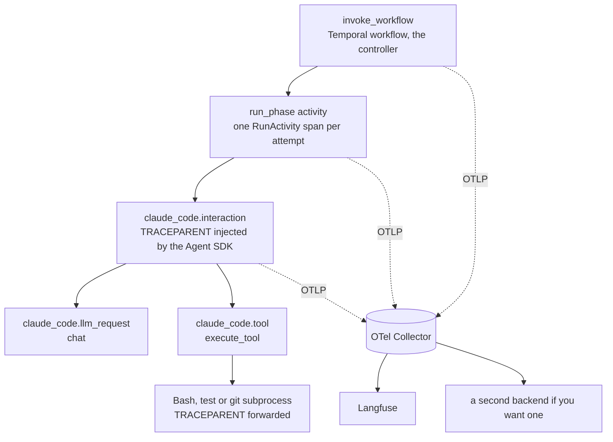
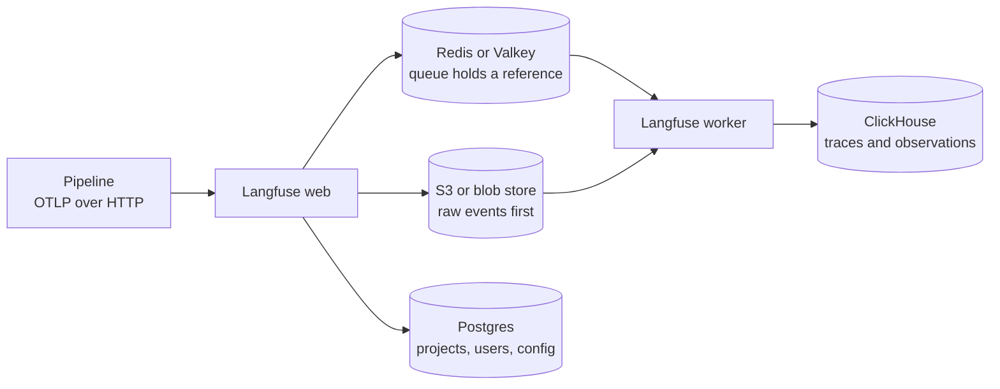

# Observability for Agent Workflows

What to see, which standard to follow, which tool to pick and how to count the money when an agent pipeline runs on a durable orchestrator, as of October 2026. It is built around one lesson: a run you cannot see is a run you have to kill.

## 1. Three panes, three questions

| Question | Pane | Who answers it | The gap |
|---|---|---|---|
| Which step is the run on, how many attempts, which worker holds it? | Control flow | Engine UIs: Temporal, Restate, Inngest (see [5. Engine UIs: the control-flow pane](#5-engine-uis-the-control-flow-pane)) | No prompts, tokens or dollars |
| What did the model see and say, how many tokens, what did it cost? | LLM trace | Langfuse, LangSmith, Phoenix, Logfire, Datadog | Cost is an estimate; content capture is off by default; the trace store itself can fail silently |
| Did the work the agent reported exist, and did it pass? | Claims | Your gates, artifacts, ledger and evals | Spans detect that something failed but rarely where it started ([TelemetrySuffBench](https://arxiv.org/abs/2608.07899)) |

## 3. OpenTelemetry GenAI conventions: status in October 2026

### 3.1 Status and churn

- **Status: Development, not Stable.** The agent-span spec, now in the dedicated `semantic-conventions-genai` repository, opens with "Status: Development" ([agent spans spec](https://raw.githubusercontent.com/open-telemetry/semantic-conventions-genai/HEAD/docs/gen-ai/gen-ai-agent-spans.md)). The old opentelemetry.io page says the conventions moved and "is no longer maintained in this repository", and the new README's Schema URL section is still an unfilled stub ([Moved: Generative AI semantic conventions](https://opentelemetry.io/docs/specs/semconv/gen-ai/)).
- **Release timeline.** The core changelog headings carry no dates (the latest heading is v1.44.0); these dates come from a third-party audit and are secondary ([CHANGELOG](https://raw.githubusercontent.com/open-telemetry/semantic-conventions/HEAD/CHANGELOG.md), [DEV audit](https://dev.to/azena-ai/opentelemetrys-genai-semantic-conventions-are-not-stable-yet-heres-what-actually-shipped-in-2026-3mke)). Core releases ran Jan 12 (v1.39.0), Feb 19, Apr 28, May 11 (v1.41.1), Jun 12 and Jul 3 (v1.43.0).

| Version | Date (2026) | GenAI change |
|---|---|---|
| v1.40.0 | Feb 19 | Added `gen_ai.usage.cache_creation.input_tokens` |
| v1.41.0 | Apr 28 | Invoke workflow operation (#2912); `invoke_agent` split into client and internal spans (#2632); `gen_ai.usage.reasoning.output_tokens` (#3194) |
| v1.42.0 | Jun 12 | Every `gen_ai`, `openai` and `mcp` definition deprecated in core and moved to `semantic-conventions-genai` (#3696) |

- **Key attributes, and how they moved inside one year** ([DEV audit](https://dev.to/azena-ai/opentelemetrys-genai-semantic-conventions-are-not-stable-yet-heres-what-actually-shipped-in-2026-3mke), [CHANGELOG](https://raw.githubusercontent.com/open-telemetry/semantic-conventions/HEAD/CHANGELOG.md)):

| Attribute | Meaning | 2026 history |
|---|---|---|
| `gen_ai.operation.name` | Kind of operation (`chat`, `invoke_agent`, `invoke_workflow`, `plan`, `execute_tool`, `retrieval`, `search_memory`) | `invoke_workflow` added in v1.41.0 |
| `gen_ai.workflow.name` | Workflow name, "MUST have low cardinality" | Defined for `invoke_workflow` spans |
| `gen_ai.usage.reasoning.output_tokens` | Reasoning tokens in the output | Added in v1.41.0 |
| `gen_ai.usage.cache_write.input_tokens` | Input tokens written to the prompt cache | Added in v1.40.0 as `gen_ai.usage.cache_creation.input_tokens`; the GenAI registry now uses the new name |
| `gen_ai.input.messages`, `gen_ai.output.messages` | Prompt and completion content, opt-in | Replace `gen_ai.prompt` and `gen_ai.completion`, "removed entirely" |

  A dashboard keyed on attribute names breaks on a rename; the audit recommends dual emission with `OTEL_SEMCONV_STABILITY_OPT_IN`.
- **The opt-in flag is still in the loop.** Datadog's "Agent Observability" docs ingest OTLP following GenAI conventions 1.37+ or OpenInference and tell frameworks on older conventions to set `OTEL_SEMCONV_STABILITY_OPT_IN=gen_ai_latest_experimental` ([Datadog](https://docs.datadoghq.com/llm_observability/instrument/otel_instrumentation/)).
- **Span events are being deprecated** (March 17, 2026): "New code should write events as logs that are correlated with the current span" ([Deprecating Span Events API](https://opentelemetry.io/blog/2026/deprecating-span-events/)). Existing span-event data stays valid.

### 3.2 Span types and how they map to a phased pipeline

The agent spec defines `create_agent`, `invoke_agent` (client and internal), `invoke_workflow`, `plan` and `execute_tool` spans, plus Agent Skills refinements. Well-known `gen_ai.operation.name` values include `chat`, `create_agent`, `execute_tool`, `invoke_agent`, `invoke_workflow`, `plan`, `retrieval` and `search_memory` ([agent spans spec](https://raw.githubusercontent.com/open-telemetry/semantic-conventions-genai/HEAD/docs/gen-ai/gen-ai-agent-spans.md)).

| Pipeline element | OTel GenAI name | Rules from the spec |
|---|---|---|
| The whole run (one workflow ID) | `invoke_workflow {gen_ai.workflow.name}` | Span kind INTERNAL; "SHOULD NOT be reported for standalone agent invocations"; `gen_ai.workflow.name` "MUST have low cardinality", so use the pipeline name, never the ticket ID |
| One phase | `invoke_agent` | Client or internal variant since v1.41.0 |
| The architect's plan | `plan` | "The LLM call that generates the plan SHOULD be a child of the plan span" |
| Each model call | `chat` | Child of the agent or plan span |
| Each tool call | `execute_tool` | Child of the agent span |
| Each retry attempt | Not GenAI: an engine span | Temporal `RunActivity` per attempt, Restate invocation-attempt span, Inngest retry span (see [4. One trace across the orchestrator and the model](#4-one-trace-across-the-orchestrator-and-the-model)) |

### 3.3 Metrics worth alerting on

The GenAI metrics spec now has agent-level histograms ([GenAI metrics spec](https://raw.githubusercontent.com/open-telemetry/semantic-conventions-genai/HEAD/docs/gen-ai/gen-ai-metrics.md)):
- `gen_ai.invoke_workflow.duration`: how long a whole run took.
- `gen_ai.invoke_agent.inference_calls` (histogram, unit `{inference_call}`): model calls per agent invocation. Explicit bucket boundaries are [1, 2, 4, 8, 16, 32, 64, 128].
- `gen_ai.invoke_agent.tool_calls`: for frameworks that "can reliably attribute tool calls to a single agent invocation". A phase that "succeeded" with zero tool calls is the Haiku-only editor story in one metric.
- Also `gen_ai.client.operation.duration`, `gen_ai.client.token.usage` and `gen_ai.execute_tool.duration`.
- **Not there: cost.** Neither the metrics doc nor the attribute registry defines a cost attribute or metric. See [9. Cost attribution per run](#9-cost-attribution-per-run).

### 3.4 Content capture is a privacy decision

"By default, no prompt content or tool arguments are captured with GenAI telemetry, as these can contain sensitive data" ([Inside the LLM Call](https://opentelemetry.io/blog/2026/genai-observability/)). The knobs differ per emitter: Claude Code uses `OTEL_LOG_USER_PROMPTS`, `OTEL_LOG_TOOL_DETAILS` and `OTEL_LOG_TOOL_CONTENT` ([Claude Code Monitoring](https://code.claude.com/docs/en/monitoring-usage)); the OTel contrib instrumentation uses `OTEL_INSTRUMENTATION_GENAI_CAPTURE_MESSAGE_CONTENT` (`span_only` or `event_only`) ([openai-v2 instrumentation](https://pypi.org/project/opentelemetry-instrumentation-openai-v2/)). Prompts for a code pipeline contain source code, so enable content deliberately, and take the same care with workflow history: "Storing sensitive data in workflow history" is on the Temporal mistakes list ([100 Temporal mistakes](https://github.com/jlegrone/100-temporal-mistakes)).

### 3.5 What to do with a moving standard

Use the span and metric names, because backends key their agent views on them; pin the convention version in code and dashboards; and put an OpenTelemetry Collector between pipeline and backend. LangSmith explicitly supports a Collector "fanout" that routes one stream of spans to several backends ([LangSmith: Trace with OpenTelemetry](https://docs.langchain.com/langsmith/trace-with-opentelemetry)), so renames and backend changes happen in one place.

## 4. One trace across the orchestrator and the model

### 4.1 Why durable engines break naive tracing

A durable workflow is replayed. A tracer that opens a span each time workflow code runs duplicates it on every replay, and random span IDs cannot rejoin a trace after a pod dies. Dapr hit the transport version: orchestration runs in a sidecar and talks to activities over a long-lived gRPC stream that cannot carry per-message headers, so workflow, activity and user spans "do not form a coherent hierarchy"; the fix embeds `traceparent` and `tracestate` inside the activity messages ([Improving Async Workflow Observability in Dapr](https://opentelemetry.io/blog/2026/dapr-workflow-observability/), January 2026). Engines that solved it give one nested trace across workers and no duplicate spans after a pod dies.

### 4.2 The five-layer trace

Retries appear as sibling attempt spans under the activity, which is where you see that you paid twice. The glue is context propagation: when you call `query()` while an OpenTelemetry span is active, the Agent SDK injects `TRACEPARENT` and `TRACESTATE` into the child process, and the CLI forwards `TRACEPARENT` to every Bash and PowerShell command it runs ([Agent SDK: Observability](https://code.claude.com/docs/en/agent-sdk/observability)). Interactive sessions ignore an inbound `TRACEPARENT`; only `-p` and SDK sessions honor it ([Claude Code Monitoring](https://code.claude.com/docs/en/monitoring-usage)).

### 4.3 Engine by engine

| Engine | What it emits natively | Path to an LLM tracer | Gotcha |
|---|---|---|---|
| Temporal | Event history with a Web UI; each Activity attempt can be its own span | `OpenTelemetryPlugin` with a replay-safe tracer provider; official Langfuse notebook; LangSmith, Braintrust, OpenBox and Parseable plugins ([integrations catalog](https://docs.temporal.io/develop/python/integrations)) | Plugin is experimental; the older `TracingInterceptor` only emits zero-duration completed spans on the workflow side |
| Restate | OTLP traces per invocation: start span, one span per attempt, end span, exported as soon as they end | `RestateTracer` wrapper for Langfuse; `@restatedev/restate-sdk-opentelemetry` for the TypeScript SDK | Since 1.7 spans export under the resource name "Restate", so dashboards keyed on old span names need updating |
| Inngest | Automatic traces in Dev Server and Cloud, queue time split from server time, retries as separate spans, AI indicator | `step.ai.infer` and `step.ai.wrap`; Extended Traces add your own OTel spans (TypeScript) | The AI Overview cost charts estimate from uncached token usage |
| LangGraph | None built in; tracing is LangSmith's job | `LANGSMITH_OTEL_ENABLED=true` (needs `langsmith>=0.3.18`, recommended `>=0.4.25`) and the `https://api.smith.langchain.com/otel` endpoint with an `x-api-key` header ([docs](https://docs.langchain.com/langsmith/trace-with-opentelemetry)) | A base endpoint ending in `/otel/v1/traces` "sends traces to /otel/v1/traces/v1/traces, which returns 404" |

**Temporal.** The Python SDK's `OpenTelemetryPlugin` gives workflow spans real durations, makes span IDs deterministic and does not export while a workflow replays; each Activity attempt gets its own `RunActivity` span, "so retries stay visible". Install `pip install temporalio[opentelemetry]` plus `opentelemetry-exporter-otlp`. The docs mark `OpenTelemetryPlugin` and `create_tracer_provider()` as experimental ([Temporal Python SDK: Observability](https://docs.temporal.io/develop/python/platform/observability)). The SDK that ships it is `temporalio` 1.34.0 (released 2026-09-30); the replay-safe provider arrived in the 1.32 line, and 1.32.0 was dated 2026-08-24 ([temporalio on PyPI](https://pypi.org/project/temporalio/), [Python SDK CHANGELOG](https://raw.githubusercontent.com/temporalio/sdk-python/HEAD/CHANGELOG.md)). With the OpenAI Agents integration the OTel mode is Public Preview (`OpenAIAgentsPlugin(use_otel_instrumentation=True)`), requires the replay-safe provider and "raises a ValueError" for any other ([OpenAI Agents SDK integration](https://docs.temporal.io/develop/python/integrations/openai-agents)).

**Temporal plus Langfuse.** Langfuse documents a notebook that sends `StartWorkflow`, `RunWorkflow`, `RunActivity` and `HandleUpdate` spans plus auto-instrumented LLM calls over OTLP with no Langfuse SDK. The endpoint is `{LANGFUSE_BASE_URL}/api/public/otel/v1/traces` with Basic auth built from the project keys, the header `x-langfuse-ingestion-version: 4` turns on real-time ingestion, and "Langfuse's OTLP endpoint is HTTP-based, so use the http exporter (not grpc)" ([Trace Temporal Workflows with Langfuse](https://langfuse.com/integrations/frameworks/temporal)).

**Restate.** "Spans are exported as soon as they end, not when the whole invocation completes", and failed retryable attempts are marked as errors "so you can spot retry loops at a glance". Configure `tracing-endpoint` (or `RESTATE_TRACING_ENDPOINT`) with an `otlp+http://` or `otlp+https://` scheme ([Restate: Tracing](https://docs.restate.dev/server/monitoring/tracing)). Restate 1.7 (server release dated 2026-06-18, announced 2026-07-07) reshaped tracing for long-running agents and added `@restatedev/restate-sdk-opentelemetry` ([Restate 1.7](https://restate.dev/blog/announcing-restate-1-7)); the TypeScript hook "suppresses span events during replay (to avoid duplicate events)" ([TS tracing](https://docs.restate.dev/develop/ts/tracing)). With Langfuse, "each execution runs on a fixed version of the code", so a trace maps to one deployment ([Restate and Langfuse](https://restate.dev/blog/langfuse-restate-announcement)).

### 4.4 Trace IDs and names you will thank yourself for

- **Seed the trace ID with the workflow ID.** Langfuse assigns random 32-hex trace IDs by default, but `create_trace_id(seed=external_request_id)` (Python) or `createTraceId(externalId)` (`@langfuse/tracing`) is deterministic ([Langfuse Trace IDs](https://langfuse.com/docs/observability/features/trace-ids-and-distributed-tracing)). Retries, resumes and a salvage run can then land in one trace.
- **Label the generic activity.** One reusable activity for all LLM calls keeps the code small but makes the timeline unreadable. Temporal's fix is the activity `summary` option, for example `summary="Plan changes"` ([Label your agent steps](https://temporal.io/blog/label-your-agent-steps)); SDK 1.34.0 adds experimental Event Groups via `workflow.create_event_group(...)` ([CHANGELOG](https://raw.githubusercontent.com/temporalio/sdk-python/HEAD/CHANGELOG.md)). A single `run_phase` activity is exactly this case.
- **Spans that stay open for hours.** LangChain rebuilt its trace store because "a start event for an agent span can arrive minutes, maybe even hours before an end event" ([SmithDB](https://www.langchain.com/blog/introducing-smithdb)). A four-hour CI-fix round is such a span; check that your backend shows it.

## 5. Engine UIs: the control-flow pane

- **Temporal Web UI** ships with every Temporal CLI: Timeline, All, Compact ("a logical grouping of Activities, Signals and Timers") and JSON history views (downloadable), pending activities, call stack, queries and metadata ([Temporal Web UI](https://docs.temporal.io/web-ui)).
- **Restate UI** (port 9070 locally): invocations, per-invocation journal, state, nested calls, and Cancel (graceful) or Kill (immediate, no cleanup) for a runaway agent ([Observability and Control](https://docs.restate.dev/ai/patterns/observability-control)). Restate 1.6 added manual pause and resume and restart from a journal entry ([A remote control for your agents](https://restate.dev/blog/a-remote-control-for-your-agents)).
- **Inngest** adds run search and, since June 2026, `inngest-cli api` commands such as `get-function-trace --include-output` for a terminal, CI or a coding agent ([Debug functions from the terminal](https://www.inngest.com/blog/debug-functions-terminal-cli-v2-rest-api)). Temporal's **Workflow Streams** (Public Preview since 2026-06-17) stream reasoning, tool calls and tokens to a UI ([Workflow Streams](https://temporal.io/blog/workflow-streams-live-interactivity-agents-other-applications)).

## 6. LLM tracing platforms (as of October 2026)

| Tool | Ingest and fit | Self-host | Price | Verdict |
|---|---|---|---|---|
| [Langfuse](https://langfuse.com/self-hosting) | OTLP; documented Temporal and Restate integrations; v4 GA 2026-08-17 | Open source, some add-ons need a license key; web, worker, Postgres, ClickHouse, Redis, S3 | Cloud (per [pricing](https://langfuse.com/pricing)): Hobby free with 50k units, Core $29/mo with 100k units then $8 per 100k, Pro $199 | Grab; start on v4 |
| [LangSmith](https://docs.langchain.com/langsmith/observability) | OTLP; native for LangGraph; SmithDB trace store | Enterprise add-on only | Developer $0 (1 seat, 5k base traces/mo), Plus $39/seat (10k base traces/mo), usage in LangChain Standard Units at $1.00 each ([pricing](https://www.langchain.com/pricing)) | Grab if on LangGraph or want SaaS |
| [Arize Phoenix](https://arize.com/docs/phoenix) | OTel and OpenInference native | Free, "no feature limitations"; SQLite by default, Postgres for production; one tenant per instance | Free to self-host; Arize AX is the managed product | Grab for the lightest self-host |
| [Pydantic Logfire](https://pydantic.dev/pricing) | OTel-native SaaS, SQL queries, agents and infrastructure in one place | SaaS | $20 of free usage a month (10M spans, logs or metrics), then $2 per million on Team ($49/mo) and Growth ($249/mo); Personal hard-capped at $0; retention 30 to 90 days | Grab if Python-heavy; per-record pricing makes span-heavy traces the cost driver |
| [Datadog Agent Observability](https://docs.datadoghq.com/llm_observability/instrument/otel_instrumentation/) | OTLP with GenAI 1.37+ or OpenInference, Langfuse-native OTel accepted, no Datadog SDK or Agent needed | SaaS | Commercial, pricing not checked | Grab if you already run Datadog; expect a 3 to 5 minute delay |
| [Helicone](https://www.helicone.ai/blog/joining-mintlify) | Proxy and AI Gateway | OSS self-host | Gateway 0% markup | Skip for new builds: acquired by Mintlify on 2026-03-03, services stay "in maintenance mode" |
| [Braintrust](https://www.braintrust.dev/docs/integrations/sdk-integrations/temporal) | Evals plus tracing; Temporal plugin (`@braintrust/temporal`, TypeScript SDK v2.1.0+) | SaaS | Commercial | Consider if evals come first |
| [.NET Aspire Dashboard](https://opentelemetry.io/blog/2026/genai-observability/) | Free local OTLP viewer with a GenAI visualizer; UI port 18888, OTLP 4317 and 4318 | One docker run | Free | Grab for a hello-world of agent traces before standing up Langfuse |

Instrumentation libraries sit under these backends: OpenInference (the Claude Agent SDK and Anthropic instrumentors Langfuse and Phoenix use; the Agent SDK one is 0.1.x, so expect churn), OpenLLMetry (supported by Datadog from 0.47) and OpenLIT ([OpenInference](https://github.com/Arize-ai/openinference), [OpenLLMetry](https://github.com/traceloop/openllmetry), [OpenLIT](https://github.com/openlit/openlit)). Langfuse documents `ClaudeAgentSDKInstrumentor().instrument()` for the Agent SDK ([Langfuse: Claude Agent SDK](https://langfuse.com/integrations/frameworks/claude-agent-sdk)).

**How to choose.** On Temporal or Restate, Langfuse has documented integrations for both. On LangGraph, LangSmith (self-host is Enterprise-only, [Self-hosted LangSmith](https://docs.langchain.com/langsmith/self-hosted)). As a small self-hosting team compare component counts first: Phoenix is one app plus a database, Langfuse is six components. Every meter is per span, trace or record, and a deep run is thousands of spans.

## 7. Langfuse in depth

### 7.1 Self-host architecture

Self-hosted Langfuse (now v4) runs two application containers, web and worker, plus Postgres, ClickHouse, Redis or Valkey, and S3-compatible blob storage. Every incoming event is written to S3 first and queued by reference in Redis: "traces [are] immediately written to S3. Only a reference is persisted in Redis for queueing", and "All incoming tracing and evaluation events are persisted in S3/Blob Storage first." Docker Compose is for a "Single VM without high availability, scaling, or backups"; the vendor claims "90B+ observations per month" (vendor) ([Self-host Langfuse](https://langfuse.com/self-hosting)).

Blob storage is not optional: Langfuse uses S3 "to store raw events, multi-modal inputs, batch exports, and other files". `LANGFUSE_S3_EVENT_UPLOAD_BUCKET` is required for both web and worker, `..._FORCE_PATH_STYLE` is required for SeaweedFS and MinIO, and `LANGFUSE_S3_MEDIA_MAX_CONTENT_LENGTH` defaults to 1_000_000_000 (1 GB) ([blob storage configuration](https://langfuse.com/self-hosting/deployment/infrastructure/blobstorage)).

### 7.2 v4 and the upgrade bill

- **The upgrade** has three steps (upgrade infrastructure, run the server in legacy or dual-write mode, cut over) and raises minimums: ClickHouse 25.12 (26.4 recommended), PostgreSQL 15 (16), Redis 7.0 (7.2). The backfill needs "roughly 3x disk headroom in ClickHouse". New tables: `events_full` (immutable, one row per LLM call, tool execution or agent step) and `events_core`. In `events_only` mode the legacy `/api/public/traces`, `/spans`, `/generations` and `/events` POST endpoints return 404, Python SDK v2 and older and JS/TS SDK v3 and older "are rejected at ingestion", and older SDK patch versions "can appear with a ~15 minute delay". "The infrastructure architecture is unchanged" ([upgrade guide](https://langfuse.com/self-hosting/upgrade/upgrade-guides/upgrade-v3-to-v4)).
- **Why the store changed.** Langfuse moved tracing from Postgres to ClickHouse in December 2024; OpenTelemetry's immutable spans made an append-only table possible, and roughly 60% of Langfuse Cloud observations already arrive through the OTel endpoint ([Simplifying Langfuse for Scale](https://langfuse.com/blog/2026-03-10-simplify-langfuse-for-scale)). LangChain's SmithDB went the same way: Rust on DataFusion and Vortex over object storage, trace tree loads at P50 92 ms (vendor), optional in self-hosted LangSmith from 0.17 ([SmithDB](https://www.langchain.com/blog/introducing-smithdb), [Self-hosted LangSmith](https://docs.langchain.com/langsmith/self-hosted)).

If you adopt Langfuse now, start on v4. If you are on v3 self-hosted, the infrastructure bump is the price, not the application change.

### 7.3 Security: the trace pipeline is production attack surface

A May 2026 write-up showed an authenticated OTel-ingestion flaw in Langfuse v3.167.4 that could expose cross-project traces and lead to code execution as the worker user; the advice was to upgrade to v3.168.0 or later ([Traces of RCE](https://aisafe.io/blog/traces-of-rce-exploiting-langfuse-prototype-pollution), disclosure timeline from April 10, 2026). Conceptually: the ingestion endpoint takes content that agents and users influence, so patch the trace stack on the same cadence as the orchestrator.

### 7.4 Inode exhaustion, and what the industry does instead

- **Why the architecture invites it.** Every event is persisted to S3 first, so a deep run becomes many small objects, and a self-run object store on a local filesystem can run out of inodes long before bytes. The link is an inference: no primary source documents Langfuse and inode exhaustion.
- **What the docs recommend.** A managed provider (S3, GCS, Azure Blob or Cloudflare R2), "as the provider takes care of durability, availability, and scaling"; SeaweedFS or MinIO only for on-prem or air-gapped installs ([blob storage docs](https://langfuse.com/self-hosting/deployment/infrastructure/blobstorage)).
- **Why it goes unnoticed.** "Disk free" is the wrong gauge for a store of many small objects, and nothing alerts when a finished run has zero traces.

**Monitor the monitor.**
1. Alert on inode usage as well as bytes for any self-run store, and on ingestion lag.
2. Poll the health endpoints: `/api/public/health` and `/api/public/ready` (web), `/api/health` (worker) ([health endpoints](https://langfuse.com/self-hosting/configuration/health-readiness-endpoints)).
3. Export Langfuse's own traces to your collector with `OTEL_EXPORTER_OTLP_ENDPOINT` (default `http://localhost:4318`), `OTEL_SERVICE_NAME` and `OTEL_TRACE_SAMPLING_RATIO` (default 1); these export Langfuse traces, not stdout logs ([self-hosted observability](https://langfuse.com/self-hosting/configuration/observability)).
4. Add a gap check to the controller: a run that reaches a terminal state with no trace is an incident.
5. Keep a second record that does not depend on the trace store, such as phase artifacts in durable storage keyed by workflow ID.

## 8. Claude Code and Agent SDK telemetry

Claude Code exports metrics, log events and (beta) distributed traces over OpenTelemetry; the Agent SDK adds no telemetry of its own and passes environment configuration to the CLI child process.

| Setting | What it does | Gotcha |
|---|---|---|
| `CLAUDE_CODE_ENABLE_TELEMETRY=1` and `CLAUDE_CODE_ENHANCED_TELEMETRY_BETA=1` | Enable telemetry and the trace beta | "Tracing is off by default"; set both, then `OTEL_TRACES_EXPORTER` |
| `OTEL_TRACES_EXPORTER` | Picks the exporter | Not the console exporter with the SDK: stdout is the SDK's message channel |
| `CLAUDE_CODE_OTEL_DIAG_STDERR=1` | Prints export errors | v2.1.179 or later; otherwise export errors fail silently |
| `OTEL_TRACES_EXPORT_INTERVAL` | Trace flush interval | Default 5000 ms; shorten it so less is lost when a pod dies |
| `TRACEPARENT`, `TRACESTATE` | Inbound trace context | Honored in `-p` and Agent SDK sessions, ignored in interactive ones; SDK auto-injects when a span is active |
| `OTEL_LOG_USER_PROMPTS`, `OTEL_LOG_TOOL_DETAILS`, `OTEL_LOG_TOOL_CONTENT` | Opt in to content | Redacted by default |

Sources: [Claude Code Monitoring](https://code.claude.com/docs/en/monitoring-usage) (2026-10-10), [Agent SDK: Observability](https://code.claude.com/docs/en/agent-sdk/observability) (2026-09-28).

- **Spans and metrics.** `claude_code.interaction` is the root, with `claude_code.llm_request`, `claude_code.hook` (needs detailed beta tracing) and `claude_code.tool` (children `claude_code.tool.blocked_on_user` and `claude_code.tool.execution`). Metrics: `claude_code.cost.usage`, `claude_code.token.usage`, `claude_code.lines_of_code.count`, `claude_code.commit.count`, `claude_code.pull_request.count`.
- **A moving target.** The changelog records headless `TRACEPARENT` support in April 2026 (2.1.110, 2026-04-15), a September warning for silently failing OTel header helpers, and project or local settings losing the ability to turn on OTel export later in September ([CHANGELOG](https://raw.githubusercontent.com/anthropics/claude-code/HEAD/CHANGELOG.md)). Put telemetry configuration in the worker's process environment, not a repository settings file.
- **Hook-based alternative.** Langfuse traces Claude Code through a Stop hook that reads the session transcript; it needs `langfuse>=4.0,<5` and "reaches into Langfuse SDK 4.x internals" ([Trace Claude Code with Langfuse](https://langfuse.com/integrations/developer-tools/claude-code)). Know the tradeoff before choosing it over the native beta. Fleet views: [SigNoz on output per token](https://signoz.io/blog/claude-code-measure-degradation-opentelemetry/) and Grafana's [agento11y](https://github.com/grafana/agento11y).

## 9. Cost attribution per run

### 9.1 Every cost number is an estimate

OTel standardizes tokens, not money. Each tool derives cost differently, and each documents its own error.

| Number | Where it comes from | Documented caveat | Use it for |
|---|---|---|---|
| Langfuse cost | "Ingested" from the LLM response, or "inferred" by regex-matching the model name against model definitions with prices per usage type; ingested wins | "According to Anthropic, their tokenizer is not accurate for Claude 3 models." Whether Claude-on-Vertex model IDs match out of the box was not verified ([Langfuse Token and Cost Tracking](https://langfuse.com/docs/observability/features/token-and-cost-tracking)) | Per-trace and per-phase views |
| Claude Code `claude_code.cost.usage` | Client-side metric | "Cost metrics are approximations. For official billing data, refer to your API provider (Claude Console, Amazon Bedrock, or Google Cloud's Agent Platform)" ([Claude Code Monitoring](https://code.claude.com/docs/en/monitoring-usage)) | Trend lines, fleet totals |
| Agent SDK `total_cost_usd` and `costUSD` | Bundled price table | "client-side estimates, not authoritative billing data"; after a session crash (`error_during_execution`) every cost field may be zeroed; process failures yield no result message; parallel tool calls share a message ID, so deduplicate by ID ([Agent SDK: Track cost and usage](https://code.claude.com/docs/en/agent-sdk/cost-tracking)) | Per-call budget guard (`max_budget_usd` counts only that call's own spend) |
| Orchestrator meter | Temporal's `temporal_cloud_v1_billable_action_count` | "This metric is not your bill"; by workflow type and action type, not by execution ([Billable Action Count](https://temporal.io/blog/getting-the-most-out-of-the-billable-action-count-metric)) | Metering the orchestrator |
| Provider billing | The invoice | The docs above point here for "official billing data" | Reconciliation |

### 9.2 A ledger of your own

- Injected context is billed: a 200-task study found injected memory and context were about 12% of the billed cost, rising from zero at workflow depth one to 27.6% at depth six, and observability tools "report total token cost but do not separate the tokens a node generates from the tokens it is handed" ([Total Cost of Agency](https://arxiv.org/abs/2609.23790); prompt caching not evaluated).

### 9.3 The orchestrator's meter is small next to the model's

| Engine | Meter | Example arithmetic |
|---|---|---|
| Temporal Cloud | $50 per million Actions pay-as-you-go; Developer Support adds 10% | Vendor example: 100,000 Actions cost $5 plus $0.50 support ([Paygo](https://temporal.io/blog/paygo-developer-support), 2026-09-14). Heartbeats count only if they reach the server; the SDK throttles them at 80% of the heartbeat timeout ([Cloud Actions](https://docs.temporal.io/evaluate/cloud/actions)) |
| Restate Cloud | $25 per million actions on Starter and Business; a payload action counts once per started 64 KiB | Free tier 100k actions; an awakeable, `ctx.run`, sleep or state write is each an action ([Pricing](https://restate.dev/pricing)) |
| Inngest Cloud | Executions = runs x (steps + 1); Pro $99/mo with 1M executions, overage $0.000050 down to $0.000015 | "A function with 5 step.run() calls uses 6 executions total" ([Pricing](https://www.inngest.com/pricing)) |

Illustrative, assumption-based estimates (Actions per run were not measured): about 5,000 Temporal Actions is about $0.25; a 20-turn agent is about 41 Inngest executions ([ZenML](https://www.zenml.io/blog/inngest-alternatives)), roughly $0.002 at the top Pro overage rate. Against the model spend of a run the meter is the cheap part; the risk is paying for a model call twice, which no meter shows.

### 9.4 Guardrails that sit on the numbers

- **Langfuse Monitors** (2026-06-19, Cloud and self-hosted) alert when "average cost per trace crosses a ceiling", an eval score drops below a bar or p95 latency passes an SLA, and notify Slack, a webhook or a GitHub Actions workflow ([Monitors](https://langfuse.com/changelog/2026-06-19-monitors)). It is the automated sibling of the per-run cap.
- **Gateways.** LangSmith's LLM Gateway (public beta) enforces spend caps per organization, workspace, user and API key and returns HTTP 402 at the cap ([LLM Gateway](https://www.langchain.com/blog/langsmith-llm-gateway-runtime-controls-for-production-agents)). LangChain's own coding-agent traffic showed "thousands of dollars in weekly spend before anyone noticed", and "A cap with no runway just blocks work" ([Predictable spend](https://www.langchain.com/blog/how-we-made-coding-agent-spend-predictable)). Temporal's catalog lists OpenRouter with "durable retries, cost tracking, and budgets" ([integrations](https://docs.temporal.io/develop/python/integrations)).

## 10. Observability that catches lies

Engines say it too. Restate: "Runtime observability records and controls execution; evaluation tools separately assess the quality, safety, or correctness of agent behavior" ([What Is an Agent Runtime?](https://restate.dev/what-is-an-agent-runtime)). Inngest: "A run can return a clean 200, and still be completely inappropriate", with scoring on runs and steps (beta) ([Agent Evals](https://www.inngest.com/blog/introducing-agent-evals)). Temporal's advocate has coding agents check the Event History "instead of trusting that code which compiles also behaves" ([Everything in its place](https://temporal.io/blog/making-agents-write-correct-temporal-applications)). A Temporal guest post shows single-trace blindness: the first agent stripped chronological order from transcripts and the traces blamed the second ([Kelet](https://temporal.io/blog/we-built-a-durable-agent-debugs-durable-agents)). `llmmas-otel` pairs OTel tracing with fault injection ([llmmas-otel](https://arxiv.org/abs/2608.24271)); injected faults prove your gates and alerts would catch a lie.

**Alerts worth having** (thresholds are yours to tune):

| Alert | Signal | What it catches |
|---|---|---|
| Phase done with zero tool calls | `gen_ai.invoke_agent.tool_calls`, cross-checked with the transcript | An agent that describes code it never wrote |
| Cost per trace over a ceiling | Langfuse Monitor | A push-and-poll CI storm |
| Run finished, zero traces | Controller gap check | A trace store that failed silently, for example on inodes |
| Telemetry export errors | `CLAUDE_CODE_OTEL_DIAG_STDERR=1` output | Export that fails silently |
| Attempts per phase | Engine attempt spans | Retries as cost policy: where you pay twice |
| Queue delay versus server time | Inngest trace bars, Temporal schedule-to-start | Randomness that comes from the scheduler, not the model |
| Span open past its budget | Open-span age | Hours-long CI-fix rounds |

## 11. Where industry practice has moved

| Area | State of the art | Change |
|---|---|---|
| Tracing through replay | Temporal `OpenTelemetryPlugin` and an official Langfuse notebook (experimental, replay-safe) | Compare current wiring with the plugin |
| One generic activity | Activity `summary` per call; Event Groups (experimental, SDK 1.34.0) | Label every call with its phase |
| Trace identity | Deterministic IDs seeded from the workflow ID (Langfuse defaults to random IDs) | Seed from the workflow ID |
| Lie detection | Claim-aware lineage, scoring in the execution layer (vendor beta), fault injection | Keep the gates; add a claim record; inject faults |
| Cost truth | Estimates everywhere; reconcile against billing | A ledger written from the activity |
| Trace store | Managed object storage recommended | Managed storage, or inode and ingestion monitors |

Worth keeping in any design: phase artifacts keyed by workflow ID as a second record that survives pod death, a verify-on-disk gate, and treating LLM visibility as a precondition for spending money.

## 12. Minimum viable agent observability

1. An OTel Collector next to the workers; GenAI span names with a constant `gen_ai.workflow.name`; version pinned; the engine's replay-safe tracing; trace IDs seeded from the workflow ID; `TRACEPARENT` carried into the Agent SDK.
2. Claude Code telemetry on with both flags, `CLAUDE_CODE_OTEL_DIAG_STDERR=1` and a short export interval; content capture off until needed.
3. A ledger row per model call written from the activity and reconciled against provider billing; phase artifacts (URI, sha256, verdict) as the claims record.
4. Alerts on zero tool calls, cost per trace, runs with no traces, export errors, attempts per phase and span age; the trace store monitored (bytes, inodes, lag, health) and patched.
5. A hello-world before real spend, with a look at the trace (a local Aspire Dashboard is one `docker run`).

## 13. Caveats and open questions

- OTel v1.42.0's date (June 12, 2026) comes from a secondary audit; the core changelog has no dates and the GenAI repo's Schema URL section is still a stub.
- No changelog entry introducing the Claude Code trace beta was found; Datadog's Agent Observability pricing and the date of its rename from "LLM Observability" were not checked.
- Whether Langfuse's model-definition matching prices Claude-on-Vertex model IDs correctly out of the box is unverified: check it before trusting a Langfuse dollar figure.
- The Langfuse and inode link is an inference. Langfuse pricing tiers are as listed on its pricing page at the time of research; licenses for Langfuse, Phoenix and the Restate server were not verified beyond what is quoted.
- No conference recording on agent observability or OTel GenAI was verified. The survey numbers (LangChain, New Relic, Inngest) are vendor-run and self-reported.

## Related

- [Human in the Loop](human-in-the-loop.md)
- [Cost Economics](cost-economics.md)
- [Evals for Agentic Pipelines](evals-for-agentic-pipelines.md)
- [Reward Hacking and Verification](reward-hacking-and-verification.md)
- [Engine Profiles](engine-profiles.md)
- [Official Docs by Engine](official-docs-by-engine.md)
- [Talks and Videos](talks-and-videos.md)
